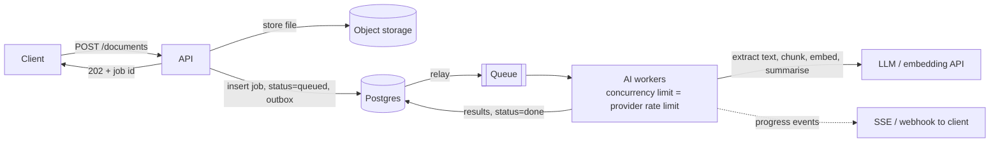
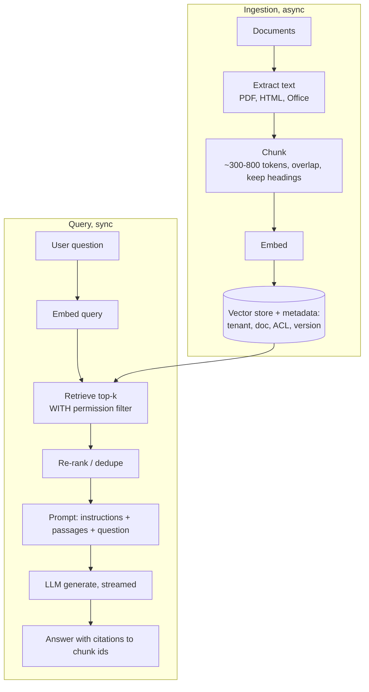

## Why it matters

LLM features are now ordinary backend work: summarisation, classification, extraction, search, chat over company documents, agents that call tools. The model call itself is one line of code. The engineering is everything around it: latency measured in seconds, rate limits, non-deterministic output, costs per token, failures, and an entirely new class of security problems. Treat the model as **a slow, expensive, occasionally wrong external dependency that can be manipulated by its input**, and apply everything you've learned about resilient systems.

## Integration patterns

### The model as a dependency

Wrap the provider behind your own interface, so you can add timeouts, retries, logging, cost tracking, caching and fallbacks in one place, and switch providers or models without touching business code:

```ts
interface LlmClient {
  complete(req: { system: string; messages: Message[]; maxTokens: number; schema?: JsonSchema; signal?: AbortSignal }): Promise<LlmResult>;
  stream(req: { system: string; messages: Message[]; maxTokens: number; signal?: AbortSignal }): AsyncIterable<string>;
}

async function summarise(llm: LlmClient, text: string, userId: string) {
  const started = performance.now();
  const result = await withRetry(                                   // retry 429/5xx with jitter (resilience lesson)
    () => llm.complete({
      system: "Summarise the document in 5 bullet points. Use only the document's content.",
      messages: [{ role: "user", content: text }],
      maxTokens: 400,                                                // always cap output
      signal: AbortSignal.timeout(30_000),                           // always time out
    }),
    { attempts: 3 },
  );
  metrics.llmLatency.observe(performance.now() - started);
  metrics.llmTokens.inc({ kind: "input" }, result.usage.inputTokens);
  metrics.llmTokens.inc({ kind: "output" }, result.usage.outputTokens);
  audit.log("llm.summarise", { userId, model: result.model, inputTokens: result.usage.inputTokens });
  return result.text;
}
```

Official SDKs (Anthropic, OpenAI, Google and others) implement the transport; your wrapper adds the policy.

### Synchronous vs asynchronous

| Use case | Pattern |
| --- | --- |
| Chat, short completions, autocomplete | Synchronous, **streamed** to the client |
| Classification or extraction on a request path | Synchronous with a tight timeout and a fallback |
| Long documents, bulk processing, embeddings for ingestion | **Background jobs** (queue + workers) |
| Very large offline batches | Provider batch APIs (lower cost, higher latency) |

### Streaming

Stream tokens to the user as they're generated. It dramatically improves perceived latency. Server-Sent Events are a natural fit ([real-time systems](/learn/real-time-systems/)):

```ts
app.get("/api/chat/stream", async (req, reply) => {
  const controller = new AbortController();
  req.raw.on("close", () => controller.abort());          // stop paying for tokens nobody will read
  reply.raw.writeHead(200, { "Content-Type": "text/event-stream", "Cache-Control": "no-cache", Connection: "keep-alive" });
  for await (const chunk of llm.stream({ system, messages, maxTokens: 1000, signal: controller.signal })) {
    reply.raw.write(`data: ${JSON.stringify({ delta: chunk })}\n\n`);
  }
  reply.raw.write("event: done\ndata: {}\n\n");
  reply.raw.end();
});
```

Make sure proxies don't buffer the stream (disable buffering for that route in Nginx with `X-Accel-Buffering: no` or `proxy_buffering off`).

### Structured output and validation

When code consumes the output, ask for JSON matching a schema (using the provider's structured-output or tool-use features where available), then **validate**:

```ts
const Ticket = z.object({
  category: z.enum(["billing", "bug", "feature_request", "account", "other"]),
  priority: z.enum(["low", "medium", "high"]),
  summary: z.string().max(300),
});

const raw = await llm.complete({ system: CLASSIFY_PROMPT, messages: [{ role: "user", content: ticketText }], maxTokens: 300, schema: zodToJsonSchema(Ticket) });
const parsed = Ticket.safeParse(JSON.parse(raw.text));
if (!parsed.success) {
  metrics.llmInvalidOutput.inc();
  return { category: "other", priority: "medium", summary: ticketText.slice(0, 300), needsReview: true };   // safe fallback
}
```

Never `eval` model output, execute it as SQL or shell, or render it as unsanitised HTML.

### Asynchronous AI jobs



- **Idempotency:** key jobs by document hash and operation, so retries and duplicate uploads don't pay twice.
- **Rate limits:** a worker pool sized to the provider's limits, with a token bucket on tokens per minute as well as requests.
- **Retries** with backoff for 429 and 5xx; DLQ after N attempts; partial progress persisted (chunk-level checkpoints for long documents).
- **Cost guards:** maximum document size, per-tenant budgets and quotas.

## Embeddings and vector search

An **embedding model** maps text (or images) to a vector of hundreds to a few thousand numbers, such that semantically similar inputs are close together (by cosine similarity or dot product). "How do I reset my password?" lands near "Forgot login credentials", with no shared keywords needed.

**Nearest-neighbour search** finds the vectors closest to a query vector. Exact search compares against everything, O(n). At scale, **approximate nearest neighbour (ANN)** indexes trade a little recall for huge speedups:

- **HNSW:** a multi-layer proximity graph searched greedily from coarse to fine layers. Excellent recall and latency; memory-hungry; slower to build. The default in most systems.
- **IVF (inverted file):** cluster vectors (k-means); search only the nearest clusters. Faster builds, less memory, tune `lists` and `probes`.
- **Quantisation** (product or scalar quantisation) compresses vectors to cut memory, with some accuracy loss.

### pgvector vs a dedicated vector database

```sql
create extension if not exists vector;

create table chunks (
  id           bigint generated always as identity primary key,
  tenant_id    uuid not null,
  document_id  uuid not null references documents(id) on delete cascade,
  content      text not null,
  embedding    vector(1024) not null,          -- dimension must match your embedding model
  metadata     jsonb not null default '{}'
);
create index on chunks using hnsw (embedding vector_cosine_ops);
create index on chunks (tenant_id);

-- Top 8 chunks for a query, restricted to the caller's tenant (and, in practice, their document ACLs)
select id, document_id, content, 1 - (embedding <=> $1) as similarity
from chunks
where tenant_id = $2
order by embedding <=> $1
limit 8;
```

| | pgvector (Postgres) | Dedicated (Qdrant, Weaviate, Pinecone, Milvus…) |
| --- | --- | --- |
| Operations | Your existing database: backups, auth, monitoring | Another system to run or buy |
| Transactions and joins with business data | Yes, including RLS for permissions | No; metadata filters and sync pipelines |
| Scale | Comfortable into millions of vectors per node; tuning needed beyond | Built for very large collections, sharding, quantisation |
| Filtered search | Works; heavily filtered ANN needs care (iterative scans in newer versions, partial indexes, partitioning) | Usually first-class |

A strong default: **start with pgvector** if you already run Postgres, and move to a dedicated store when scale, filtering performance or feature needs justify the extra system (an ADR moment; see the example in [technology decision matrix](/learn/technology-decision-matrix/)).

**Hybrid search** (vector similarity combined with keyword search such as BM25 or Postgres full-text) usually beats either alone, especially for names, codes and exact terms. Merge results with reciprocal rank fusion, then optionally **re-rank** the top candidates with a cross-encoder model.

## Retrieval-augmented generation (RAG)

LLMs don't know your private, recent or tenant-specific data, and will confidently invent answers. **RAG** retrieves relevant passages from your data and includes them in the prompt, so answers are grounded and citable.



Engineering decisions that determine quality:

- **Chunking:** split on structure (headings, paragraphs) rather than blindly by characters; keep chunks self-contained; add titles and section context to each chunk; overlap slightly.
- **Metadata:** tenant, document id, ACLs, source URL, version and timestamps on every chunk, for filtering, citations and deletion.
- **Freshness:** re-ingest on document change (outbox or CDC events); delete chunks when documents are deleted (GDPR!).
- **Retrieval tuning:** k, hybrid search, re-ranking, query rewriting.
- **Prompting:** instruct the model to answer only from the provided passages, to cite chunk IDs, and to say "I don't know" when the passages don't contain the answer. Verify that cited IDs exist in what you retrieved.

### Permissions are the critical part

In a multi-tenant or permissioned corpus, **filter at retrieval time**, inside the query (`WHERE tenant_id = $1 AND document_id = ANY($allowed)`, or Postgres row-level security), using the authenticated user's identity. Never rely on the prompt to keep secrets: whatever reaches the model's context can end up in the answer.

## Tools and agents

Models can request **tool calls** (structured function invocations) that your backend executes: search orders, create a ticket, query a database. Treat every tool call like an API request from an untrusted client:

- Authorise each call **as the end user**, not as a privileged service account.
- Least privilege: narrow, purpose-built tools ("get_order_status(order_id)") rather than general ones ("run_sql(query)").
- Validate arguments against schemas; rate-limit and cap the number of tool iterations.
- Require **human confirmation** for irreversible or sensitive actions (payments, emails, deletions).
- Log every call with inputs, outputs and the user it acted for.

## Evaluation and observability

You can't improve what you don't measure, and LLM output can't be unit-tested with exact string matches.

- Build an **evaluation set**: representative questions with expected answers or criteria, including adversarial and "should refuse" cases.
- Measure **retrieval** (did the right chunks appear in the top-k? recall@k, MRR) separately from **generation** (faithfulness to sources, correctness, format).
- Use automated graders (rule checks, schema validation, and model-graded rubrics, carefully, with human spot checks) and run evals in CI on every prompt, model or chunking change.
- Trace every request: prompt version, model, retrieved chunk IDs, token counts, latency, cost, and user feedback (thumbs up or down). OpenTelemetry has emerging GenAI semantic conventions for this.

## Cost and latency control

- Pick the **smallest model** that passes your evals for each task; route hard requests to bigger models.
- **Cap tokens**: maximum input size (truncate or summarise), `max_tokens` on output, maximum conversation history.
- **Cache**: exact-match caching of deterministic prompts, embedding caching by content hash, and provider-side prompt caching for long shared prefixes (system prompts, documents).
- **Batch** offline work; use batch APIs where available.
- Per-tenant **budgets and quotas**, with metrics and alerts on spend: an attacker or a runaway loop can generate a large bill quickly (the OWASP LLM list calls this unbounded consumption).

## Security: the LLM-specific threats

| Threat | What happens | Mitigations |
| --- | --- | --- |
| **Direct prompt injection** | A user instructs the model to ignore its rules | Don't rely on prompts for security; enforce rules in code; limit capabilities |
| **Indirect prompt injection** | Instructions hidden in retrieved documents, emails or web pages hijack the model | Treat all retrieved content as untrusted data; least-privilege tools; confirmations; output filtering |
| **Sensitive information disclosure** | Model reveals other users' data, secrets or system prompts | Permission-filtered retrieval; no secrets in prompts; output scanning for PII and secrets |
| **Excessive agency** | Model takes harmful actions via tools | Narrow tools, user-scoped authorisation, human-in-the-loop, rate limits |
| **Insecure output handling** | Model output rendered as HTML or executed | Treat output as untrusted user input: escape, validate, never execute |
| **Unbounded consumption** | Huge inputs or loops drive cost and DoS | Size limits, token caps, quotas, timeouts |
| **Training-data and privacy issues** | Sending regulated data to a provider | Data classification, provider data-retention settings, regional endpoints, redaction |

Prompt injection has **no complete fix** today. Design so that a fully manipulated model still can't do much damage: that's the real defence.

## Common mistakes

- No timeouts, retries or output caps on model calls.
- Holding HTTP requests open for minutes instead of using jobs.
- Trusting model output without validation.
- Permission checks in the prompt instead of the retrieval query.
- Adding a dedicated vector database on day one without need.
- No evaluation set, so every prompt change is a guess.
- Logging full prompts containing personal data without a retention policy.

## Hands-on exercise

Build a minimal document Q&A service (Python or Node) with Postgres + pgvector:

1. Upload endpoint → object storage → background job that extracts text, chunks by headings, embeds (any provider, or a local embedding model through Ollama or sentence-transformers), and stores chunks with `tenant_id`.
2. `GET /ask?q=` that embeds the question, retrieves the top 8 chunks **filtered by tenant**, and streams an answer with citations over SSE. Validate that cited chunk IDs were actually retrieved.
3. Add hybrid search (Postgres full-text + vector, merged with reciprocal rank fusion) and compare retrieval on 20 test questions you write, with expected source documents (recall@5 before and after).
4. Add a malicious document containing an injected instruction and show that your design limits the damage (no tools with side effects, or tools requiring confirmation).
5. Track tokens, latency and cost per request as Prometheus metrics, and enforce a per-tenant daily token budget.

## Completion criteria

- You integrate LLMs with the same resilience, observability and validation as any external dependency.
- You can build a permission-aware RAG pipeline and evaluate its retrieval and answers.
- You can name the LLM-specific threats and design so that a manipulated model can't cause serious harm.
