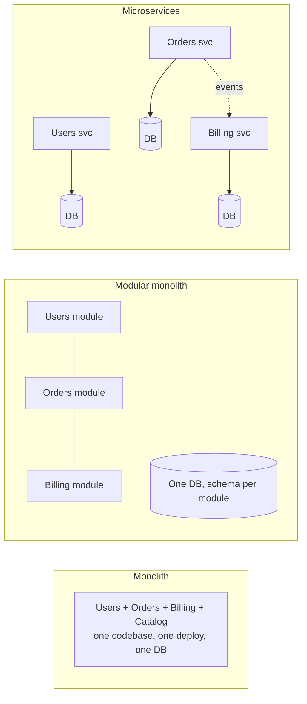

## Why it matters

Architecture decisions are expensive to reverse and shape everything: how fast teams ship, how the system fails, what it costs to run. The industry's swing toward microservices produced many systems that were slower to build and harder to operate than the monoliths they replaced, and some that genuinely needed them. Choosing well means understanding what each style is *for*.

## The styles at a glance



| | Monolith | Modular monolith | Microservices |
| --- | --- | --- | --- |
| Deploy unit | One | One | Many |
| Boundaries | Often implicit | Enforced modules with public interfaces | Network APIs |
| Data | One database | One database, ownership per module | Database per service |
| Cross-boundary call | Function call | Function call through a module's interface | Network call (can fail, is slow) |
| Transactions across boundaries | Easy | Easy (but discouraged across modules) | Sagas, eventual consistency |
| Independent scaling | No | No | Yes |
| Independent deploys per team | No | No | Yes |
| Operational overhead | Low | Low | High: per-service CI/CD, observability, networking |
| Best for | Small teams, early products | Most products and teams up to dozens of engineers | Many teams needing autonomy; parts with very different scaling or reliability needs |

## Monolith

**Problem it solves:** shipping a product quickly with one team.

**How it works:** one codebase, built and deployed as one unit, usually with one database. Calls between parts are in-process function calls, and transactions are local and ACID.

**When to use:** new products, small teams, unclear domains. Shopify, GitHub and Stack Overflow ran large monoliths serving huge traffic for many years (Shopify still describes its core as a modular monolith).

**When not to:** when many teams collide in one codebase and release train, or when one part needs radically different scaling or technology.

**Failure scenarios:** a memory leak in one feature takes down everything; a bad deploy affects all features; without discipline, it degrades into a "big ball of mud" where everything depends on everything.

## Modular monolith: the underrated default

A modular monolith is one deployable unit internally divided into **modules with explicit boundaries**: each module owns its data and exposes a small public interface; other modules may not reach into its internals or tables.

```
src/
  modules/
    catalog/
      api.ts            # the ONLY file other modules may import
      internal/         # services, repositories, models: private
    orders/
      api.ts
      internal/
    billing/
      api.ts
      internal/
  shared/               # tiny: logging, config, db connection, error types
```

```ts
// modules/orders/internal/place-order.ts
import { catalog } from "../../catalog/api";       // ✓ through the public interface
import { billing } from "../../billing/api";
// import { productRepo } from "../../catalog/internal/repo";   ✗ forbidden, enforced by a lint rule
```

Enforce the rules mechanically: ESLint `no-restricted-imports` or dependency-cruiser in TypeScript, ArchUnit in Java, Packwerk in Ruby, import-linter in Python. Give each module its own database **schema** and forbid cross-schema joins in code review, or with database permissions.

**Why it's often the right choice:**

- You get most of the *design* benefits of services (clear ownership, low coupling, replaceable internals) without the *distribution* costs.
- Refactoring a boundary is a code change, not a cross-team migration.
- If a module later needs to become a service (different scaling, separate team), its interface and data are already separated, so extraction is mechanical.

Modules can still communicate asynchronously through an in-process event bus, or an outbox table, which keeps them decoupled and makes later extraction smoother.

## Microservices

**Problem it solves:** letting many teams work, deploy and scale independently. Microservices are first an **organisational** scaling tool. Conway's law says systems mirror the communication structure of the organisations that build them; microservices lean into that, giving each team end-to-end ownership of a service.

**How it works:** small services around business capabilities, each with its own codebase, pipeline and data store, communicating over the network (HTTP/gRPC or messaging).

**When to use:**

- Multiple teams blocking each other in one codebase or release process.
- Parts with very different scaling, latency, reliability or compliance needs (a video-transcoding pipeline vs an admin UI; a PCI-scoped payment component).
- You already have strong automation: CI/CD, infrastructure as code, centralised logging, tracing, on-call.

**When not to:** small teams, early products, unclear domains, or no platform maturity. Fowler's guidance: you must be this tall (rapid provisioning, basic monitoring, rapid deployment) to use microservices.

**Costs you take on:**

- Every call can fail or be slow, so you need timeouts, retries, circuit breakers and idempotency ([resilience patterns](/learn/resilience-patterns/)).
- No cross-service transactions: sagas and eventual consistency ([CQRS, event sourcing and sagas](/learn/cqrs-event-sourcing-sagas/)).
- No cross-service joins: data duplication via events, or API composition.
- Distributed debugging needs tracing ([observability](/learn/observability-in-practice/)).
- Versioning and contract testing between services.
- More infrastructure, more pipelines, more on-call surface.

**Failure scenarios:** cascading failures through synchronous call chains; retry storms; inconsistent data after partial failures; the **distributed monolith** (services that share a database or must deploy in lockstep).

### Service-oriented architecture (SOA)

SOA (2000s) also split systems into services, typically larger, often sharing an **enterprise service bus** that handled routing, transformation and orchestration centrally. Microservices are often described as SOA done with "smart endpoints and dumb pipes": logic in services, not in a central bus.

## Finding boundaries with domain-driven design

Bad boundaries are the most expensive architectural mistake: services that must always change together, or modules that constantly reach into each other. **Domain-driven design (DDD)** offers tools to find better ones.

- **Ubiquitous language:** engineers and domain experts use the same terms, in code too.
- **Bounded context:** a boundary within which a model and its language are consistent. "Product" in Catalog (descriptions, images) differs from "Product" in Inventory (stock per warehouse) and in Pricing (price lists, discounts). Separate models, linked by ids.
- **Context map:** how contexts relate: upstream/downstream, shared kernel, anti-corruption layers that translate a messy external model into yours.
- **Aggregates:** clusters of objects changed together under one consistency boundary (an `Order` with its `OrderLines`). Transactions should rarely span aggregates; cross-aggregate consistency is eventual.
- **Domain events:** facts that happened (`OrderPlaced`, `PaymentCaptured`), used to integrate contexts.

**Event storming** is a practical workshop: put every domain event on sticky notes along a timeline with domain experts, then cluster them. The clusters and the language changes between them suggest bounded contexts, and therefore module or service boundaries.

### Decomposition heuristics

- Split by **business capability** (ordering, billing, shipping), not by technical layer (a "database service", a "validation service").
- Things that **change together** stay together. Look at your Git history: files that are always modified in the same commits belong in the same module.
- Prefer boundaries where the interface is **narrow** and **stable**.
- Avoid splitting a single aggregate across services.
- Use the **strangler fig** pattern to extract services from an existing monolith incrementally: route one capability at a time to the new service behind a proxy, until the old code can be deleted.

## Communication between services

| | Synchronous (HTTP/gRPC) | Asynchronous (events, queues) |
| --- | --- | --- |
| Coupling in time | Both must be up | Producer doesn't need the consumer up |
| Latency | Immediate answer | Eventually processed |
| Failure handling | Timeouts, retries, circuit breakers | Retries, DLQs, idempotent consumers |
| Use for | Queries needing an answer now; user-facing reads | Notifications of facts; workflows; fan-out; anything that can happen later |

Guidelines:

- **Query synchronously, propagate changes asynchronously.** "Get the price" can be a call; "an order was placed" is an event that billing, shipping and email consume.
- Keep synchronous chains short (ideally one hop from the edge). Availabilities multiply, and latencies add.
- **REST vs gRPC** between services: gRPC gives typed contracts, efficient encoding, streaming and deadlines, good for internal high-volume calls. REST/JSON is universal and easy to debug, good at the edge and for heterogeneous consumers.
- Publish **events** with a schema and version (JSON Schema, Avro or Protobuf with a schema registry), and design them as facts consumers can rely on.

## API gateways and backends-for-frontends

An **API gateway** is the single entry point for external clients: routing to services, TLS, authentication, rate limiting, request aggregation, and API keys or analytics. Products include Kong, AWS API Gateway, Apigee, Envoy Gateway and Traefik.

A **backend-for-frontend (BFF)** is a gateway tailored to one client type (web, iOS, partner API) that aggregates calls and shapes responses for that client. Keep business logic *out* of gateways; they should route and enforce cross-cutting policy, not own domain rules.

## Service discovery

Instances come and go (autoscaling, deploys, failures), so services need to find each other dynamically:

- **Client-side discovery:** clients query a registry (Consul, Eureka) and load-balance themselves.
- **Server-side discovery:** clients call a stable name; a load balancer or the platform routes it. **Kubernetes Services** do this with DNS (`orders.default.svc.cluster.local`) plus kube-proxy or a service mesh.
- A **service mesh** (Istio, Linkerd) adds sidecar proxies that handle discovery, mTLS, retries, timeouts and telemetry uniformly, at the cost of operational complexity.

## Database per service

Each service owns its data; others access it only through its API or the events it publishes. Consequences:

- Queries spanning services use **API composition** (call both, join in memory) or a **read model** built from events (CQRS).
- Business transactions spanning services use **sagas**.
- Reference data needed by many services (product names) is **replicated via events** into each consumer's store, accepting eventual consistency.

## Multi-tenancy

SaaS systems serve many customers (tenants) from shared infrastructure. Isolation models:

| Model | How | Isolation | Cost and ops | Fits |
| --- | --- | --- | --- | --- |
| **Pool** (shared everything) | All tenants in shared tables with a `tenant_id` column | Logical (enforced by code or RLS) | Cheapest; simplest to operate | Most B2B SaaS, many small tenants |
| **Bridge** (schema per tenant) | One database, a schema per tenant | Stronger | Migrations × N schemas | Mid-size tenant counts |
| **Silo** (database or stack per tenant) | Separate databases or even deployments | Strongest; noisy-neighbour-proof | Highest | Enterprise or regulated tenants, data residency |

Many products mix them: pooled for most tenants, siloed for enterprise contracts. Pooled essentials: `tenant_id` on every row and as the leading column of composite indexes; tenant resolved from the authenticated identity (never from a client-supplied header alone); **row-level security** as a backstop; per-tenant rate limits and quotas to contain noisy neighbours; tenant-aware logging and metrics.

```sql
alter table projects enable row level security;
create policy tenant_isolation on projects
  using (tenant_id = current_setting('app.tenant_id')::uuid);
-- the app sets the tenant per transaction:  SET LOCAL app.tenant_id = '…';
```

## Recording decisions: ADRs

An **Architecture Decision Record** captures one significant decision, its context and consequences, so future engineers know *why*, and when to revisit.

```markdown
# ADR-012: Keep billing inside the modular monolith (for now)

Status: Accepted (2026-11-10)

## Context
Billing logic changes weekly and is tightly linked to orders and plans. One team of 7 owns
orders, plans and billing. Peak load is 40 req/s; the monolith handles it on two instances.

## Decision
Billing stays a module in the monolith with its own schema and a public interface
(modules/billing/api.ts). Other modules interact only via that interface and the
`billing.*` events in the outbox.

## Consequences
+ Local transactions between orders and billing; no saga needed.
+ One deploy pipeline; no new on-call surface.
− Billing can't be scaled or deployed independently.
− Requires lint enforcement of module boundaries.

## Revisit when
A separate billing team forms, PCI scope needs isolating, or billing load needs scaling
independently of the main app.
```

Store ADRs in the repository (`docs/adr/`), number them, and never edit an accepted one: supersede it with a new ADR.

## Real-world use cases

- **Shopify:** a very large Rails modular monolith with enforced component boundaries.
- **Amazon:** service ownership by "two-pizza" teams, driven by organisational scaling.
- **Segment:** famously moved *from* microservices *back* to a monolith for one system after operational overhead outweighed the benefits.
- **Uber and Netflix:** thousands of services, with heavy investment in platform tooling to make that workable.

## Common mistakes

- Starting with microservices before understanding the domain.
- Splitting by technical layer instead of business capability.
- Shared databases between services (the distributed monolith).
- Long synchronous call chains.
- No platform investment (CI/CD, tracing, logging) before splitting.
- Business logic accumulating in the API gateway.

## Security considerations

- More services means more network surface: use mTLS or a mesh for service-to-service authentication, and propagate end-user identity (signed tokens) for authorisation decisions.
- Tenant isolation must be enforced at the data layer, not only in the UI or gateway.
- Each service gets least-privilege credentials for only its own data.

## Performance considerations

- In-process calls cost nanoseconds to microseconds; network calls cost at least hundreds of microseconds even within a datacenter, plus serialisation. Chatty service boundaries are slow.
- Microservices let you scale hot components independently, but a well-provisioned monolith with horizontal scaling handles far more than most teams expect.

## Hands-on exercise

1. Take the [Task API project](/projects/task-api/) and restructure it into a modular monolith with `projects`, `tasks` and `notifications` modules, each with a public `api.ts`, its own schema, and a lint rule forbidding cross-module internal imports.
2. Make `notifications` react to `task.assigned` events through an in-process bus or an outbox table, instead of being called directly.
3. Write an ADR deciding whether `notifications` should become a separate service, with concrete revisit triggers.
4. Run a mini event-storming session (alone or with friends) for a food-delivery domain and propose bounded contexts.

## Completion criteria

- You can argue for or against microservices for a specific team and product.
- You can draw bounded contexts for a domain and explain the boundaries.
- You've built enforced module boundaries and written an ADR.
