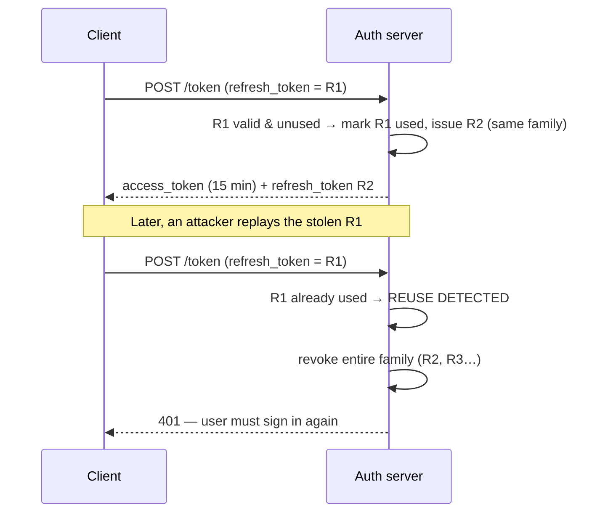
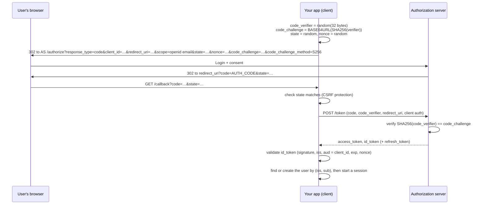

## Why it matters

Authentication is the front door. Getting it wrong means account takeovers, credential stuffing, leaked password databases and stolen sessions. It's also full of subtle traps that look fine in a demo. The good news is that the correct patterns are well established. This lesson walks through each building block with code you can adapt.

**First, consider not building it.** Managed identity providers (Auth0, Clerk, Cognito, Firebase Auth, Supabase Auth, Keycloak if self-hosted) handle passwords, MFA, social login, breach detection and account recovery. Build it yourself to learn, or when you have a specific reason, and when you do, follow this lesson closely.

## Passwords

### Hashing with Argon2id

Store only a slow, salted, memory-hard hash. Argon2id is OWASP's first recommendation; scrypt and bcrypt are acceptable alternatives (bcrypt silently truncates input at 72 bytes).

```ts
import argon2 from "argon2";

// OWASP's minimum suggested Argon2id settings: 19 MiB memory, 2 iterations, 1 degree of parallelism.
// Tune so one hash takes on the order of tens to hundreds of ms on your hardware, and re-measure as hardware changes.
const OPTS = { type: argon2.argon2id, memoryCost: 19456, timeCost: 2, parallelism: 1 };

export const hashPassword = (pw: string) => argon2.hash(pw, OPTS);   // salt is generated and embedded

export async function verifyPassword(stored: string, pw: string) {
  const ok = await argon2.verify(stored, pw);                         // constant-time comparison
  const needsRehash = ok && argon2.needsRehash(stored, OPTS);          // parameters changed since it was stored
  return { ok, needsRehash };
}
```

The stored string encodes the algorithm, parameters and salt (`$argon2id$v=19$m=19456,t=2,p=1$<salt>$<hash>`), so you can raise the cost later and **rehash on next successful login**. The same trick migrates legacy MD5 or SHA-1 hashes: wrap them (`argon2(sha1(pw))`) immediately, then replace with a direct Argon2 hash at each login.

### Password policy (NIST SP 800-63B)

- Minimum length (at least 8 characters, preferably longer for passwords chosen by users); allow long passphrases (64+) and any characters.
- **Check against known breached passwords** (the Have I Been Pwned range API uses k-anonymity, so you never send the full hash).
- No composition rules ("one symbol, one uppercase") and no forced periodic rotation; they push users toward predictable patterns.

### Login flow defences

```ts
async function login(email: string, password: string, ip: string) {
  await rateLimit(`login:ip:${ip}`, 20, "10m");          // slow down credential stuffing per IP
  await rateLimit(`login:email:${email}`, 5, "15m");     // and per account
  const user = await users.findByEmail(email);
  // Verify against a dummy hash when the user doesn't exist, so response timing doesn't reveal valid emails.
  const { ok, needsRehash } = await verifyPassword(user?.passwordHash ?? DUMMY_HASH, password);
  if (!user || !ok) {
    await audit("login.failed", { email, ip });
    throw new UnauthorizedError("Invalid email or password");   // same message either way
  }
  if (needsRehash) await users.setPasswordHash(user.id, await hashPassword(password));
  return user;
}
```

Prefer progressive delays, CAPTCHAs after repeated failures, and alerts over hard lockouts, which let attackers lock victims out on purpose.

## Sessions

A server-side session stores state on the server and gives the browser only an unguessable identifier.

```sql
create table sessions (
  id_hash      bytea primary key,         -- SHA-256 of the session token; the raw token only lives in the cookie
  user_id      uuid not null references users(id) on delete cascade,
  created_at   timestamptz not null default now(),
  last_seen_at timestamptz not null default now(),
  expires_at   timestamptz not null,
  ip           inet,
  user_agent   text,
  mfa_passed   boolean not null default false
);
```

```ts
import { randomBytes, createHash } from "node:crypto";
const sha256 = (s: string) => createHash("sha256").update(s).digest();

export async function createSession(res: Response, userId: string) {
  const token = randomBytes(32).toString("base64url");                 // 256 bits of entropy
  await db.query("insert into sessions (id_hash, user_id, expires_at) values ($1, $2, now() + interval '14 days')", [sha256(token), userId]);
  res.cookie("sid", token, { httpOnly: true, secure: true, sameSite: "lax", path: "/", maxAge: 14 * 864e5 });
}

export async function loadSession(token?: string) {
  if (!token) return null;
  const { rows } = await db.query(
    "update sessions set last_seen_at = now() where id_hash = $1 and expires_at > now() returning user_id, mfa_passed",
    [sha256(token)],
  );
  return rows[0] ?? null;
}
```

Session rules:

- **Rotate the session id on login and privilege change** (prevents session fixation).
- Use **idle** and **absolute** timeouts.
- Logout deletes the server row. A "log out everywhere" button deletes all of a user's rows.
- Hash tokens at rest, so a database leak doesn't hand out live sessions.
- Store sessions in Postgres or Redis. Redis with TTLs is common at scale.

## JWTs: useful, frequently misused

A JWT is `base64url(header).base64url(payload).signature`. The payload is **signed, not encrypted**: anyone can read it.

```json
{ "alg": "RS256", "kid": "2026-11" }
{ "iss": "https://auth.example.com", "sub": "user_42", "aud": "api.example.com",
  "exp": 1794301200, "iat": 1794300300, "scope": "tasks:read tasks:write" }
```

Verification checklist:

```ts
import { jwtVerify, createRemoteJWKSet } from "jose";
const JWKS = createRemoteJWKSet(new URL("https://auth.example.com/.well-known/jwks.json"));

const { payload } = await jwtVerify(token, JWKS, {
  algorithms: ["RS256"],                  // pin the algorithm; never trust the header's alg
  issuer: "https://auth.example.com",     // who issued it
  audience: "api.example.com",            // that it was meant for *this* API
  clockTolerance: 30,                     // seconds of clock skew allowed for exp/nbf
});
```

**When JWTs fit:** short-lived access tokens checked by many services without a central lookup, and service-to-service tokens. **When they don't:** as long-lived browser sessions, because you can't revoke a stateless token before it expires. The pragmatic design is short-lived access tokens (5–15 minutes) plus revocable refresh tokens.

Pitfalls: `alg: none` acceptance; RS256/HS256 confusion; missing `aud` checks (a token for service A accepted by service B); storing sensitive data in the payload; giant tokens in every request; and putting tokens in `localStorage`, where any XSS can read them.

## Refresh tokens with rotation and reuse detection



```sql
create table refresh_tokens (
  id_hash     bytea primary key,
  family_id   uuid not null,            -- all tokens descended from one login
  user_id     uuid not null,
  used_at     timestamptz,
  revoked_at  timestamptz,
  expires_at  timestamptz not null
);
```

On refresh: inside a transaction, look up the token's hash with `FOR UPDATE`. If it's revoked or expired, return 401. If `used_at` is already set, revoke every token in the family and return 401. Otherwise mark it used and insert a new token in the same family. For browsers, deliver refresh tokens in an `HttpOnly; Secure; SameSite=Strict` cookie scoped to the refresh path.

## OAuth 2.0 and OpenID Connect

**OAuth 2.0** lets a user grant an application limited access to their resources on another service without sharing their password ("let this app read my Google Calendar"). **OpenID Connect (OIDC)** is a layer on top that adds *authentication*: a signed **ID token** saying who the user is ("Sign in with Google").

The roles: **resource owner** (the user), **client** (your app), **authorization server** (Google, Okta, your IdP), **resource server** (the API holding the data).

### Authorization code flow with PKCE

The recommended flow for web, mobile and single-page apps (RFC 9700 says to use PKCE for all clients; the implicit flow is deprecated):



Validation details that matter:

- **`state`** must match what you stored, which prevents login CSRF.
- **`nonce`** in the ID token must match, which prevents token replay.
- Identify users by **`iss` + `sub`**, never by email alone: emails can change or be unverified at some providers. Link accounts by email only if `email_verified` is true and you trust that provider.
- Register exact redirect URIs; never allow open redirects.
- Confidential (server-side) clients authenticate at the token endpoint with a client secret or private key JWT. Public clients (SPAs, mobile) can't keep secrets, which is exactly why PKCE matters.

Other grant types: **client credentials** (machine-to-machine, no user), **device authorization** (TVs and CLIs), **refresh token**. The resource-owner password grant is deprecated.

A common modern architecture for SPAs is the **backend-for-frontend (BFF)**: the server does the OAuth flow, keeps tokens server-side, and gives the browser only an HttpOnly session cookie.

## Multi-factor authentication

### TOTP (authenticator apps)

TOTP (RFC 6238) computes a 6-digit code from a shared secret and the current 30-second time step: `HOTP(secret, floor(unixTime / 30))`.

```ts
import { authenticator } from "otplib";

// Enrolment: generate a secret, show it as a QR code (otpauth:// URI), confirm with a first code before enabling.
const secret = authenticator.generateSecret();                       // store encrypted at rest
const uri = authenticator.keyuri(user.email, "Backend Academy", secret);

// Verification: allow one step of clock drift, and reject reuse of the same code within its window.
authenticator.options = { window: 1 };
const valid = authenticator.verify({ token: submittedCode, secret });
```

Also: issue single-use **recovery codes** (store them hashed), rate-limit code attempts, mark the session `mfa_passed` only after verification, and require re-authentication for sensitive actions.

### Passkeys (WebAuthn)

Passkeys replace passwords with a public/private key pair held on the user's device. The server stores only the public key and verifies signed challenges. They are **phishing-resistant** because the browser binds each credential to your origin, so a lookalike domain can't use it. SMS codes are the weakest factor (SIM-swap attacks); prefer passkeys or TOTP.

## API keys

For server-to-server access by your customers:

```ts
// Format: visible prefix + random secret. The full key is shown once at creation.
const secret = randomBytes(24).toString("base64url");
const key = `sk_live_${secret}`;
await db.query(
  "insert into api_keys (prefix, key_hash, owner_id, scopes, expires_at) values ($1, $2, $3, $4, $5)",
  [key.slice(0, 12), sha256(key), ownerId, ["orders:read"], expiresAt],
);
```

Keys are high-entropy, so a fast SHA-256 is appropriate (unlike passwords, which need slow hashing). Support scopes, expiry, rotation (two active keys during changeover), last-used timestamps and instant revocation. Enable secret scanning so leaked keys in public repos are caught (GitHub's partner program can notify you).

## Authorisation: RBAC, ABAC and ReBAC

Authentication answers *who*; authorisation answers *may they do this to that resource*.

| Model | Rule shape | Good for |
| --- | --- | --- |
| **RBAC** (role-based) | "Admins can delete projects" | Most business apps; roles map to permissions |
| **ABAC** (attribute-based) | "Managers can approve expenses under ₹50,000 in their own department during business hours" | Rules depending on resource, user and context attributes |
| **ReBAC** (relationship-based) | "Viewers of a folder can view its documents" | Sharing models like Google Drive (Zanzibar-style systems: OpenFGA, SpiceDB) |

Centralise checks in one module so they're consistent and testable:

```ts
type Action = "project:read" | "project:update" | "project:delete" | "task:assign";
const ROLE_PERMISSIONS: Record<Role, Action[]> = {
  viewer: ["project:read"],
  member: ["project:read", "task:assign"],
  admin: ["project:read", "project:update", "project:delete", "task:assign"],
};

export function can(user: User, action: Action, project: Project): boolean {
  if (project.orgId !== user.orgId) return false;                         // tenant isolation first, always
  const membership = project.members.find((m) => m.userId === user.id);
  if (!membership) return false;
  if (!ROLE_PERMISSIONS[membership.role].includes(action)) return false;
  if (action === "project:delete" && project.status === "archived-legal-hold") return false; // attribute rule
  return true;
}
// In a service:
if (!can(user, "project:delete", project)) throw new NotFoundError("project", project.id);
```

Enforce on the server for **every** request, scope queries by tenant and owner (`WHERE org_id = $1`), and consider Postgres **row-level security** as a second layer. Most real breaches in APIs are broken object-level authorisation: the check exists for the list endpoint but was forgotten on `GET /things/{id}`.

## Common mistakes

- Fast hashes (MD5, SHA-*) for passwords, or rolling your own crypto.
- Different error messages or timing for "no such user" vs "wrong password".
- Long-lived JWTs in `localStorage` with no revocation.
- Accepting the JWT's `alg` header; skipping `aud`/`iss` checks.
- OAuth without `state` or PKCE; identifying users by email from any provider.
- MFA that can be bypassed by calling the API directly before the MFA step completes.
- Authorisation checks only in the UI or only on some endpoints.

## Security considerations

This entire lesson is security. Add audit logs for logins, MFA changes, password resets, key creation and permission changes; notify users of new-device logins and credential changes; and make password reset tokens single-use, short-lived (around 15–60 minutes) and hashed at rest.

## Performance considerations

- Argon2 is deliberately expensive: size your login service for it, and rate-limit so attackers can't use it to exhaust your CPU.
- Session lookups on every request should hit Redis or an indexed table. Cache JWKS keys rather than fetching per request.

## Hands-on exercise

Build the [authentication service project](/projects/auth-service/), or at minimum:

1. Register and login with Argon2id, with rehash-on-login when parameters change.
2. Server-side sessions with secure cookies, rotation on login, and "log out everywhere".
3. Short-lived JWT access tokens plus rotating refresh tokens with reuse detection. Write a test that replays an old refresh token and asserts the whole family is revoked.
4. TOTP enrolment and verification with recovery codes.
5. "Sign in with GitHub or Google" using authorization code + PKCE, validating `state`, `nonce` and the ID token.
6. An RBAC `can()` function with tests for cross-tenant access.

## Completion criteria

- You can implement password storage, sessions and token refresh correctly and explain each defence.
- You can draw the OAuth code + PKCE flow from memory and say what each parameter protects against.
- Every protected operation in your code goes through one authorisation function.
