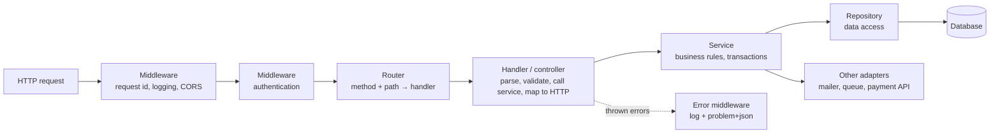
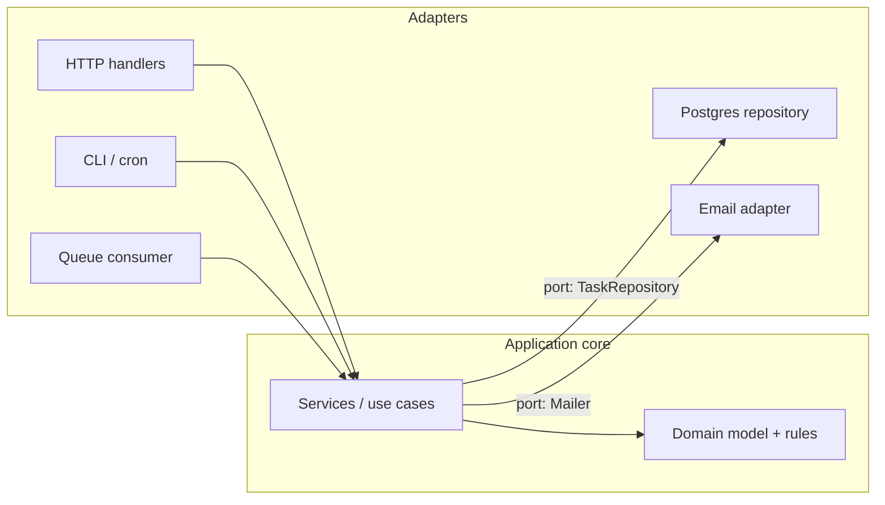

## Why it matters

A backend that works on day one can become impossible to change by month six. The difference is rarely the framework; it's whether responsibilities are separated. When HTTP parsing, business rules and SQL are tangled in one function, every change risks breaking something unrelated, nothing can be tested without a running server and database, and reusing logic from a queue consumer means copy-paste. A small amount of structure fixes this.

## The request pipeline

Whatever the framework, a request flows through the same stages:



| Layer | Knows about | Must not know about |
| --- | --- | --- |
| Middleware | HTTP, cross-cutting concerns | Business rules |
| Handler (controller) | HTTP: params, bodies, status codes | SQL, other services' internals |
| Service | Business rules, transactions, orchestration | HTTP (`req`, `res`, status codes) |
| Repository | SQL or ORM, the database schema | HTTP, business decisions |

The test for a good boundary: could you call this service from a CLI script or a queue consumer without faking an HTTP request? If yes, the boundary is in the right place.

## A worked example: creating a task

### Router and handler

```ts
// routes/tasks.ts
export function taskRoutes(app: FastifyInstance, deps: { tasks: TaskService }) {
  app.post("/projects/:projectId/tasks", async (req, reply) => {
    const { projectId } = ProjectParams.parse(req.params);   // validate path params
    const input = CreateTaskBody.parse(req.body);            // validate body
    const task = await deps.tasks.create(req.user.id, projectId, input);
    return reply.code(201).header("Location", `/tasks/${task.id}`).send(task);
  });
}
```

The handler is thin: parse, validate, delegate, translate the result into HTTP.

### Validation at the boundary

```ts
// schemas/task.ts
import { z } from "zod";
export const ProjectParams = z.object({ projectId: z.string().uuid() });
export const CreateTaskBody = z.object({
  title: z.string().trim().min(1).max(200),
  priority: z.number().int().min(1).max(4).default(2),
  assigneeId: z.string().uuid().nullable().default(null),
  dueDate: z.coerce.date().optional(),
}).strict();                       // reject unknown fields instead of silently ignoring them
export type CreateTaskInput = z.infer<typeof CreateTaskBody>;
```

Validate **everything** that crosses a trust boundary: body, query, path params, headers, and also messages from queues and responses from third-party APIs. Validation gives you friendly errors and a typed object. Database constraints are the second line of defence that guarantees integrity even when there's a bug.

The Python equivalent with FastAPI and Pydantic is declarative:

```python
class CreateTask(BaseModel):
    model_config = ConfigDict(extra="forbid")
    title: Annotated[str, StringConstraints(strip_whitespace=True, min_length=1, max_length=200)]
    priority: Annotated[int, Field(ge=1, le=4)] = 2
    assignee_id: UUID | None = None

@router.post("/projects/{project_id}/tasks", status_code=201)
async def create_task(project_id: UUID, body: CreateTask, user=Depends(current_user), svc: TaskService = Depends(task_service)):
    return await svc.create(user.id, project_id, body)
```

### Service: business rules

```ts
// services/task-service.ts
export class TaskService {
  constructor(private repo: TaskRepository, private projects: ProjectRepository, private events: EventPublisher) {}

  async create(userId: string, projectId: string, input: CreateTaskInput): Promise<Task> {
    const project = await this.projects.findForMember(projectId, userId);
    if (!project) throw new NotFoundError("project", projectId);          // 404, never reveals existence
    if (input.assigneeId && !(await this.projects.isMember(projectId, input.assigneeId)))
      throw new ValidationError([{ field: "assigneeId", message: "must be a project member" }]);

    const task = await this.repo.insert({ ...input, projectId, createdBy: userId });
    await this.events.publish({ type: "task.created", taskId: task.id, projectId });
    return task;
  }
}
```

The service throws **domain errors** (`NotFoundError`, `ValidationError`, `ConflictError`), not HTTP responses. It has no idea it's being called over HTTP.

### Repository: data access

```ts
// repositories/task-repository.ts
export class TaskRepository {
  constructor(private db: Pool) {}
  async insert(t: NewTask): Promise<Task> {
    const { rows } = await this.db.query(
      `insert into tasks (project_id, title, priority, assignee_id, due_date, created_by)
       values ($1, $2, $3, $4, $5, $6) returning *`,
      [t.projectId, t.title, t.priority, t.assigneeId, t.dueDate ?? null, t.createdBy],
    );
    return toTask(rows[0]);
  }
}
```

Always use **parameterised queries** (`$1`, `$2`), never string concatenation; that's the SQL injection defence. The repository maps rows to domain objects, so the rest of the app doesn't depend on column names.

**Should you always have a repository layer?** For simple CRUD in a small service, an ORM call in the service is fine. Introduce repositories when queries get complex, when you want to test services without a database, or when the same queries are reused.

## Middleware

Middleware wraps every request with cross-cutting behaviour. Order matters: the request id must exist before logging uses it; authentication must run before handlers that need the user.

```ts
// middleware/request-context.ts
app.addHook("onRequest", async (req, reply) => {
  req.id = (req.headers["x-request-id"] as string) ?? crypto.randomUUID();
  reply.header("x-request-id", req.id);
  req.log = logger.child({ request_id: req.id, method: req.method, path: req.url });
});

app.addHook("onResponse", async (req, reply) => {
  req.log.info({ status: reply.statusCode, duration_ms: reply.elapsedTime }, "request completed");
});
```

Typical middleware stack, outermost first: request id → access logging → security headers → CORS → body size limit and parsing → rate limiting → authentication → (route) → error handler.

## Error handling

Design errors in three tiers:

1. **Validation errors** → `400`/`422` with field details.
2. **Domain errors** → specific codes: `404`, `409`, `403`, `412`.
3. **Unexpected errors** → `500`, logged with full detail, returned with only a request id.

```ts
// errors.ts
export class AppError extends Error { constructor(public status: number, public type: string, message: string, public extra?: object) { super(message); } }
export class NotFoundError extends AppError { constructor(what: string, id: string) { super(404, "not-found", `${what} ${id} not found`); } }
export class ConflictError extends AppError { constructor(msg: string) { super(409, "conflict", msg); } }
export class ValidationError extends AppError { constructor(errors: { field: string; message: string }[]) { super(422, "validation", "Request validation failed", { errors }); } }

// middleware/error-handler.ts
app.setErrorHandler((err, req, reply) => {
  if (err instanceof ZodError) err = new ValidationError(err.issues.map((i) => ({ field: i.path.join("."), message: i.message })));
  if (err?.code === "23505") err = new ConflictError("A record with this value already exists"); // Postgres unique violation

  if (err instanceof AppError) {
    return reply.code(err.status).type("application/problem+json")
      .send({ type: `https://api.example.com/problems/${err.type}`, title: err.message, status: err.status, ...err.extra, request_id: req.id });
  }
  req.log.error({ err }, "unhandled error");                       // full detail stays in logs
  return reply.code(500).type("application/problem+json")
    .send({ type: "about:blank", title: "Internal Server Error", status: 500, request_id: req.id });
});
```

Clients get one consistent shape (RFC 9457 problem details). Support staff can find the full story from the `request_id`.

## Configuration

Read configuration once, validate it, and pass a typed object around:

```ts
// config.ts
const Config = z.object({
  NODE_ENV: z.enum(["development", "test", "production"]),
  PORT: z.coerce.number().default(3000),
  DATABASE_URL: z.string().url(),
  REDIS_URL: z.string().url().optional(),
  JWT_SECRET: z.string().min(32),
  LOG_LEVEL: z.enum(["debug", "info", "warn", "error"]).default("info"),
});
export type Config = z.infer<typeof Config>;
export const loadConfig = (env = process.env): Config => Config.parse(env);
```

The same build artefact runs in every environment; only configuration differs. Never branch on `NODE_ENV === "production"` for behaviour that should be configurable.

## Dependency injection without a framework

Dependency injection means a component receives its collaborators instead of creating them. A **composition root**, one place that wires everything, is all you need:

```ts
// app.ts
export function buildApp(config: Config) {
  const db = new Pool({ connectionString: config.DATABASE_URL, max: 10 });
  const projects = new ProjectRepository(db);
  const tasksRepo = new TaskRepository(db);
  const events = new OutboxPublisher(db);
  const tasks = new TaskService(tasksRepo, projects, events);

  const app = Fastify({ logger });
  taskRoutes(app, { tasks });
  return { app, close: () => db.end() };
}
// server.ts: buildApp(loadConfig()).app.listen(...)
// tests:     buildApp(testConfig) against a test database, or construct TaskService with fakes
```

Frameworks like NestJS, Spring and FastAPI's `Depends` automate this wiring. The principle is the same.

## SOLID, pragmatically

| Principle | In backend terms | Over-applied when… |
| --- | --- | --- |
| **S**ingle responsibility | A module has one reason to change: the handler changes when the HTTP contract changes, the repository when the schema changes | Every function gets its own file and class |
| **O**pen/closed | Add a new payment provider by adding an adapter, not editing a giant `switch` | Plugin systems for things with one implementation |
| **L**iskov substitution | Any `Storage` implementation (S3, local disk) behaves as callers expect | — |
| **I**nterface segregation | A service depends on `findById`, not a 40-method repository | Interfaces for every class "just in case" |
| **D**ependency inversion | Services depend on abstractions (a `Mailer` interface), adapters implement them | Abstractions with exactly one implementation and no tests needing a fake |

## Clean and hexagonal architecture

**Hexagonal architecture (ports and adapters)** and **clean architecture** share one rule: *dependencies point inward*. The domain (entities and business rules) depends on nothing. Outer layers (web framework, database, message broker) are adapters that plug into ports (interfaces) the domain defines.



Benefits: the core is testable without infrastructure, and infrastructure can change (Postgres → DynamoDB, REST → gRPC) without touching rules. Cost: more files and indirection. For a CRUD service with little logic, three layers are plenty. Reach for full hexagonal structure when the domain logic is rich and long-lived.

## Organising files: by layer or by feature?

```
by layer                     by feature (often better as it grows)
src/                         src/
  routes/                      tasks/
  services/                      tasks.routes.ts
  repositories/                  tasks.service.ts
  schemas/                       tasks.repository.ts
                                 tasks.schema.ts
                                 tasks.test.ts
                               projects/ ...
                               shared/ (errors, db, config, middleware)
```

Feature folders keep everything about one capability together and make it obvious when one feature reaches into another's internals. That's the seed of a [modular monolith](/learn/architecture-styles/).

## Logging

Log structured JSON, one event per line, with a request id on every line. Log at boundaries (request completed, job processed, external call failed), not inside every function. Never log passwords, tokens, full card numbers or personal data you don't need. More in [observability in practice](/learn/observability-in-practice/).

## Common mistakes

- Fat handlers containing business logic and SQL.
- Services that take `req` and `res`, so they can't be reused outside HTTP.
- Validation only in the frontend, or only in the database.
- Catch-all `try/catch` that swallows errors and returns 200.
- Configuration read lazily all over the codebase.
- Abstracting everything up front: interfaces, factories and generic repositories for code with one implementation.

## Security considerations

- Validate and reject unknown fields to prevent **mass assignment** (a client sending `"role": "admin"` that your ORM happily saves).
- Authorisation checks belong in services (or the database via RLS) so every entry point enforces them.
- Error responses must not leak internals.
- Parameterised queries only.

## Performance considerations

- Layering costs nothing measurable; extra database round trips do. Watch for services calling repositories in loops (N+1).
- Reuse connection pools: create them once in the composition root, never per request.

## Hands-on exercise

Take a messy single-file Express or FastAPI app (or write one quickly: five endpoints with SQL inline) and refactor it:

1. Split into routes, handlers, services and repositories by feature.
2. Add schema validation for every input, with unknown fields rejected.
3. Add domain errors and one error handler producing RFC 9457 responses with request ids.
4. Add validated configuration loaded once.
5. Write unit tests for one service using a fake repository, and integration tests for its endpoints against a real database.

## Completion criteria

- Your services can be called without HTTP and tested without a database.
- Every input is validated at the boundary, and every error has a consistent shape.
- You can explain when hexagonal architecture is worth it and when three layers are enough.
