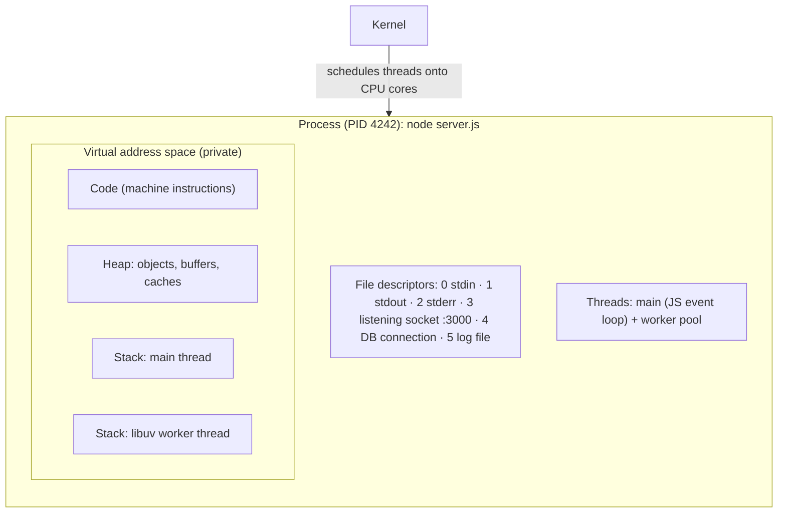
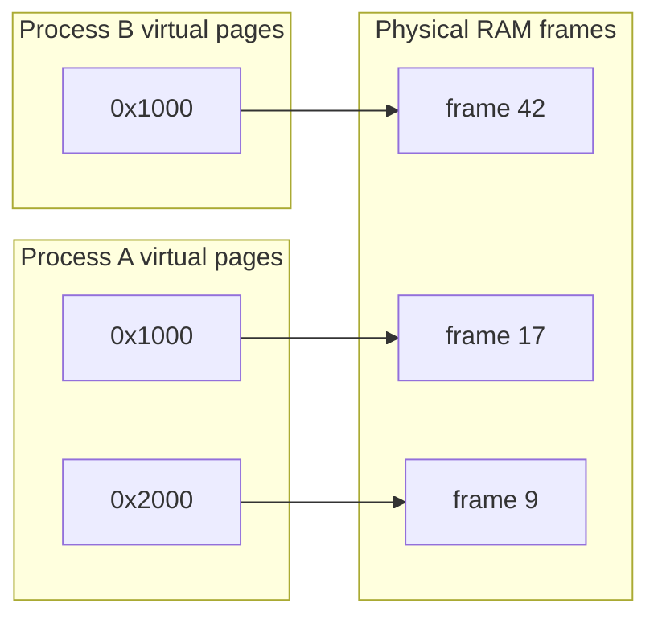

## Why it matters

Every backend bug that ends with "the server got slow and then died" is, underneath, about processes, memory, threads or file descriptors. When a container is OOM-killed, when a Node service stops accepting connections, when a Java app pauses for two seconds, when a Postgres server refuses connection 101, the explanation lives in this lesson. You don't need to be a kernel developer, but you do need a working mental model of what the machine does with your code.

## The three kinds of hardware that matter

A computer running your server has three resources you'll reason about constantly:

| Resource | What it holds | Rough access time | Size on a typical server | Survives power loss? |
| --- | --- | --- | --- | --- |
| CPU registers and caches (L1/L2/L3) | The few values being worked on right now | ~1–40 ns | KB to tens of MB | No |
| RAM (main memory) | Running programs and their data | ~100 ns | GBs to TBs | No |
| SSD / disk | Files, databases | ~16–150 µs (SSD random read), ms for spinning disks | TBs | Yes |
| Network (same datacenter) | Data on another machine | ~0.5 ms round trip | — | — |

The exact numbers vary by hardware. The ratios are what matter: each step down is roughly 100–1000× slower. Much of backend performance engineering is keeping data in a faster tier: databases cache pages in RAM, apps cache query results in Redis, browsers cache responses.

The **CPU** runs a loop: fetch the next instruction, decode it, execute it, repeat, billions of times per second per core. A modern server has many cores, so it can truly run several things **in parallel**. Everything else in this lesson is about how the operating system shares those cores, and that memory, among many programs safely.

## Processes: a running program in a box

When you run `node server.js`, the operating system creates a **process**. A process is a running program plus everything the OS tracks about it:

- **An address space:** the memory the process can see (code, globals, heap, stacks). It's private: process A cannot read process B's memory.
- **One or more threads:** each an independent sequence of execution with its own registers and stack.
- **A file descriptor table:** small integers (0, 1, 2, 3…) that refer to open files, sockets and pipes. 0 is stdin, 1 is stdout, 2 is stderr.
- **Credentials and limits:** which user it runs as, its maximum open files, memory limits (cgroups in containers).
- **A process ID (PID)** and a parent PID.



You can see all of this on Linux:

```bash
pgrep -f "node server.js"          # find the PID, e.g. 4242
ls -l /proc/4242/fd                # every open file and socket
cat /proc/4242/status | grep -E 'VmRSS|Threads'   # resident memory, thread count
cat /proc/4242/limits | grep 'open files'          # the file descriptor limit
```

### How processes are created

On Unix-like systems, a process is created by **fork** (copy the current process) followed by **exec** (replace the copy's program with a new one). Your shell does this every time you run a command. Modern kernels make fork cheap with **copy-on-write**: parent and child share memory pages until one of them writes.

This matters to backend developers because many servers use multiple processes on purpose:

- **Gunicorn** (Python) and **Puma** (Ruby) fork worker processes so they can use every CPU core despite each interpreter effectively running one thread of Python or Ruby code at a time.
- **PostgreSQL** forks one backend process **per client connection**. That's why each connection costs several MB, and why connection poolers exist.
- **Node's cluster module** and **PM2** fork one process per core.

## Threads: several flows inside one process

A **thread** is a sequence of execution inside a process. All threads in a process share the heap and file descriptors but each has its own stack and registers.

| | Processes | Threads |
| --- | --- | --- |
| Memory | Isolated | Shared |
| Creation cost | Higher (new address space) | Lower |
| Communication | Pipes, sockets, shared memory segments | Just read and write the same variables |
| A crash… | …kills only that process | …usually kills the whole process |
| Main risk | Overhead | Data races, deadlocks |

The **scheduler** in the kernel decides which threads run on which cores. When a thread waits for I/O (a disk read, a network packet), it is put to sleep and another thread runs. When a thread uses its time slice, it may be **preempted**. Switching between threads is a **context switch**: the kernel saves one thread's registers and restores another's. It costs on the order of microseconds plus cache disruption, which is why tens of thousands of OS threads become expensive and why event loops and lightweight threads (goroutines, Java virtual threads) exist. That's the subject of [Concurrency and async](/learn/concurrency-async/).

## Memory: stack, heap, and the illusion of private RAM

### Stack and heap

Each thread has a **stack**: a region where function calls push their local variables and return addresses. It's fast (allocation is just moving a pointer) and freed automatically when the function returns. It's also small, typically 1–8 MB per OS thread, so deep recursion causes a **stack overflow**.

The **heap** is where long-lived or dynamically sized data goes: objects, arrays, buffers. In C you `malloc` and `free` manually. In Java, Go, JavaScript, Python and C#, a **garbage collector (GC)** finds objects nothing refers to anymore and frees them.

A **memory leak** in a garbage-collected language means something still *refers* to data you no longer need, so the GC can't free it:

```js
// A classic Node.js leak: an unbounded in-process "cache"
const cache = new Map();
app.get("/user/:id", async (req, res) => {
  if (!cache.has(req.params.id)) cache.set(req.params.id, await db.getUser(req.params.id));
  res.json(cache.get(req.params.id)); // entries are never evicted; memory grows forever
});
```

The fix is a bounded cache (LRU with a maximum size) or a TTL. More in [Caching in depth](/learn/caching-deep-dive/).

### Virtual memory

Every process believes it has a huge, contiguous, private memory starting at address 0. That's an illusion maintained by the CPU's **memory management unit (MMU)** and the kernel:

- Memory is divided into **pages** (usually 4 KB).
- Each process has a **page table** mapping its virtual pages to physical RAM frames.
- Pages are only given physical memory when first touched. This is why a process's *virtual* size (VSZ) can be huge while its *resident* size (RSS) is small.
- If RAM is short, the kernel can move rarely used pages to swap on disk. Touching them again causes a slow **page fault**. Servers usually run with little or no swap because swapping makes latency unpredictable.



Two processes can both use virtual address `0x1000`, mapped to different physical frames. That is the isolation.

The kernel also uses spare RAM as a **page cache** for files. When Postgres reads a table page, the kernel keeps a copy in RAM, so the next read is a memory read. This is why "free" memory on a database server is often nearly zero, and that's healthy.

### Memory limits in containers

Containers don't have their own kernel. Docker and Kubernetes use **cgroups** to cap a group of processes' memory. If the processes exceed the limit, the kernel's **OOM killer** sends `SIGKILL` and the container exits with code **137** (128 + signal 9). Runtimes must be told about the limit: a JVM sizes its heap from the container limit only if configured (modern JVMs do by default), and Node's default heap limit may not match your container, so set `--max-old-space-size` deliberately.

## System calls: asking the kernel for help

User programs run in **user mode** and cannot touch hardware directly. To read a file, open a socket or allocate memory pages, they make a **system call**, a controlled jump into the kernel:

```c
int fd = open("/etc/hostname", O_RDONLY);  // syscall: returns a file descriptor, e.g. 3
char buf[64];
ssize_t n = read(fd, buf, sizeof buf);     // syscall: copy bytes from kernel to buf
close(fd);                                 // syscall: release descriptor 3
```

Every language's file and network APIs are wrappers around a handful of syscalls (`open`, `read`, `write`, `socket`, `bind`, `listen`, `accept`, `connect`, `epoll_wait`…). You can watch them live:

```bash
strace -f -e trace=network,read,write -p 4242   # Linux: watch a running process's syscalls
```

For servers, the important ones are the **I/O multiplexing** calls: `epoll` (Linux), `kqueue` (BSD/macOS) and `io_uring` (newer Linux). They let one thread wait on thousands of sockets at once and be told which are ready. That's how Nginx, Node.js (via libuv), Redis and Go's network poller handle huge numbers of connections with few threads.

## Signals: how processes are told to stop

The OS sends **signals** to processes. The ones you'll meet in production:

| Signal | Number | Meaning | Can be caught? |
| --- | --- | --- | --- |
| `SIGINT` | 2 | Ctrl+C | Yes |
| `SIGTERM` | 15 | "Please shut down" (Docker, Kubernetes and systemd send this first) | Yes |
| `SIGKILL` | 9 | Die now (OOM killer, or after the grace period) | No |
| `SIGHUP` | 1 | Terminal closed; many daemons use it as "reload config" | Yes |

A production server must handle `SIGTERM` gracefully: stop accepting new connections, finish in-flight requests, close the database pool, then exit. Kubernetes waits a grace period (30 s by default) before sending `SIGKILL`.

```js
const server = app.listen(3000);
process.on("SIGTERM", () => {
  console.log("SIGTERM received, draining");
  server.close(async () => {          // stop accepting; callback runs when open connections finish
    await db.end();                   // close the connection pool
    process.exit(0);
  });
  setTimeout(() => process.exit(1), 25_000).unref(); // hard stop before the orchestrator kills us
});
```

## Real-world scenarios

- **Postgres connection limits.** Each connection is a forked process with its own memory. 2,000 serverless functions each opening a connection can exhaust `max_connections` or RAM, which is why PgBouncer and other poolers exist.
- **"The pod keeps restarting."** `kubectl describe pod` shows `OOMKilled`: a leak or an undersized limit.
- **"New connections time out but the CPU is idle."** The process hit its file descriptor limit, or the listen backlog is full because the event loop is blocked.
- **Graceful deploys.** Rolling deploys only avoid dropped requests if your app handles `SIGTERM` correctly.

## Common mistakes

- Treating "free memory is low" on Linux as a problem. The page cache uses spare RAM on purpose. Look at "available", not "free".
- Running as root inside containers. If the process is compromised, so is more of the host than necessary.
- Not handling `SIGTERM`, so every deploy drops in-flight requests.
- Unbounded in-memory structures (caches, arrays of pending work), which cause slow leaks and eventual OOM kills.
- Starting one OS thread per request at high concurrency, which hits memory limits and context-switch overhead.

## Security considerations

- Process isolation is a security boundary: one process can't read another's memory. Threads have no such boundary.
- Run services as an unprivileged user and drop capabilities, so a remote code execution bug doesn't become root.
- Secrets in environment variables are visible in `/proc/<pid>/environ` to the same user and root. Restrict who can read them.
- Core dumps can contain secrets from memory. Control where they go, or disable them in production.

## Performance considerations

- Memory tier ratios dominate performance. Design so hot data is in RAM.
- Context switches and thread stacks make "one OS thread per connection" expensive at high concurrency, while event loops and lightweight threads scale further.
- Forking worker processes is how single-threaded runtimes use multiple cores.
- GC pauses show up as tail latency. Heap size and allocation rate both matter.

## Hands-on exercise

On a Linux machine (or a Docker container: `docker run -it --rm ubuntu bash`, then `apt update && apt install -y procps strace python3`):

1. Start `python3 -m http.server 8000 &` and find its PID with `pgrep`.
2. List its open file descriptors in `/proc/<pid>/fd`. Identify the listening socket.
3. Use `strace -p <pid>` and, from another terminal, `curl localhost:8000`. Find the `accept`, `read` and `write` (or `sendto`) calls.
4. Write a tiny program in any language that allocates 50 MB every second and never frees it. Run it in a container with `docker run --memory=200m …` and watch it die. Confirm the exit code is 137.
5. Write a server that handles `SIGTERM` gracefully: it should log, finish a slow in-flight request, then exit. Test with `kill -TERM <pid>` while a slow request is running.

## Completion criteria

- You can explain process vs thread, stack vs heap, and virtual vs resident memory to a teammate.
- You can diagnose OOM kills (exit 137) and file descriptor exhaustion (EMFILE).
- Your servers shut down gracefully on `SIGTERM`.
