## Why it matters

A backend serves many users at once. Whether it does that well depends on how it handles concurrency: thousands of connections waiting on databases, a few CPU-heavy tasks, shared state that many requests touch. Most production bugs that "only happen under load" (double charges, oversold stock, corrupted counters, hung servers) are concurrency bugs.

## Concurrency vs parallelism

- **Concurrency** is *dealing with* many things at once: structuring a program so multiple tasks make progress, interleaved.
- **Parallelism** is *doing* many things at once: literally running on multiple CPU cores at the same instant.

A single-core machine can be concurrent (switching between tasks) but not parallel. A web server is mostly a concurrency problem: at any moment most requests are *waiting* on the database or network, not computing.

```mermaid
gantt
  title One thread, three requests (concurrent, not parallel)
  dateFormat X
  axisFormat %Lms
  section Request A
  CPU parse    :a1, 0, 2
  wait for DB  :done, a2, 2, 40
  CPU render   :a3, 40, 43
  section Request B
  CPU parse    :b1, 2, 4
  wait for DB  :done, b2, 4, 45
  CPU render   :b3, 45, 48
  section Request C
  CPU parse    :c1, 4, 6
  wait for API :done, c2, 6, 30
  CPU render   :c3, 30, 32
```



The thread is only busy during the short CPU bars. While A waits for the database, it serves B and C.

## Four ways runtimes handle many requests

| Model | How it works | Used by | Watch out for |
| --- | --- | --- | --- |
| **Process per worker** | Fork N processes, each handling one request at a time | Gunicorn sync workers, PHP-FPM, Postgres connections | Memory per process; concurrency = number of workers |
| **Thread per request** | A pool of OS threads, each handling one request; blocking I/O just blocks that thread | Classic Spring MVC, Tomcat, Rails/Puma | Thread memory and context switches limit concurrency to hundreds or low thousands |
| **Event loop** | One thread runs callbacks; the OS reports which sockets are ready (epoll/kqueue); I/O never blocks the thread | Node.js, Python asyncio, Nginx, Redis | Any CPU-heavy or blocking call freezes everything |
| **Lightweight threads** | Very cheap runtime-managed threads multiplexed onto a few OS threads | Go goroutines, Java 21 virtual threads, Erlang processes | Shared-memory races still apply |

[Choosing a backend language](/learn/languages-and-frameworks/) compares these in depth. Here we focus on writing correct concurrent code.

## Async/await: how an event loop runs your code

An `async` function returns a promise (JS), coroutine (Python) or future (Rust). `await` pauses that function *without blocking the thread*. The event loop runs something else and resumes the function when the awaited operation completes.

```js
// Sequential: ~3 s if each call takes 1 s
const a = await getUser(id);
const b = await getOrders(id);
const c = await getRecommendations(id);

// Concurrent: ~1 s. All three start immediately, then we wait for all.
const [user, orders, recs] = await Promise.all([getUser(id), getOrders(id), getRecommendations(id)]);

// Concurrent, tolerating failures of the optional one
const results = await Promise.allSettled([getUser(id), getRecommendations(id)]);
```

Python's equivalent:

```python
import asyncio

async def handler(user_id: str):
    async with asyncio.timeout(2):                # one deadline for the whole group
        async with asyncio.TaskGroup() as tg:     # structured concurrency (3.11+)
            user = tg.create_task(get_user(user_id))
            orders = tg.create_task(get_orders(user_id))
    return {"user": user.result(), "orders": orders.result()}
```

`TaskGroup` cancels the remaining tasks if one fails, so no orphaned work runs on after the request has errored. That's **structured concurrency**: child tasks never outlive their parent scope.

### Unbounded concurrency is a bug too

```js
// ✗ Starts 50,000 requests at once: exhausts sockets, DB connections, or the partner's rate limit
await Promise.all(allUserIds.map(sendEmail));

// ✓ Bounded: at most 10 in flight
import pLimit from "p-limit";
const limit = pLimit(10);
await Promise.all(allUserIds.map((id) => limit(() => sendEmail(id))));
```

### Blocking the event loop

Anything synchronous and slow freezes every request in an event-loop runtime: a big `JSON.parse`, a CPU loop, `bcrypt.hashSync`, `fs.readFileSync` on a hot path, a catastrophic regex, `time.sleep` or a sync DB driver in async Python. Move CPU work to worker threads, a process pool or a background job, and use async drivers.

## Goroutines and channels

Go makes concurrency cheap enough to be the default: each incoming connection gets its own goroutine. It encourages **"don't communicate by sharing memory; share memory by communicating"** through channels.

```go
// A worker pool: N workers consume jobs from a channel
func process(ctx context.Context, jobs []Job, workers int) []Result {
    in := make(chan Job)
    out := make(chan Result)
    var wg sync.WaitGroup
    for i := 0; i < workers; i++ {
        wg.Add(1)
        go func() {
            defer wg.Done()
            for j := range in {
                select {
                case out <- handle(j):
                case <-ctx.Done(): // stop early on cancellation
                    return
                }
            }
        }()
    }
    go func() { for _, j := range jobs { in <- j }; close(in) }()
    go func() { wg.Wait(); close(out) }()
    var results []Result
    for r := range out { results = append(results, r) }
    return results
}
```

`context.Context` carries deadlines and cancellation through every call. Passing `ctx` to database and HTTP calls means a cancelled request stops its downstream work too.

## Race conditions

A **race condition** is when correctness depends on timing. The classic form is **read-modify-write**:

```
Thread A: read balance (100)
Thread B: read balance (100)
Thread A: write 100 - 30 = 70
Thread B: write 100 - 50 = 50     ← A's withdrawal is lost
```

This happens with threads sharing memory, and equally with **multiple processes or servers sharing a database**, which is the version most backend engineers meet. Even single-threaded Node has races across `await` points:

```js
// ✗ Race: two concurrent requests both see stock = 1 and both sell
const item = await db.getItem(id);
if (item.stock > 0) {
  await db.setStock(id, item.stock - 1);
  await createOrder(id);
}
```

Fixes, in rough order of preference:

1. **Make it atomic in one place.** `UPDATE items SET stock = stock - 1 WHERE id = $1 AND stock > 0` and check the affected row count. The database serialises the update.
2. **Use a lock.** `SELECT … FOR UPDATE` in a transaction (database), a `Mutex` (in-process), or a distributed lock (carefully; see [resilience patterns](/learn/resilience-patterns/)).
3. **Use optimistic concurrency.** A version column and `WHERE version = $expected`; retry on conflict.
4. **Avoid sharing.** Give each worker its own data, or route all updates for one key through one queue partition or one actor.

See the interactive lost-update simulation in [transactions and concurrency](/learn/transactions-and-concurrency/).

### In-process locks

```go
type Counter struct {
    mu sync.Mutex
    n  map[string]int
}
func (c *Counter) Inc(key string) {
    c.mu.Lock()
    defer c.mu.Unlock() // always released, even on panic
    c.n[key]++
}
```

For simple numbers, atomics are cheaper: `atomic.AddInt64(&n, 1)` in Go, `AtomicLong` in Java. Go's race detector (`go test -race`) and Java's thread-safety tooling catch many races in tests; use them.

## Deadlocks

A **deadlock** needs four conditions together: mutual exclusion, hold-and-wait, no preemption, and circular wait. Break any one and it can't happen. In practice:

- **Lock ordering:** always acquire locks in the same global order (for example by ascending account id when transferring between two accounts).
- **Timeouts:** `lock_timeout` in Postgres, `tryLock(timeout)` in Java, a context deadline in Go.
- **Hold locks briefly:** never call a slow network service while holding a lock.

Databases detect deadlocks and abort one transaction (Postgres raises `40P01 deadlock_detected`), so your code must be ready to retry.

```sql
-- Transfer between accounts 7 and 3: lock in id order to avoid deadlocks with a concurrent 3→7 transfer
BEGIN;
SELECT id FROM accounts WHERE id IN (3, 7) ORDER BY id FOR UPDATE;
UPDATE accounts SET balance = balance - 100 WHERE id = 7;
UPDATE accounts SET balance = balance + 100 WHERE id = 3;
COMMIT;
```

## Real-world scenarios

- **Fan-out API aggregation:** a product page calls pricing, inventory and reviews concurrently with a shared deadline, and degrades gracefully if reviews time out.
- **Batch jobs:** a worker pool with bounded concurrency processes a million rows without overloading the database.
- **Flash sales:** atomic stock decrements in the database prevent overselling under thousands of concurrent buyers.

## Trade-offs

| Approach | Strength | Weakness |
| --- | --- | --- |
| Event loop | Huge numbers of idle connections, simple memory model (no data races inside one loop) | One blocking call stalls everything; CPU work needs offloading |
| Thread pools | Blocking code is fine; uses many cores | Memory per thread; shared-state races |
| Lightweight threads | Simple blocking-style code that scales | Races still possible; tooling and pinning caveats |
| Message passing | Fewer shared-state bugs | More moving parts; harder to see global state |

## Common mistakes

- `await` in a loop when the calls are independent (accidental sequential code).
- `Promise.all` over unbounded lists (accidental overload).
- No timeouts on outbound calls.
- Check-then-act races across `await` points, or across servers.
- Holding a lock (or a DB transaction) while making a network call.
- Fire-and-forget promises with no error handling, which lose errors silently.

## Security considerations

- **TOCTOU** (time-of-check to time-of-use) races are security bugs: checking a balance, a coupon's usage count or a file's permissions and then acting on it later lets attackers race you with parallel requests. Enforce invariants atomically in the database.
- Unbounded concurrency on user-controlled input is a denial-of-service vector.

## Performance considerations

- I/O-bound work scales with concurrency; CPU-bound work scales with cores.
- Lock contention serialises work and shows up as rising latency with idle CPUs.
- Measure with realistic concurrency; single-request tests hide all of this.

## Hands-on exercise

1. **Sequential vs concurrent:** write a script that calls `https://httpbin.org/delay/1` five times sequentially, then with `Promise.all` or `asyncio.gather`. Record both timings.
2. **Bounded pool:** process 200 fake jobs (each `sleep(100ms)`) with at most 10 in flight. Verify with a counter that concurrency never exceeds 10.
3. **Race:** in Go or Java, increment a shared counter from 8 threads 100,000 times each without a lock and print the result. Fix it twice: once with a mutex and once with an atomic. Run Go's `-race` flag on the broken version.
4. **Deadlock:** in Postgres, open two `psql` sessions and create a deadlock by updating two rows in opposite orders. Read the error message, then fix it with consistent ordering.

## Completion criteria

- You can explain how an event loop serves thousands of connections on one thread, and what breaks it.
- You write concurrent code with bounds and deadlines by default.
- You can spot check-then-act races and fix them atomically.
