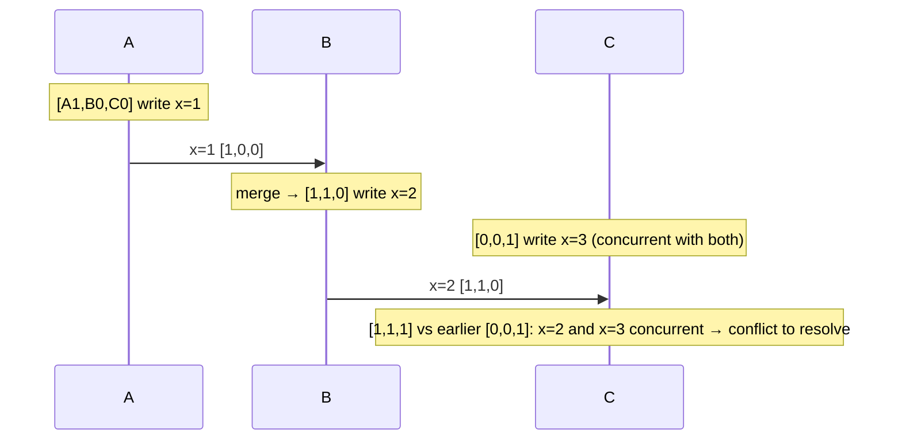
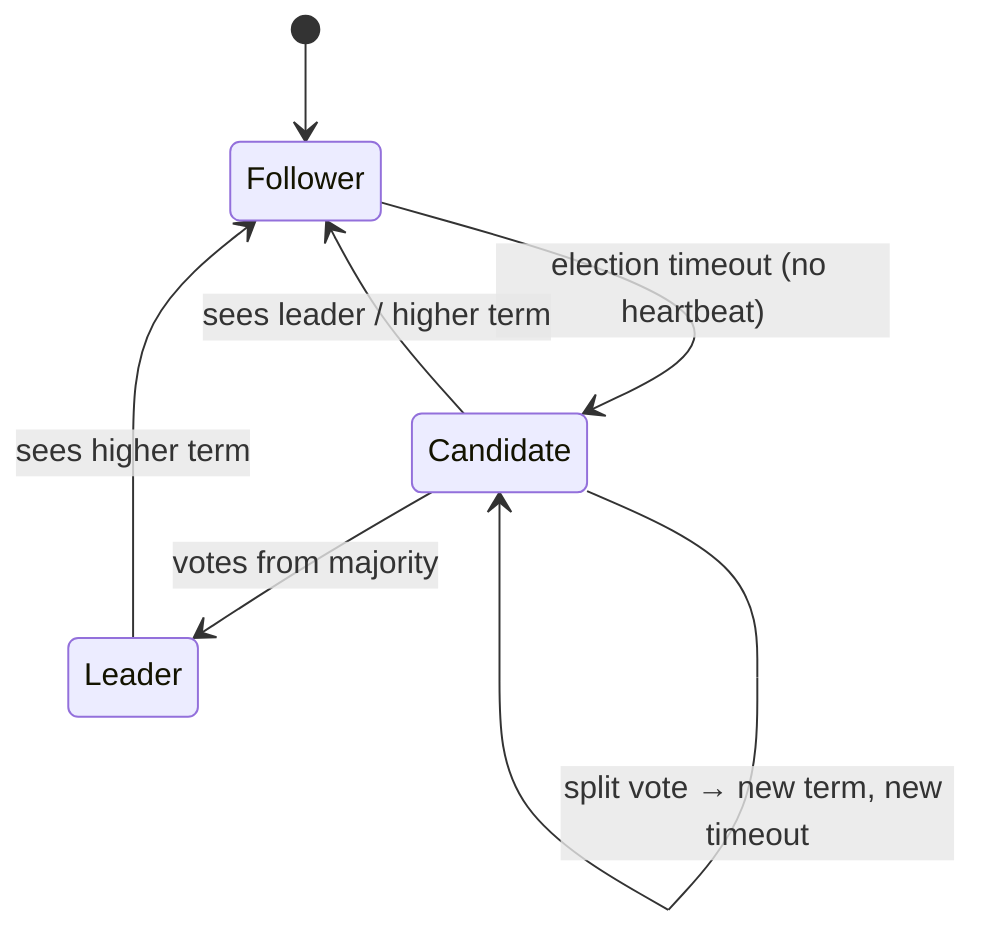

## Why it matters

Distributed systems constantly need to agree: who's the leader, which write came first, whether a lock is held, what the current configuration is. Doing this with wall-clock timestamps or "whoever answers first" silently corrupts data. **Consensus** algorithms are how systems like etcd (Kubernetes' brain), ZooKeeper, Consul, Kafka's KRaft controller, CockroachDB and Spanner agree safely despite crashes and partitions. You'll rarely implement one, but you'll depend on them, configure them and debug them.

## Physical clocks lie

Every machine has a quartz clock that **drifts** (typically tens of parts per million, varying with temperature, so seconds per day). **NTP** periodically corrects it against time servers, with accuracy that depends on network delay: often milliseconds within a datacenter, potentially tens of milliseconds or worse over the internet. Corrections can make the clock jump forward or backward. Leap seconds, VM pauses and misconfigured NTP add surprises.

Consequences:

- **Clock skew:** two machines disagree about the current time.
- Timestamps from different machines **cannot reliably order events** that are closer together than the skew.
- A machine's clock can go **backwards**, so durations should use a **monotonic clock** (`performance.now()`, `time.monotonic()`, Go's `time.Since`), never wall-clock subtraction.

```
Real order:   B writes x=2 at true time 10:00:00.100
              A writes x=1 at true time 10:00:00.050
A's clock is 80 ms fast → A stamps 10:00:00.130, B stamps 10:00:00.100
Last-write-wins keeps x=1. The real latest write (x=2) is lost, silently.
```

Google's **Spanner** confronts this directly: TrueTime exposes clock uncertainty as an interval (using GPS and atomic clocks), and transactions wait out the uncertainty before committing, giving externally consistent timestamps. Most systems can't do that, so they use logical time instead.

## Logical clocks

### Happens-before

Lamport defined **happens-before** (→): within one process, earlier events happen before later ones; sending a message happens before receiving it; and the relation is transitive. Events not related either way are **concurrent**: neither could have influenced the other.

### Lamport clocks

Each process keeps a counter:

1. Increment before each local event.
2. Attach the counter to every message sent.
3. On receive: `counter = max(local, received) + 1`.

If a → b then `L(a) < L(b)`. The converse doesn't hold: `L(a) < L(b)` doesn't tell you a happened before b. Lamport timestamps, with process id as a tiebreaker, give a **total order consistent with causality**, which is useful for ordering operations deterministically, but they can't detect concurrency.

### Vector clocks

Each process keeps a vector of counters, one per process:

1. Increment your own entry before each event.
2. Send the whole vector with messages.
3. On receive: take the element-wise max, then increment your own entry.

Compare vectors V and W: V → W if every entry of V ≤ W and at least one is strictly less. If neither dominates, the events are **concurrent**, which is exactly the information you need to detect conflicting writes.



Dynamo-style stores used version vectors to keep concurrent "siblings" for the application to merge, instead of silently discarding one. The cost is vector size growing with the number of writers.

### Hybrid logical clocks

**HLCs** combine a physical timestamp with a logical counter: timestamps stay close to wall-clock time (human-readable, usable for "as of" queries) while still respecting causality. CockroachDB and YugabyteDB use them.

### CRDTs

**Conflict-free replicated data types** are data structures whose concurrent updates always merge deterministically without coordination: grow-only counters, PN-counters, observed-remove sets, sequence CRDTs for collaborative text (Automerge, Yjs). They make multi-leader and offline-first systems converge automatically.

## Consensus: agreeing despite failures

**Consensus** means a set of nodes agrees on a value (or a sequence of values, a log) such that:

- **Agreement:** all correct nodes decide the same value.
- **Validity:** the decided value was proposed by someone.
- **Termination:** correct nodes eventually decide.

and it stays correct (safe) despite crashes, message loss and partitions. The **FLP result** proves no deterministic algorithm can *guarantee* termination in a fully asynchronous system with even one crash, so practical algorithms (Paxos, Raft, Zab, Viewstamped Replication) are always safe but rely on timeouts to make progress, which they do in practice whenever the network is reasonably behaved.

A replicated log agreed by consensus gives you a **replicated state machine**: every node applies the same commands in the same order and ends up in the same state. That's how you build a linearizable, fault-tolerant key-value store, lock service or configuration store.

### Why majorities

With 2f + 1 nodes, any two majorities (f + 1 nodes each) overlap in at least one node. So a new leader elected by a majority always talks to at least one node that saw every committed entry, and only one side of a partition can make progress. That's why clusters are 3 nodes (tolerating 1 failure) or 5 (tolerating 2). More nodes add fault tolerance but slow down every write, since more acknowledgements are needed.

## Raft, step by step

Raft splits consensus into **leader election**, **log replication** and **safety**. Each server is a **follower**, **candidate** or **leader**. Time is divided into **terms** (numbered elections). Each term has at most one leader.

### Leader election



1. Followers expect periodic **heartbeats** (empty AppendEntries RPCs) from the leader.
2. If a follower hears nothing for its **election timeout** (randomised, for example 150–300 ms, so nodes rarely time out together), it becomes a candidate: increments the term, votes for itself, and sends RequestVote to everyone.
3. Each server grants **at most one vote per term**, and only to a candidate whose log is **at least as up to date** as its own (compared by last log entry's term, then index).
4. A candidate with votes from a majority becomes leader and starts sending heartbeats. If another server claims leadership with a term at least as high, the candidate steps down. If votes split, the term times out and a new election starts.

### Log replication

1. Clients send commands to the leader (followers redirect them).
2. The leader appends the command to its log with the current term and sends **AppendEntries** to followers, including the index and term of the entry just before the new ones.
3. A follower accepts only if its log contains that preceding entry (the **consistency check**). If not, the leader backs up and resends earlier entries until the logs match, overwriting any conflicting uncommitted entries on the follower.
4. Once an entry from the leader's current term is stored on a **majority**, it's **committed**. The leader applies it to its state machine, replies to the client, and tells followers the new commit index so they apply it too.

```
Index:     1    2    3    4    5
Leader:   [t1] [t1] [t2] [t3] [t3]   commitIndex = 4 (stored on 3 of 5)
Follower1 [t1] [t1] [t2] [t3] [t3]
Follower2 [t1] [t1] [t2] [t3]
Follower3 [t1] [t1]                  (lagging; leader will catch it up)
Follower4 [t1] [t1] [t2] [t2]        (conflicting uncommitted entry at 4 → overwritten)
```

### Safety in one sentence

Because a candidate needs votes from a majority, and voters refuse candidates with less up-to-date logs, **any elected leader already has every committed entry**, so committed entries are never lost or changed.

### Practicalities

- **Log compaction:** the log can't grow forever, so state is periodically **snapshotted** and the log truncated.
- **Membership changes:** adding or removing nodes safely uses joint consensus or single-server changes.
- **Reads:** to serve linearizable reads, the leader must confirm it's still leader (a round of heartbeats, "ReadIndex") or hold a time-based lease (which relies on bounded clock drift).
- **Pre-vote** stops a partitioned node from disrupting the cluster with ever-higher terms when it rejoins.

## Where consensus is used, and what it costs

| System | Uses consensus for |
| --- | --- |
| **etcd** (Raft) | Kubernetes cluster state, leader election, locks |
| **ZooKeeper** (Zab) | Coordination for Hadoop, older Kafka, HBase |
| **Kafka KRaft** (Raft-based) | Cluster metadata and controller election (replacing ZooKeeper) |
| **Consul** (Raft) | Service catalog, KV, sessions |
| **CockroachDB, TiKV, YugabyteDB** (Raft per range) | Replicating each data range |
| **Spanner** (Paxos per split) | Replicating each data split |

Costs and limits:

- Every write waits for a majority round trip: latency is bounded by the network between nodes (painful across regions).
- Throughput is limited by the leader. Systems scale by running **many independent Raft groups** (one per data range).
- Without a majority, the cluster can't make progress (the CP side of CAP).
- Keep coordination services small and focused: store leadership, locks and configuration there, not your business data.

### Leader election as a building block

You can use etcd or ZooKeeper (or a Kubernetes Lease object) to elect a single active instance of a scheduler or controller, with a **lease** and **fencing token**:

```go
// Using etcd's concurrency package: campaign for leadership; the lease expires if we die.
session, _ := concurrency.NewSession(cli, concurrency.WithTTL(10))
election := concurrency.NewElection(session, "/scheduler/leader")
if err := election.Campaign(ctx, hostname); err != nil { return err }
// We're the leader. The leader key's revision is a monotonically increasing fencing token:
token := election.Rev()
runSchedulerLoop(ctx, token) // pass the token to anything that writes, and have storage reject older tokens
```

## Common mistakes

- Ordering events across machines by wall-clock timestamps, or using last-write-wins without understanding the data loss.
- Measuring durations with the wall clock.
- Running 2- or 4-node consensus clusters (no fault-tolerance gain over 1 or 3).
- Spreading a consensus cluster across distant regions without understanding the write latency.
- Building your own consensus or leader election from database rows and timestamps.

## Security considerations

- Consensus clusters hold your most critical state (Kubernetes secrets live in etcd). Encrypt traffic between members and to clients, restrict access tightly, and encrypt data at rest.
- Byzantine (malicious) faults are outside Raft and Paxos's model: they assume nodes may crash but don't lie.

## Performance considerations

- Fast disks with low fsync latency matter: every committed entry is persisted on a majority.
- Batching and pipelining entries is how consensus systems achieve high throughput.
- Keep values small; large values slow replication and snapshots.

## Hands-on exercise

1. Implement Lamport clocks and vector clocks for three simulated processes exchanging random messages. Print each event's vector and classify pairs as happened-before or concurrent.
2. Use the interactive Raft visualisation at raft.github.io: stop the leader, partition the cluster 2–3, and observe terms, elections and which side can commit.
3. Run a 3-node etcd cluster in Docker Compose. Write keys, kill the leader, and observe re-election (`etcdctl endpoint status -w table`). Kill a second node and show writes fail.
4. Stretch goal: work through the Raft lab of MIT 6.824 (6.5840), or the [distributed key-value store project](/projects/distributed-kv-store/).

## Completion criteria

- You never order cross-machine events by wall-clock time, and you can explain why.
- You can explain Lamport and vector clocks and detect concurrent events.
- You can walk through Raft's election, replication and commit rules and explain why majorities guarantee safety.
