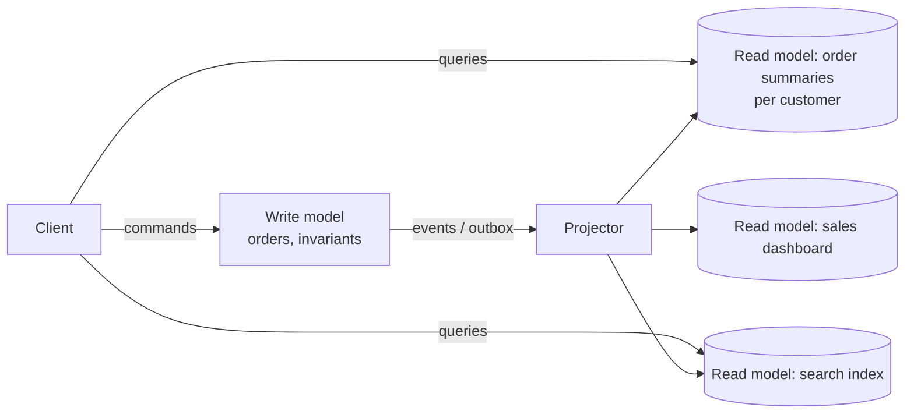
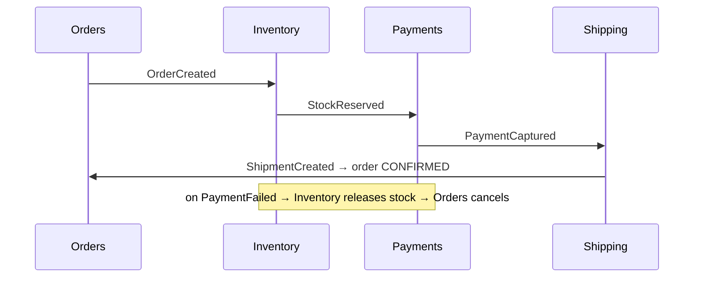

## Why it matters

Once data is split across modules or services, the convenient single-database transaction disappears for operations that span them. How do you keep an order, a payment and a shipment consistent? How do you publish "order placed" without sometimes losing it? How do you serve fast, complex queries over data owned by five services? These patterns are the answers, and each carries real complexity, so it's as important to know when *not* to use them.

## CQRS: separate models for reads and writes

**Command Query Responsibility Segregation** splits a model in two:

- **Commands** (`PlaceOrder`, `CancelOrder`) go to a **write model** that enforces business rules and invariants.
- **Queries** read from one or more **read models**, denormalised and shaped exactly for the screens and APIs that use them.



**What problem it solves:** the write side needs normalised data and transactional rules; reads need fast, often denormalised views, sometimes combining data from several services. One model can't serve both well when they diverge strongly.

**It doesn't have to be complicated.** A materialised view, or a summary table updated in the same transaction, is already CQRS. Separate stores and asynchronous projection are an option, not a requirement.

```sql
-- Read model as a table maintained by a projector consuming order events
create table customer_order_summaries (
  customer_id   uuid primary key,
  order_count   int not null default 0,
  total_spent   bigint not null default 0,
  last_order_at timestamptz,
  last_event_id bigint not null default 0      -- for idempotent, ordered projection
);
```

```ts
// Projector: idempotent because it records the last processed event per row
async function project(e: OrderPlaced) {
  await db.query(
    `insert into customer_order_summaries (customer_id, order_count, total_spent, last_order_at, last_event_id)
     values ($1, 1, $2, $3, $4)
     on conflict (customer_id) do update set
       order_count = customer_order_summaries.order_count + 1,
       total_spent = customer_order_summaries.total_spent + excluded.total_spent,
       last_order_at = excluded.last_order_at,
       last_event_id = excluded.last_event_id
     where customer_order_summaries.last_event_id < excluded.last_event_id`,
    [e.customerId, e.total, e.occurredAt, e.eventId],
  );
}
```

**When to use:** read and write shapes diverge a lot; read load dwarfs write load; queries need data from several services; you need several specialised views (search, analytics, per-customer summaries).

**When not to:** simple CRUD. CQRS with asynchronous projections introduces **eventual consistency** ("I placed an order but it's not in my list yet"), which must be handled in the UX (read-your-writes by reading the write model right after a command, or optimistic UI).

**Failure scenarios:** projector lag; projector bugs corrupting a read model (fix by rebuilding it from the event history); out-of-order events (handle with version checks as above).

## Event sourcing: state as a log of facts

Instead of storing current state and overwriting it, **store every change as an immutable event**, and derive current state by replaying them.

```
account-42 stream:
  1  AccountOpened    { owner: "asha", currency: "INR" }
  2  MoneyDeposited   { amount: 10000 }
  3  MoneyWithdrawn   { amount: 2500 }
  4  MoneyDeposited   { amount: 500 }
→ current balance = 8000 (a fold over the events)
```

```sql
create table events (
  stream_id   text   not null,
  version     int    not null,              -- position within the stream
  type        text   not null,
  data        jsonb  not null,
  metadata    jsonb  not null default '{}',  -- causation id, correlation id, user, schema version
  global_seq  bigserial,
  occurred_at timestamptz not null default now(),
  primary key (stream_id, version)           -- optimistic concurrency: two writers can't both append version 5
);
```

```ts
type Event = { type: "AccountOpened"; owner: string } | { type: "MoneyDeposited"; amount: number } | { type: "MoneyWithdrawn"; amount: number };

const apply = (s: { balance: number; open: boolean }, e: Event) =>
  e.type === "AccountOpened" ? { balance: 0, open: true }
  : e.type === "MoneyDeposited" ? { ...s, balance: s.balance + e.amount }
  : { ...s, balance: s.balance - e.amount };

async function withdraw(streamId: string, amount: number) {
  const { rows } = await db.query("select type, data, version from events where stream_id = $1 order by version", [streamId]);
  const state = rows.reduce((s, r) => apply(s, { type: r.type, ...r.data }), { balance: 0, open: false });
  if (!state.open || state.balance < amount) throw new ConflictError("insufficient funds");
  const nextVersion = rows.length + 1;
  // Fails with a unique violation if someone appended concurrently → reload and retry
  await db.query("insert into events (stream_id, version, type, data) values ($1, $2, 'MoneyWithdrawn', $3)", [streamId, nextVersion, { amount }]);
}
```

**Benefits:** a complete, trustworthy audit log; the ability to rebuild any read model or answer new questions about history; temporal queries ("what was the balance on March 1?"); natural fit with event-driven integration.

**Real costs:**

- **Event schema evolution:** events are forever. You need versioning and **upcasters** that transform old event shapes into new ones on read.
- **Replays get slow** for long streams, so you add **snapshots** (store state at version N and replay from there).
- **Querying current state** requires projections (so you also need CQRS).
- **Privacy:** "delete my data" conflicts with immutability; common approaches are keeping personal data out of events, or crypto-shredding (encrypt per user, delete the key).
- A steep learning curve for the team.

**When to use:** domains where history *is* the product or a legal requirement: ledgers, trading, audit-heavy workflows, collaborative editing history. **When not to:** most CRUD applications. An audit-log table alongside normal state gets you much of the value at a fraction of the cost.

## The dual-write problem and the transactional outbox

A service must update its database **and** publish an event. Doing both directly is unsafe:

```ts
await db.query("insert into orders …");   // succeeds
await broker.publish("order.placed", …);  // process crashes before this line → event lost forever
```

Reversing the order doesn't help (the event is published but the insert fails). There's no atomic commit across a database and a broker. The **transactional outbox** fixes it:

```ts
await db.transaction(async (tx) => {
  const order = await tx.query("insert into orders (…) values (…) returning *");
  await tx.query(
    "insert into outbox (id, aggregate_id, type, payload) values ($1, $2, 'order.placed', $3)",
    [randomUUID(), order.id, JSON.stringify(order)],
  );
});  // both rows commit, or neither does
```

A **relay** then publishes outbox rows to the broker and marks them sent, either by **polling** (`select … for update skip locked`, publish, update) or with **change data capture** (Debezium reads the database's write-ahead log and streams outbox inserts to Kafka). The relay may publish a row more than once (crash after publish, before marking sent), so delivery is **at-least-once** and consumers must be **idempotent**, for example by recording processed event ids under a unique constraint.

The mirror image on the consuming side is the **inbox** pattern: record the incoming message id in the same transaction as its side effects, and skip ids already seen.

## Sagas: business transactions across services

A **saga** is a sequence of local transactions, one per service. Each step publishes an event or reply that triggers the next. If a step fails, the saga runs **compensating transactions** for the completed steps, in reverse.

| Step | Service | Action | Compensation |
| --- | --- | --- | --- |
| 1 | Orders | Create order (`PENDING`) | Mark order `CANCELLED` |
| 2 | Inventory | Reserve stock | Release reservation |
| 3 | Payments | Charge card | Refund |
| 4 | Shipping | Create shipment | (last step: if it fails, compensate 3, 2, 1) |
| 5 | Orders | Mark order `CONFIRMED` | — |

Compensations are **semantic** undos, not rollbacks: a refund is a new transaction, visible to the customer. Some actions can't be undone at all (an email was sent), so order steps to put irreversible actions last, or make them "pivot" steps after which the saga only moves forward with retries.

### Choreography

Each service reacts to events and emits its own; there's no central coordinator.



Simple for short flows, with loose coupling. But the workflow is implicit, spread across services: hard to see, hard to change, and prone to cyclic dependencies as steps are added.

### Orchestration

A central **orchestrator** (often in the service that owns the process) tells each participant what to do and tracks state explicitly.

```ts
// A saga orchestrator as an explicit state machine, persisted after each step
const steps = [
  { name: "reserveStock", run: (o) => inventory.reserve(o.id, o.items), undo: (o) => inventory.release(o.id) },
  { name: "chargeCard",   run: (o) => payments.charge(o.id, o.total, { idempotencyKey: `charge-${o.id}` }), undo: (o) => payments.refund(o.id) },
  { name: "createShipment", run: (o) => shipping.create(o.id, o.address), undo: async () => {} },
];

async function runSaga(order: Order) {
  const done: typeof steps = [];
  for (const step of steps) {
    try {
      await retry(() => step.run(order), { attempts: 3 });   // transient failures
      done.push(step);
      await sagaLog.record(order.id, step.name, "done");      // persist progress so a crash can resume
    } catch (err) {
      await sagaLog.record(order.id, step.name, "failed");
      for (const s of done.reverse()) await retry(() => s.undo(order), { attempts: Infinity });  // compensations must eventually succeed
      await orders.markCancelled(order.id, String(err));
      return;
    }
  }
  await orders.markConfirmed(order.id);
}
```

Production orchestrators persist state durably and resume after crashes. Workflow engines like **Temporal**, AWS Step Functions and Camunda do this for you, which is usually better than building it yourself.

| | Choreography | Orchestration |
| --- | --- | --- |
| Coordination | Implicit, via events | Explicit, a central coordinator |
| Coupling | Services know events, not each other | Orchestrator knows participants |
| Visibility | Hard to see the whole flow | Flow lives in one place |
| Best for | 2–4 steps, stable flows | Longer, branching, or frequently changing workflows |

### Saga pitfalls

- **Lack of isolation:** other transactions can see intermediate states (an order `PENDING` with stock reserved). Use semantic locks (status fields), and design the UX for in-progress states.
- Every step and compensation must be **idempotent**, because messages are redelivered.
- **Timeouts:** a step that never replies needs a deadline and a decision.

## Two-phase commit (2PC)

2PC achieves an atomic commit across multiple resources:

1. **Prepare:** the coordinator asks each participant to prepare (write everything durably, hold locks) and vote yes or no.
2. **Commit/abort:** if all vote yes, the coordinator tells everyone to commit; otherwise abort.

It's correct, but **blocking**: if the coordinator crashes after participants voted yes, they wait in doubt, holding locks, until it recovers. It needs every participant to support it (XA transactions), which most message brokers, NoSQL stores and third-party APIs don't. 2PC is used *inside* distributed databases (Spanner, CockroachDB use it with consensus-replicated participants to avoid blocking) and in some enterprise middleware, but between independently deployed services, sagas are the norm.

## Real-world use cases

- **E-commerce checkout:** saga across inventory, payments and shipping, with an outbox for each service's events.
- **Banking ledgers:** event-sourced accounts with projections for balances and statements.
- **Travel booking:** flight, hotel and car reservations as a saga with compensating cancellations.
- **Search and analytics:** CQRS read models fed by CDC into Elasticsearch and a warehouse.

## Common mistakes

- Event sourcing a CRUD app because it sounds elegant.
- Publishing events directly after a DB write (the dual-write problem).
- Non-idempotent consumers and compensations.
- Choreography sprawling into an invisible, unmaintainable workflow.
- Ignoring the UX of eventual consistency.

## Security considerations

- Events often carry personal data and live forever in logs and topics. Minimise what goes into them and plan for erasure.
- Authorise commands at the write model; read models must also be filtered per user and tenant.
- Sign or authenticate events crossing trust boundaries.

## Performance considerations

- Read models make queries fast at the cost of projection lag; monitor lag as a metric.
- Long event streams need snapshots.
- Outbox polling adds load; CDC scales better at high volume.

## Hands-on exercise

Build the [event-driven order processing project](/projects/event-driven-orders/), or a minimal version:

1. Three services (or modules): orders, inventory, payments (a fake that fails 20% of the time), each with its own schema and an outbox.
2. An orchestrated saga with compensations, persisted so a crash mid-saga resumes on restart.
3. Idempotent consumers using an inbox table.
4. A read model `customer_order_summaries` built by a projector, plus a script that rebuilds it from scratch.
5. Chaos test: kill each process at random during a run of 500 orders and verify that every order ends `CONFIRMED` or `CANCELLED`, that stock and payments balance, and that nobody is charged twice.

## Completion criteria

- You can explain when CQRS and event sourcing are worth their cost, and when they're not.
- You publish events reliably with an outbox and consume them idempotently.
- You can design a saga with compensations and choose orchestration or choreography.
