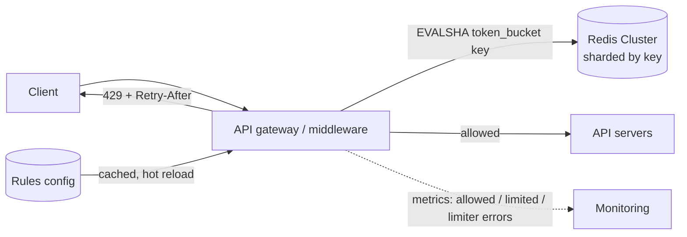
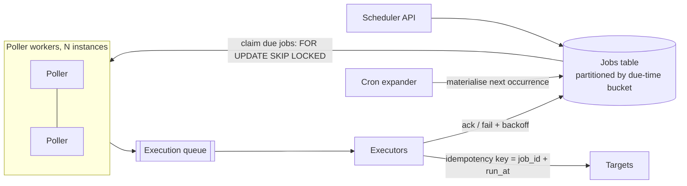
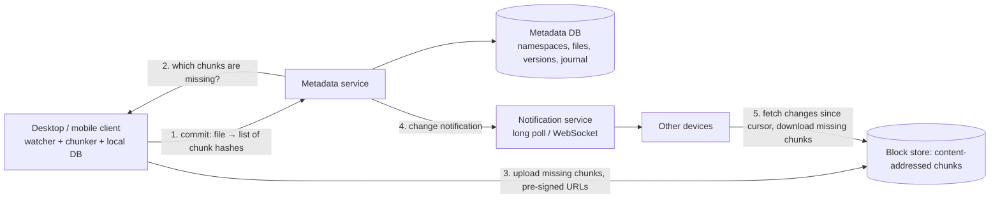
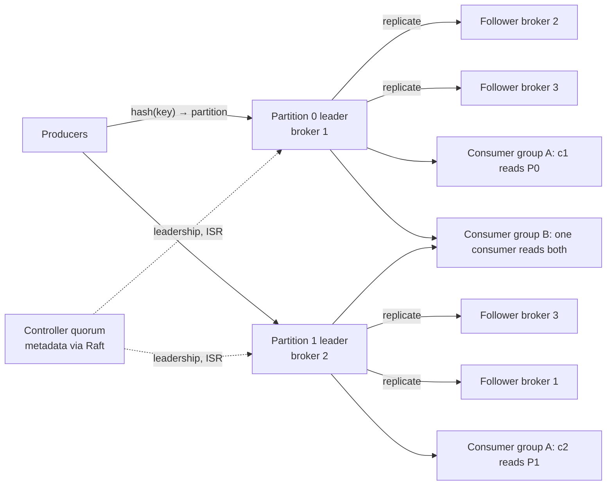

## How to use this lesson

These are "build the platform" problems: each is a component other systems depend on, so correctness invariants matter more than features. For each, identify the invariant first ("never exceed the limit by much", "never lose a job", "never lose a file version", "never lose an acknowledged message"), then design to protect it under failures.

---

## 1. Distributed rate limiter

### Requirements

**Functional:** limit requests per key (API key, user, IP, endpoint) with configurable rules (for example 100 req/min per API key, 10 req/s burst); return 429 with `Retry-After` and remaining-quota headers.

**Non-functional:** adds < 2 ms p99 to each request; works across hundreds of API servers; small, bounded inaccuracy is acceptable; **if the limiter's storage is down, fail open** for most endpoints (don't take the API down) but **fail closed** for sensitive ones (login, OTP).

### Estimates (assumptions)

- 500k req/s across the fleet → 500k limiter checks/s.
- 10M active keys × ~100 bytes of state ≈ 1 GB, which fits in a Redis cluster with room to spare.

### Algorithm choice

See the interactive comparison in [web vulnerabilities](/learn/web-vulnerabilities/) and [background work](/learn/system-design-async/).

| Algorithm | State per key | Accuracy | Bursts |
| --- | --- | --- | --- |
| Fixed window counter | 1 counter | 2× burst at window edges | Allowed at edges |
| Sliding window log | All timestamps | Exact | Smooth |
| Sliding window counter | 2 counters | Close approximation | Smooth |
| Token bucket | Tokens + timestamp | Exact for its model | Up to bucket size |
| Leaky bucket (queue) | Queue | Smooths output | Queued, not rejected |

Token bucket is the most common for APIs (explicit burst and sustained rate); the sliding window counter is a cheap, accurate alternative.

### Architecture



Atomic token bucket in a Redis Lua script (runs atomically on the server, one round trip):

```lua
-- KEYS[1] = bucket key; ARGV = capacity, refill_per_sec, now_ms, cost
local cap, rate, now, cost = tonumber(ARGV[1]), tonumber(ARGV[2]), tonumber(ARGV[3]), tonumber(ARGV[4])
local b = redis.call('HMGET', KEYS[1], 'tokens', 'ts')
local tokens = tonumber(b[1]) or cap
local ts = tonumber(b[2]) or now
tokens = math.min(cap, tokens + (now - ts) / 1000 * rate)      -- refill for elapsed time
local allowed = tokens >= cost
if allowed then tokens = tokens - cost end
redis.call('HSET', KEYS[1], 'tokens', tokens, 'ts', now)
redis.call('PEXPIRE', KEYS[1], math.ceil(cap / rate * 1000) * 2)  -- idle buckets disappear
return { allowed and 1 or 0, tokens }
```

(Passing `now` from the caller relies on server clocks being roughly synchronised; alternatively call `redis.call('TIME')` inside the script, which is allowed in modern Redis with effects replication.)

### Deep dives

- **Latency:** one round trip to a nearby Redis shard. For extreme scale, use a **local token cache**: each server takes a batch of tokens from Redis (say 10% of the limit) and spends them locally, trading accuracy for fewer round trips.
- **Multi-region:** per-region limits (limit/number of regions), or async replication of counters accepting temporary overshoot. Global exactness costs cross-region latency on every request, which is rarely worth it.
- **Hot keys:** a single abusive key hammers one Redis shard; add a local in-memory deny cache for keys currently over their limit.
- **Failure policy:** wrap the limiter call in a short timeout and a circuit breaker; on failure, fail open (or fall back to a coarse local limit) except for sensitive endpoints.
- **Rules:** layered (global → per tenant → per endpoint), versioned, cached in each gateway.

### Security and cost

Key choice matters: IP limits are evaded with botnets and hurt users behind shared NAT; prefer authenticated keys, and combine with bot detection. Redis memory and network are the cost drivers; TTLs keep idle state out.

---

## 2. Distributed job scheduler

### Requirements

**Functional:** schedule one-off jobs ("send reminder at 09:00 tomorrow") and recurring jobs (cron expressions); jobs carry a payload and a target (a queue or HTTP endpoint); retries with backoff; cancellation; history and status.

**Non-functional:** **never lose a scheduled job**; run within a few seconds of the due time; at-least-once triggering with **no concurrent duplicate execution** and idempotent effects; millions of pending jobs; survives node failures.

### Estimates (assumptions)

- 100M pending jobs; 10k jobs due per second at peak (top of the hour is a notorious spike: everyone schedules at :00).

### Architecture



```sql
create table jobs (
  id           uuid primary key,
  tenant_id    uuid not null,
  run_at       timestamptz not null,
  status       text not null default 'scheduled',   -- scheduled | claimed | done | failed | cancelled
  payload      jsonb not null,
  attempts     int not null default 0,
  lease_until  timestamptz,
  lease_token  bigint not null default 0,            -- fencing token, incremented on every claim
  cron         text                                   -- for recurring jobs
);
create index jobs_due on jobs (run_at) where status = 'scheduled';
```

Claiming (many pollers in parallel, no double claims):

```sql
with due as (
  select id from jobs
  where status = 'scheduled' and run_at <= now()
  order by run_at
  limit 500
  for update skip locked
)
update jobs j set status = 'claimed', lease_until = now() + interval '60 seconds', lease_token = lease_token + 1
from due where j.id = due.id
returning j.id, j.payload, j.lease_token;
```

### Deep dives

- **Lease expiry and recovery:** a reaper returns jobs whose `lease_until` passed back to `scheduled`. Because a slow worker might still finish, completion uses the fencing token: `update jobs set status='done' where id=$1 and lease_token=$2`. Targets receive an idempotency key (`job_id:run_at`) so duplicate deliveries have no double effect.
- **Recurring jobs:** store the cron spec; after each run, compute and insert the next occurrence in the same transaction as marking the current run done, so the series can't be lost or duplicated. Decide explicitly what happens to missed runs after an outage (catch up all, run once, or skip).
- **Scale:** partition jobs by time bucket (hour) and hash; assign partitions to pollers (or let SKIP LOCKED spread work). For very large scale, a **hierarchical timing wheel** in memory per partition, loaded slightly ahead from durable storage, handles millions of timers efficiently.
- **The top-of-the-hour spike:** add jitter where semantics allow, pre-load the next minute's jobs, and scale executors ahead of predictable peaks.
- **Isolation:** per-tenant concurrency limits so one tenant scheduling a million jobs at 09:00 can't delay everyone.

### Failures and trade-offs

Database is the durability anchor; replicate it with a synchronous standby. Executor crashes lead to lease expiry and retry. Exactly-once *execution* is impossible across failures; exactly-once *effect* comes from idempotency. Off-the-shelf options (Temporal, Quartz clustered, Sidekiq/Oban/BullMQ schedulers, cloud schedulers such as EventBridge Scheduler) usually beat building one.

---

## 3. File storage and sync (Dropbox-like)

### Requirements

**Functional:** upload and download files of any size; sync a folder across a user's devices; version history; sharing with permissions; offline edits sync later.

**Non-functional:** never lose an acknowledged file version; efficient sync of small edits to big files; resumable transfers; high durability (object-storage grade); strong consistency of metadata (a user must never see a folder state that never existed).

### Estimates (assumptions)

- 50M users, 10 GB average stored → 500 PB logical; cross-user and cross-version deduplication reduces physical storage meaningfully.
- 1M file changes per minute at peak.

### Key idea: split metadata from content



- **Content:** files are split into chunks (around 4 MB, or content-defined, variable-size); each chunk is stored once by its hash (SHA-256) in a **content-addressed block store** (object storage). Identical chunks across versions, files and users are stored once (subject to privacy design).
- **Metadata:** a file version is an ordered list of chunk hashes plus attributes. A per-namespace **journal** (an append-only log of changes with a monotonically increasing cursor) lets devices ask "what changed since cursor 1234?".

### Deep dives

- **Chunking:** content-defined chunking with a rolling hash (FastCDC or Rabin fingerprints) picks boundaries where the hash matches a pattern, so an insertion only changes nearby chunks and an edit to a 2 GB file uploads a few MB.
- **Upload protocol:** client computes chunk hashes → asks the metadata service which are missing → uploads only those directly to the block store with pre-signed URLs → commits the new version (an atomic metadata transaction referencing only chunks that exist). A version is visible only after commit, so a half-uploaded file never appears.
- **Conflicts:** if two devices edit the same file offline, the commit includes the base version; the second commit finds the base is no longer current. Rather than silently overwriting, keep both ("report (Asha's conflicted copy).docx"). Folder-level operations (rename versus edit) need careful ordering rules.
- **Notifications:** devices hold a long poll or WebSocket per namespace; on change, they pull the journal from their cursor.
- **Garbage collection:** chunks are reference-counted (or mark-and-sweep) across versions; delete only after version retention expires and no version references them, carefully, since a wrong delete is permanent data loss.
- **Durability:** object storage with erasure coding across availability zones; metadata DB with synchronous replication, backups and point-in-time recovery.

### Security and privacy

Encrypt in transit and at rest; per-user or per-namespace keys enable crypto-shredding. Cross-user dedup can leak information ("does anyone have this exact file?"), so many services dedup only within a user or tenant. Shared-link permissions are checked on every chunk download via short-lived signed URLs. Malware scanning of shared content.

### Cost and trade-offs

Storage dominates: dedup, compression, and cold tiers for old versions. Smaller chunks dedupe better but mean more metadata and requests. Strongly consistent metadata limits how far the metadata tier can be geo-distributed.

---

## 4. Event streaming platform (Kafka-like)

### Requirements

**Functional:** producers append records to named **topics**; consumers read records in order per partition, from any retained position; **consumer groups** share partitions for parallel processing; time- or size-based retention; compacted topics (keep the latest value per key).

**Non-functional:** very high throughput (millions of records per second per cluster); acknowledged records survive broker failures; per-partition ordering; horizontal scale; consumers can replay.

### Design



- **Partition = append-only log**, stored as segment files on disk; records are addressed by **offset**. Appends are sequential writes, and reads are mostly sequential, which is exactly what disks and the OS page cache are good at. Brokers serve consumers with zero-copy transfer (`sendfile`) from the page cache.
- **Ordering** is per partition; producers choose the partition by key hash, so all events for one key stay ordered.
- **Replication:** each partition has a leader and followers. Followers that are caught up form the **in-sync replica set (ISR)**. With `acks=all` and `min.insync.replicas=2` (replication factor 3), a write is acknowledged only once it's on at least 2 replicas, so it survives one broker loss.
- **Metadata and leadership:** a controller quorum (Raft-based in Kafka's KRaft mode) tracks brokers, partition leaders and ISRs, and elects new leaders from the ISR on failure.
- **Consumer groups:** partitions are assigned to group members; each partition is read by exactly one member of a group. Consumers commit offsets (to an internal topic). Rebalancing reassigns partitions when members join or leave. See the simulation in [messaging systems](/learn/messaging-and-background-jobs/).
- **Retention:** delete segments older than N days or beyond a size; **log compaction** keeps the latest record per key (useful for changelogs and state restoration).
- **Batching and compression** on the producer amortise per-record overhead and are the main throughput lever.

### Delivery semantics

- **At-most-once:** commit offsets before processing (risk of loss).
- **At-least-once:** process, then commit (risk of duplicates on crash). The common default; pair with idempotent consumers.
- **Exactly-once within Kafka:** idempotent producers (sequence numbers per partition dedupe retries) plus transactions that atomically write output records and commit consumer offsets, for read-process-write pipelines inside Kafka. Side effects in external systems still need idempotency.

### Failures and trade-offs

Broker failure → leader election from the ISR (unclean election from out-of-sync replicas trades durability for availability; disable it for important data). Slow consumers → growing lag (alert on it), and retention can delete data they haven't read. More partitions mean more parallelism but more files, more metadata and longer failovers; and changing the partition count remaps keys. A log trades per-message features (priorities, per-message TTL, individual acks, delayed delivery) for throughput and replay, which is why task queues (RabbitMQ, SQS) remain the better tool for job distribution.

---

## Hands-on exercise

Pick one and build it as a project:

- [Distributed rate limiter](/projects/distributed-rate-limiter/): the Lua token bucket behind middleware, a fail-open policy with a circuit breaker, and a k6 test proving the limit holds across 4 API instances.
- [Distributed job scheduler](/projects/job-scheduler/): Postgres-backed with SKIP LOCKED, leases, fencing tokens, cron expansion and a chaos test killing workers.
- [Message broker](/projects/message-broker/): a single-node partitioned log with segment files, offsets, consumer groups and retention.

## Completion criteria

- For each system you can state its core invariant and show how your design protects it during failures.
- You can implement atomic distributed counters, lease-based claiming with fencing, content-addressed storage and an append-only partitioned log.
