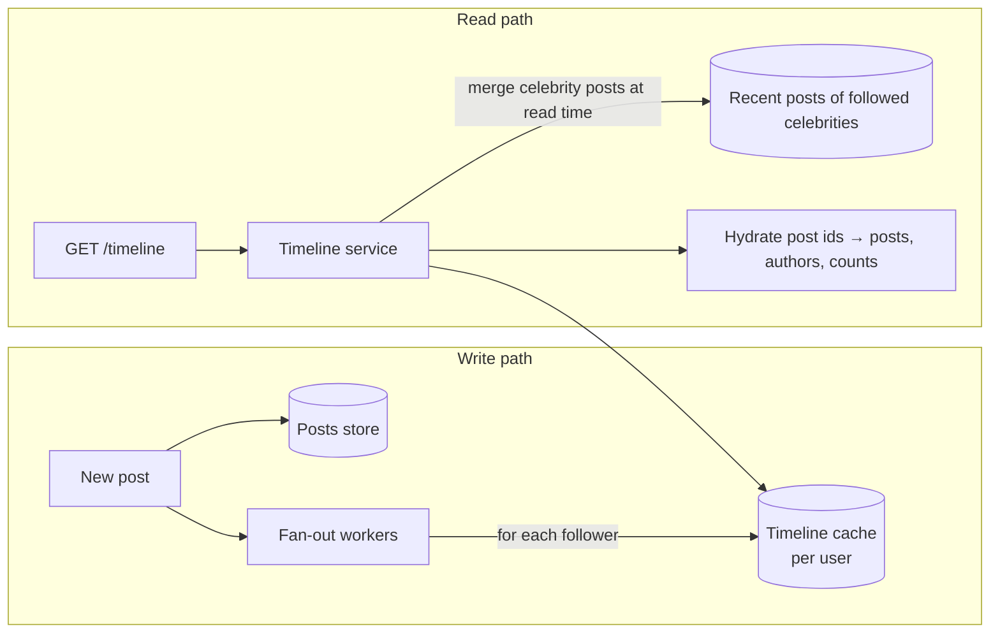
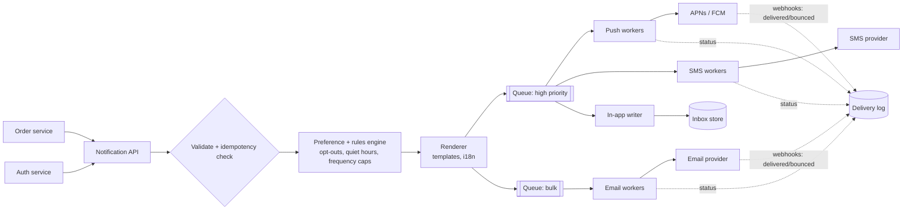
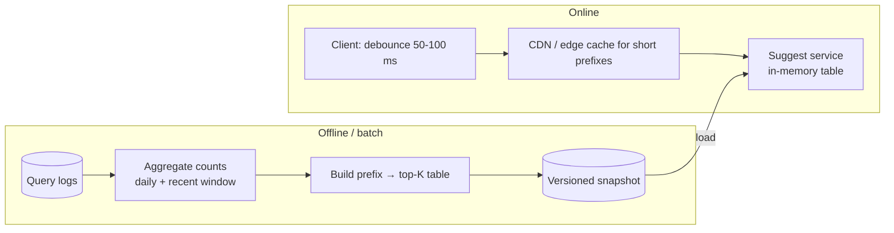
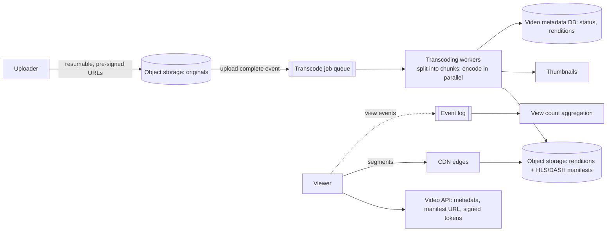

## How to use this lesson

Each case follows the [system design method](/learn/system-design-method/): requirements, estimates (with stated assumptions; the numbers are for reasoning practice, not real company figures), API, data model, architecture, deep dives, failures, security, cost and trade-offs. Try each case yourself for 20 minutes before reading the solution.

---

## 1. Social media home timeline (Twitter-like)

### Requirements

**Functional:** post short messages; follow users; see a home timeline of recent posts from people you follow, newest first; like and reply (counts shown).

**Non-functional:** timeline load p99 < 300 ms; a new post visible to followers within ~5 s (eventual is fine); highly available reads; very read-heavy.

**Out of scope:** search, ads ranking, DMs.

### Estimates (assumptions)

- 200M daily active users; each opens the timeline 10× per day → 2B timeline reads/day ≈ **23k reads/s**, peak ~70k/s.
- 20M posts/day ≈ **230 posts/s**, peak ~1k/s.
- Average 200 followers per user, heavily skewed: some accounts have tens of millions.
- Post size ~1 KB with metadata → 20 GB/day of posts (media stored separately in object storage).

### API

```
POST /v1/posts                 { "text": "...", "media_ids": [] }       → 201
GET  /v1/timeline?cursor=…     → { "posts": [...], "next_cursor": "..." }
POST /v1/users/{id}/follow     → 204
```

### Data model

```
posts(post_id, author_id, text, media, created_at)     -- partitioned by post_id; also an index by (author_id, created_at)
follows(follower_id, followee_id, created_at)          -- two indexes: by follower and by followee
timelines: per user, a list of recent post_ids         -- Redis sorted set or a wide-column table, capped (e.g. 800 entries)
```

Post ids should be roughly time-ordered (Snowflake-style: timestamp + machine id + sequence) so sorting by id ≈ sorting by time.

### The core decision: fan-out on write vs read



| | Fan-out on write (push) | Fan-out on read (pull) |
| --- | --- | --- |
| On post | Insert post id into every follower's timeline | Just store the post |
| On read | Read one precomputed list | Query recent posts from every followee and merge |
| Read latency | Very low | High for users following many accounts |
| Write cost | Proportional to follower count (celebrities explode) | Constant |
| Wasted work | Timelines for inactive users | None |

**Hybrid (what large systems do):** fan out on write for ordinary accounts; for accounts above a follower threshold (celebrities), *don't* fan out; at read time, merge the user's precomputed timeline with recent posts from the celebrities they follow (a small set, cached hot). Skip fan-out to users inactive for 30+ days and rebuild their timeline on demand when they return.

### Deep dives

- **Fan-out pipeline:** the post service writes the post and an outbox event; fan-out workers consume it, page through the follower list, and `ZADD` the post id into each follower's timeline (trimming to N entries). Partition the work by follower range so one celebrity-ish account can be processed in parallel.
- **Hydration:** the timeline holds only ids; the read path batch-fetches post bodies, authors and counts from caches (`MGET`), falling back to stores.
- **Counters:** likes are written to a log and aggregated; displayed counts are approximate and eventually consistent. Shard hot counters.
- **Pagination:** cursor by post id.

### Failures

- Fan-out backlog during spikes: posts appear late but nothing is lost (durable queue, lag alerting, autoscaled workers).
- Timeline cache loss: rebuild from the follow graph and posts store on read (fan-out on read as a fallback), with rate limiting to avoid a stampede.

### Security and privacy

Protected or private accounts: filter at fan-out *and* at read (follow state can change). Blocks and mutes are applied at read time. Rate-limit posting and following to fight spam.

### Cost and trade-offs

Timeline caches in memory are the big cost: cap list length and skip inactive users. The hybrid adds read-path complexity in exchange for bounded write cost. Ranking (non-chronological feeds) adds a candidate-generation and scoring stage on top of the same storage.

---

## 2. Notification system

### Requirements

**Functional:** other services trigger notifications ("order shipped", "new follower", "password changed"); delivered via push (iOS/Android), email, SMS and in-app; user preferences per type and channel; quiet hours; templating and localisation; delivery status tracking.

**Non-functional:** at-least-once internally, no visible duplicates; transactional notifications (security codes) within seconds; bulk campaigns don't delay transactional ones; scale to campaign spikes of tens of millions of messages.

### Estimates (assumptions)

- 50M notifications/day on average ≈ 580/s; a marketing campaign to 20M users within 30 minutes ≈ 11k/s peak.
- Third-party providers impose their own rate limits (email providers, SMS gateways, APNs/FCM throughput guidance).

### Architecture



### API and data

```
POST /v1/notifications
{ "idempotency_key": "order-881-shipped", "user_id": "u_42", "type": "order_shipped",
  "data": { "order_id": "881", "carrier": "BlueDart" }, "priority": "high" }

preferences(user_id, type, channel, enabled)          -- e.g. (u_42, marketing, email, false)
devices(user_id, platform, token, last_seen_at)        -- push tokens; prune invalid ones on provider errors
notifications(id, user_id, type, payload, created_at)  -- in-app inbox, read_at
deliveries(notification_id, channel, status, provider_id, attempts, updated_at)
```

### Deep dives

- **Priority isolation (bulkheads):** separate queues and worker pools per priority and channel, so a 20M-user campaign never delays a 2FA code.
- **Idempotency:** dedupe at ingestion by `idempotency_key`, and at send time by `(notification_id, channel)` in the deliveries table.
- **Provider rate limits and retries:** token-bucket limiters per provider; exponential backoff with jitter on 429/5xx; DLQ after N attempts; failover to a secondary SMS or email provider.
- **Fan-out for campaigns:** a campaign job pages through the audience in segments and enqueues batches, throttled to provider capacity, instead of one giant loop.
- **Feedback loops:** process bounce and complaint webhooks to disable bad addresses (required to keep email sender reputation); delete push tokens the provider reports as invalid.
- **User experience rules:** frequency caps, digests (batch 20 "likes" into one), quiet hours by the user's time zone, collapse keys so newer pushes replace stale ones.

### Failures, security, cost

Provider outages → failover and queue buildup with alerting. Never put secrets (OTP codes excepted, which are short-lived) or sensitive data in push payloads, which display on lock screens. Verify webhook signatures. SMS is by far the most expensive channel per message, so default to push and email, and keep SMS for security and critical messages.

---

## 3. Search autocomplete

### Requirements

**Functional:** as the user types, show the top 5–10 suggested queries for the prefix, ranked by popularity (optionally personalised and localised). **Non-functional:** p99 < 50 ms end to end per keystroke; suggestions may be hours stale; very high request rate.

### Estimates (assumptions)

- 10M DAU × 10 searches × ~6 keystroke requests each = 600M requests/day ≈ **7k/s**, peak ~20k/s.
- Distinct popular queries to index: ~100M, averaging 20 bytes → ~2 GB raw, which fits in memory, sharded and replicated.

### Design



**Data structure options:**

- **Trie** with each node storing the precomputed top-K completions for its prefix: lookup is O(prefix length), no traversal at query time.
- **Prefix hash table**: `prefix → [top K]` for every prefix up to some length (say 20 characters). Simpler to shard (by prefix) and to store in Redis or a key-value store; larger, but memory is cheap compared with latency.

**Ranking:** score = popularity with time decay (recent trends matter), plus optional personalisation (the user's history, merged client-side or by a second lookup) and locale.

### Deep dives

- **Freshness:** rebuild snapshots hourly or daily; for trending terms, a streaming job maintains a small "recent hot prefixes" overlay merged at query time.
- **Latency:** clients debounce keystrokes and cancel stale requests; responses for 1–2 character prefixes are hugely shared and cache well at the CDN; servers keep everything in memory.
- **Sharding:** by first characters (beware skew: far more queries start with "s" than "x") or by hash of the prefix.
- **Filtering:** remove offensive, illegal or personal-data suggestions before publishing a snapshot; keep a fast blocklist that applies at query time.

### Trade-offs

Precomputation trades freshness and storage for very low latency. Fuzzy matching (typo tolerance) and infix matching need different structures (n-gram indexes, edit-distance automata) and usually move you to a search engine.

---

## 4. Video platform (YouTube-like)

### Requirements

**Functional:** upload videos; process them into streamable formats; watch with adaptive quality; thumbnails; view counts; search and recommendations are out of scope here.

**Non-functional:** playback starts fast (low time to first frame) and rebuffers rarely worldwide; uploads are resumable; processing within minutes; extremely high egress bandwidth; durable storage.

### Estimates (assumptions)

- 500k uploads/day, average 8 minutes, ~500 MB original → **250 TB/day** of originals.
- Transcoded renditions (e.g. 240p to 1080p, two codecs) add a multiple of the original; store originals in a cold tier.
- 1B views/day × average 5 minutes × ~3 Mbit/s ≈ 1B × 300 s × 375 KB/s ≈ 1.1 × 10¹⁷ bytes/day ≈ **110 PB/day egress**, which can only be served by a CDN with heavy caching. This number dominates the whole design.

### Architecture



### Deep dives

- **Uploads:** the client gets pre-signed multipart upload URLs and uploads directly to object storage in chunks (resumable, and it bypasses your app servers). Completion triggers processing.
- **Transcoding:** split the video into segments (e.g. by GOP/keyframes), encode segments in parallel across many workers into a bitrate ladder (and codecs such as H.264, plus VP9 or AV1 for efficiency), then stitch manifests. The work is idempotent per segment and rendition, so it can be retried. Use spot or preemptible instances for cost; it's a classic batch workload.
- **Adaptive bitrate streaming:** HLS or DASH serves a master manifest listing renditions; each rendition is a sequence of short segments (2–6 s). The player measures throughput and buffer level and switches renditions per segment.
- **CDN strategy:** popular videos' segments are cached at the edge; long-tail videos are fetched from origin or regional mid-tier caches. Pre-position (push) new videos from popular creators. Very large platforms run their own CDN appliances inside ISPs (Netflix Open Connect, Google Global Cache).
- **View counts:** stream view events into a log; aggregate with deduplication and fraud filtering; update displayed counts periodically.
- **Metadata:** a relational or wide-column store for video records, cached heavily.

### Failures

Transcode worker failures: retry per segment, with job visibility timeouts. A region's object storage outage: replicate renditions across regions for popular content. CDN edge issues: multi-CDN with DNS or client-side failover.

### Security

Signed, expiring URLs or tokens for segments (and DRM for premium content); malware and content moderation scanning before publishing; private and unlisted videos must not be cacheable publicly without tokens; virus scanning of uploads.

### Cost and trade-offs

Egress and storage dominate. More renditions and better codecs improve quality per bit (lower egress) at higher encode cost; encode popular videos with expensive codecs and the long tail with cheap ones. Cold-tier the originals. Shorter segments adapt faster but add request overhead.

---

## Patterns across all four

| Pattern | Feed | Notifications | Autocomplete | Video |
| --- | --- | --- | --- | --- |
| Precompute for reads | Timelines | Rendered templates | Prefix tables | Renditions |
| Async pipelines | Fan-out | Channel workers | Batch builds | Transcoding |
| Caches / CDN | Timeline + post caches | — | Edge-cached prefixes | Segment CDN |
| Skew handling | Celebrities | Campaign spikes | Short prefixes | Viral videos |
| Eventual consistency accepted | Timeline delay | Status updates | Hours-old suggestions | View counts |

## Hands-on exercise

Choose one case and implement a scaled-down version locally:

- **Feed:** Postgres + Redis. Fan-out workers with a celebrity threshold of 1,000 followers; generate 10,000 users with a skewed follower distribution; measure timeline p95 and fan-out lag.
- **Notifications:** build the [notification service project](/projects/notification-service/).
- **Autocomplete:** build a top-K trie from a public query or word-frequency dataset; serve it over HTTP and load-test p99 per keystroke.
- **Video:** upload a file to MinIO, transcode it with `ffmpeg` into a 3-rendition HLS ladder from a queue worker, and play it in a browser with hls.js.

## Completion criteria

- You can explain fan-out on write vs read and justify a hybrid.
- You can design multi-channel notifications with priorities, idempotency and provider limits.
- You can design autocomplete and video pipelines and identify what dominates their cost.
