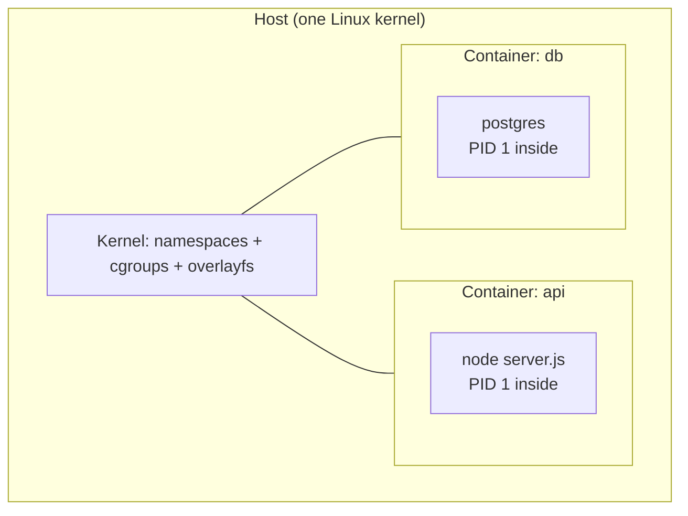

## Why it matters

"It works on my machine" stops being an excuse when the machine is part of the artefact. Containers package your app with its runtime and dependencies into an image that runs the same on a laptop, in CI and in production. They're the unit of deployment for Kubernetes, Cloud Run, ECS, Fly.io and most modern platforms, and Docker Compose is the easiest way to run a realistic multi-service stack locally.

## What a container really is

A container is **an ordinary Linux process** with:

- **Namespaces** limiting what it can *see*: its own PID tree (it thinks it's PID 1), network stack (its own interfaces and ports), mount table (its own root file system), hostname, users and IPC.
- **cgroups** limiting what it can *use*: CPU shares and quotas, memory limits (exceeding them gets you OOM-killed, exit code 137), I/O and PIDs.
- A **root file system** from an image, using a layered (overlay) file system.



| | Container | Virtual machine |
| --- | --- | --- |
| Kernel | Shared with host | Own guest kernel |
| Start time | Typically sub-second to seconds | Typically tens of seconds or more |
| Overhead | Low | Higher (a full OS per VM) |
| Isolation | Process-level (a kernel bug can cross it) | Hardware-virtualised (stronger) |

On macOS and Windows, Docker Desktop runs containers inside a small Linux VM, because containers need a Linux kernel.

## Images, layers and tags

An **image** is a stack of read-only **layers**, each the file-system diff produced by one Dockerfile instruction, plus metadata (entrypoint, environment, exposed ports). A running container adds a thin writable layer on top, which disappears with the container. Persistent data belongs in **volumes**.

- Layers are content-addressed and shared between images, and **cached** during builds.
- **Tags** (`myapi:1.4.2`, `myapi:latest`) are mutable pointers. **Digests** (`myapi@sha256:…`) are immutable. Deploy immutable tags such as the git SHA, or digests.
- Images live in **registries**: Docker Hub, GitHub Container Registry, ECR, GCR/Artifact Registry.

## Writing a good Dockerfile

A production-quality multi-stage build for a Node.js TypeScript API:

```dockerfile
# syntax=docker/dockerfile:1

# ---- deps: install all dependencies (cached unless lockfile changes)
FROM node:22-slim AS deps
WORKDIR /app
COPY package.json package-lock.json ./
RUN --mount=type=cache,target=/root/.npm npm ci

# ---- build: compile TypeScript
FROM deps AS build
COPY tsconfig.json ./
COPY src ./src
RUN npm run build && npm prune --omit=dev

# ---- runtime: only what's needed to run, as a non-root user
FROM node:22-slim AS runtime
ENV NODE_ENV=production
WORKDIR /app
COPY --from=build --chown=node:node /app/node_modules ./node_modules
COPY --from=build --chown=node:node /app/dist ./dist
COPY --chown=node:node package.json ./
USER node
EXPOSE 3000
HEALTHCHECK --interval=10s --timeout=3s --retries=3 CMD node -e "fetch('http://127.0.0.1:3000/health').then(r=>process.exit(r.ok?0:1)).catch(()=>process.exit(1))"
CMD ["node", "dist/server.js"]
```

And for Python with uv:

```dockerfile
FROM python:3.13-slim AS build
COPY --from=ghcr.io/astral-sh/uv:latest /uv /usr/local/bin/uv
WORKDIR /app
COPY pyproject.toml uv.lock ./
RUN uv sync --frozen --no-dev --no-install-project
COPY src ./src
RUN uv sync --frozen --no-dev

FROM python:3.13-slim
WORKDIR /app
COPY --from=build /app /app
ENV PATH="/app/.venv/bin:$PATH"
RUN useradd --uid 10001 app
USER app
CMD ["uvicorn", "src.main:app", "--host", "0.0.0.0", "--port", "8000"]
```

(In real pipelines, pin the uv image to a version rather than `latest`.)

Principles:

1. **Order for caching:** things that change rarely (base image, system packages, dependency manifests and install) first; source code last.
2. **Multi-stage:** build tools and dev dependencies stay in build stages; the runtime image contains only the app. Smaller images pull faster and expose less.
3. **Small, trusted base images:** `-slim`, Alpine (musl libc; occasionally incompatible with native modules), or distroless (no shell at all). Pin versions.
4. **Run as non-root** (`USER`), and keep the file system read-only where possible.
5. **`.dockerignore`** to keep `node_modules`, `.git`, `.env`, build output and tests out of the build context:
   ```
   node_modules
   .git
   .env*
   dist
   coverage
   *.log
   ```
6. **One process per container**, as PID 1, using exec-form `CMD ["node", "…"]` so it receives `SIGTERM` directly and can shut down gracefully. (Shell form `CMD node server.js` wraps it in `/bin/sh`, which may not forward signals.)
7. **No secrets in images:** not in `ENV`, not copied in, not in build args (they persist in layer history). Use BuildKit secret mounts for build-time secrets and runtime injection for app secrets.

```bash
docker build -t myapi:$(git rev-parse --short HEAD) .
docker run --rm -p 3000:3000 --env-file .env myapi:abc1234
docker image ls myapi                      # check the size
docker history myapi:abc1234               # see layers and what created them
```

## Networking

- `-p 8080:3000` publishes container port 3000 on host port 8080. Without publishing, ports are reachable only from other containers on the same network.
- Containers on the same **user-defined bridge network** reach each other **by name** via Docker's embedded DNS (`db:5432`). Compose creates one per project automatically.
- Inside a container, `localhost` means *that container*. To reach the host from a container on Docker Desktop, use `host.docker.internal`.
- Bind your server to `0.0.0.0` inside the container, not `127.0.0.1`, or published ports won't reach it.

## Volumes and data

- **Named volumes** (`pgdata:/var/lib/postgresql/data`) persist data managed by Docker. Use them for databases.
- **Bind mounts** (`./src:/app/src`) mount host directories, great for live-reload development and wrong for production data.
- Containers are disposable; anything written to the container's own layer is lost when it's removed.

## Docker Compose: a full local stack

`compose.yaml` for an API, worker, Postgres, Redis and a one-off migration job:

```yaml
services:
  db:
    image: postgres:17
    environment:
      POSTGRES_USER: app
      POSTGRES_PASSWORD: app
      POSTGRES_DB: app
    volumes:
      - pgdata:/var/lib/postgresql/data
    ports: ["5432:5432"]                     # only for local tools like psql
    healthcheck:
      test: ["CMD-SHELL", "pg_isready -U app -d app"]
      interval: 5s
      timeout: 3s
      retries: 10

  redis:
    image: redis:7-alpine
    command: ["redis-server", "--maxmemory", "128mb", "--maxmemory-policy", "allkeys-lru"]
    healthcheck:
      test: ["CMD", "redis-cli", "ping"]
      interval: 5s

  migrate:
    build: .
    command: ["node", "dist/migrate.js"]
    environment:
      DATABASE_URL: postgres://app:app@db:5432/app
    depends_on:
      db: { condition: service_healthy }
    restart: "no"

  api:
    build: .
    environment:
      DATABASE_URL: postgres://app:app@db:5432/app
      REDIS_URL: redis://redis:6379
      PORT: "3000"
    ports: ["3000:3000"]
    depends_on:
      migrate: { condition: service_completed_successfully }
      redis: { condition: service_healthy }

  worker:
    build: .
    command: ["node", "dist/worker.js"]
    environment:
      DATABASE_URL: postgres://app:app@db:5432/app
      REDIS_URL: redis://redis:6379
    depends_on:
      migrate: { condition: service_completed_successfully }
    deploy:
      replicas: 2

volumes:
  pgdata:
```

```bash
docker compose up --build -d        # build and start everything
docker compose ps                   # status and health
docker compose logs -f api worker   # follow logs
docker compose exec db psql -U app  # shell into the database
docker compose down                 # stop (add -v to delete volumes: destroys data)
```

`depends_on` with `condition: service_healthy` waits for health checks, not just container start, which avoids "connection refused" races at boot. Your app should *still* retry connections on startup, since dependencies can restart at any time.

For development, `compose watch` (or a bind mount plus a file watcher) syncs code changes into running containers.

## Image security

- Scan images in CI (`trivy image myapi:abc1234`, Docker Scout, Grype) and fail on critical vulnerabilities with fixes available.
- Rebuild regularly to pick up base-image patches.
- Sign images (cosign/Sigstore) and verify signatures at deploy time in mature setups.
- Drop Linux capabilities and avoid `--privileged`; never mount the Docker socket into an application container (it's root on the host).

## Common mistakes

- `COPY . .` before installing dependencies (no caching) and no `.dockerignore` (secrets and huge contexts sent to the builder).
- Running as root; huge images full of build tools.
- Using `localhost` between containers.
- Storing data in the container layer instead of a volume.
- Shell-form `CMD` that swallows `SIGTERM`, so every stop waits for the kill timeout.
- Deploying `:latest`.

## Security considerations

- A container is a weaker boundary than a VM: keep the kernel patched, run non-root, use read-only file systems and minimal images, and apply seccomp and AppArmor profiles (defaults are a reasonable start).
- Secrets via runtime injection, never baked into layers.

## Performance considerations

- Smaller images mean faster pulls, faster scaling and faster cold starts.
- BuildKit cache mounts and registry-backed layer caches make CI builds much faster.
- Set CPU and memory limits deliberately and make runtimes aware of them (Node heap size, JVM container support, Go's `GOMAXPROCS`, which Go 1.25+ derives from cgroup CPU limits by default).

## Hands-on exercise

1. Containerise an API you've built with a multi-stage Dockerfile. Record the image size before and after switching from a full base image to slim or distroless.
2. Prove layer caching: change one source file and time the rebuild; change the lockfile and time it again.
3. Write a `compose.yaml` with the API, a worker, Postgres (named volume + health check), Redis and a migration job. One command should bring up a working stack from a fresh clone.
4. Verify graceful shutdown: start a slow request, run `docker compose stop api`, and confirm the request completes and the container exits before the 10-second kill timeout.
5. Scan the image with Trivy and fix at least one finding.

## Completion criteria

- You can explain containers in terms of namespaces and cgroups.
- Your Dockerfiles are multi-stage, cache-friendly, small and non-root, with no secrets inside.
- You can run a multi-service stack locally with Compose, with health-checked startup ordering.
