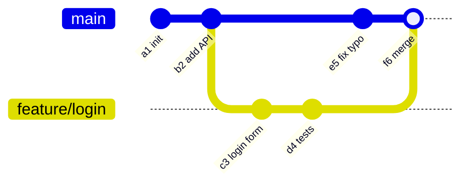

## Why it matters

Git is how teams collaborate on code, how CI knows what to test, how deploys know what to ship, and how you find out *when* and *why* a bug appeared. Most Git pain comes from treating it as a black box. Once you understand its data model, the commands make sense.

## Git's data model in five minutes

Git is a content-addressed database of four kinds of object, each named by a hash of its content:

- **Blob:** a file's contents.
- **Tree:** a directory listing (names → blobs and subtrees).
- **Commit:** a snapshot (one root tree) plus metadata: author, message, and the **parent** commit(s).
- **Tag:** a named pointer to a commit, optionally signed.



Key consequences:

- A commit is a **snapshot**, not a diff. Diffs are computed when you ask for them.
- Commits form a chain through parent pointers, and hashes depend on parents, so changing an old commit changes every hash after it. That is why rewriting shared history is disruptive.
- A **branch** is a pointer to a commit. `main` is a file containing a hash.
- **HEAD** is a pointer to the branch you're on (or directly to a commit, "detached HEAD").

You can look inside:

```bash
git cat-file -p HEAD          # the commit object: tree, parent, author, message
git cat-file -p HEAD^{tree}   # the root directory listing
cat .git/refs/heads/main      # a branch really is just a hash in a file
```

## The three areas

```
working directory ──git add──▶ staging area (index) ──git commit──▶ repository (history)
```

The staging area lets you build a commit deliberately: `git add -p` stages selected hunks, so one commit holds one logical change.

```bash
git status
git diff              # working dir vs staging
git diff --staged     # staging vs last commit
git add -p            # stage interactively, hunk by hunk
git commit -m "feat(tasks): add cursor pagination"
git log --oneline --graph --decorate --all
```

## A team workflow: feature branches and pull requests

The common trunk-based workflow:

1. `main` is always deployable and protected (no direct pushes; CI must pass).
2. For each change: `git switch -c feat/task-filters`.
3. Commit small, logical steps. Push and open a **pull request** early.
4. CI runs tests, lint and type checks. Teammates review.
5. Merge (often squash-merge) to `main`; the pipeline deploys it.
6. Delete the branch.

Keep branches short-lived (hours to a few days). Long-lived branches drift and produce painful merges. Hide unfinished features behind **feature flags** instead of keeping them on branches.

### Writing good commits

A useful commit message says *why*, not just *what*:

```
fix(auth): reject expired refresh tokens before rotation

Rotation previously issued a new token even when the presented one had
expired, effectively extending sessions forever. Check expiry first and
return 401.

Refs: #482
```

The `type(scope): summary` style is [Conventional Commits](https://www.conventionalcommits.org/). Tools can generate changelogs and version bumps from it.

## Merge vs rebase

Both integrate changes from `main` into your branch.

- **Merge** creates a merge commit with two parents. History is truthful but can get noisy.
- **Rebase** replays your commits on top of the latest `main`, creating new commits. History is linear and clean, but the commits are rewritten.

```bash
git switch feat/task-filters
git fetch origin
git rebase origin/main            # replay my commits on top of latest main
# resolve conflicts if any, then:
git add <files> && git rebase --continue
git push --force-with-lease       # safe force: refuses if someone else pushed meanwhile
```

**The golden rule:** don't rebase commits other people have based work on. Rebasing your own unpublished or personal branch is fine.

Interactive rebase tidies a branch before review:

```bash
git rebase -i origin/main   # reorder, squash "fix typo" commits, reword messages
```

## Undoing things

| Situation | Command |
| --- | --- |
| Unstage a file | `git restore --staged file` |
| Discard local changes to a file | `git restore file` (destructive) |
| Fix the last commit's message or add a forgotten file | `git commit --amend` (only if not pushed) |
| Undo a pushed commit safely | `git revert <hash>` (new commit that inverts it) |
| Move a branch back, keeping changes in the working dir | `git reset --soft HEAD~1` |
| Throw away commits and changes | `git reset --hard <hash>` (destructive) |
| Find "lost" commits | `git reflog`, then `git branch rescue <hash>` |
| Find which commit introduced a bug | `git bisect start`, `git bisect bad`, `git bisect good <hash>` |

`git bisect` binary-searches history. With a test script, `git bisect run ./test.sh` finds the guilty commit automatically. It's a real production debugging tool.

## What not to commit

A `.gitignore` for a typical backend:

```gitignore
node_modules/
.venv/
__pycache__/
dist/
build/
.env
.env.*
!.env.example
*.log
coverage/
.DS_Store
```

Commit `.env.example` with placeholder values so others know which variables exist. Commit lockfiles (`package-lock.json`, `pnpm-lock.yaml`, `uv.lock`, `go.sum`) so every machine installs identical dependency versions.

**If a secret is committed:** rotate it first (assume it's compromised the moment it's pushed; bots scan public repos within minutes), then remove it from history with `git filter-repo`, and add secret scanning such as GitHub push protection or `gitleaks` in CI.

## Common mistakes

- Giant commits mixing refactors, features and formatting, which makes review and bisect hard.
- Long-lived feature branches that diverge for weeks.
- Force-pushing shared branches without `--force-with-lease`.
- Committing secrets, `node_modules` or build output.
- Resolving merge conflicts by blindly picking "ours" or "theirs" without running the tests.

## Hands-on exercise

1. Create a repo, make three commits on `main`, then create `feature/a` and make two commits.
2. Make a conflicting change to the same line on `main`. Rebase `feature/a` onto `main` and resolve the conflict.
3. Run `git reset --hard HEAD~2` on `feature/a`, then recover the commits using `git reflog`.
4. Introduce a "bug" (a failing `test.sh`) somewhere in a 10-commit history and find it with `git bisect run ./test.sh`.
5. Commit a fake `.env` with `API_KEY=abc`, then remove it from all history with `git filter-repo` and verify with `git log -p --all | grep API_KEY`.

## Completion criteria

- You can explain branches, HEAD and commits as pointers and snapshots.
- You can rebase a feature branch, resolve conflicts and push safely.
- You can recover lost commits and find a bad commit with bisect.
