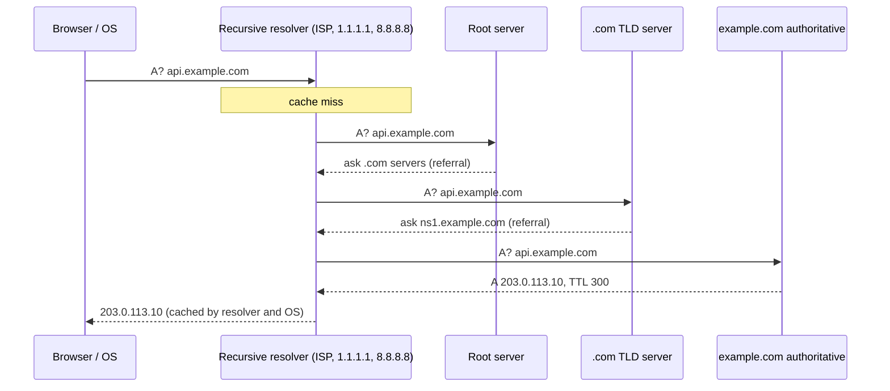
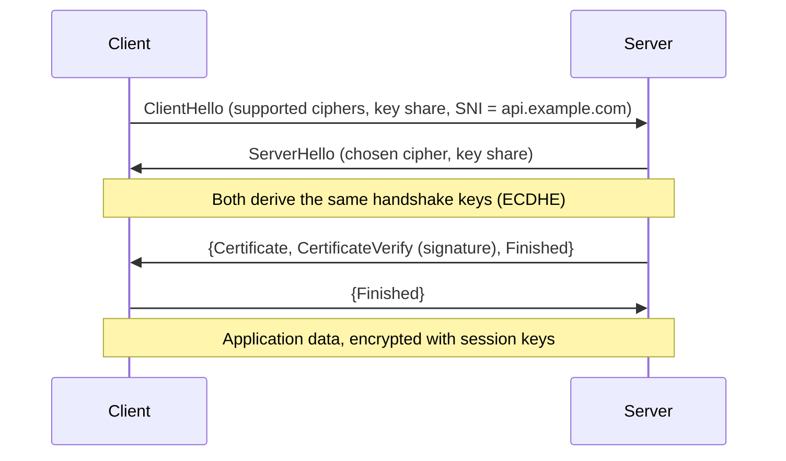

## Why it matters

Your API's latency budget is often dominated by the network, not your code. A user 150 ms away pays that round trip several times before your handler even runs. When a request fails, the cause could be DNS, routing, a firewall, TLS, or your app, and you need to know which layer to look at. This lesson gives you the mental model.

## The layers, briefly

Networking is built in layers, each using the one below:

| Layer | Job | Examples | Addresses |
| --- | --- | --- | --- |
| Application | Meaning of messages | HTTP, DNS, SMTP, gRPC, Postgres protocol | URLs, hostnames |
| Security | Encryption, authentication | TLS | Certificates |
| Transport | Process-to-process delivery | TCP, UDP, QUIC | Ports |
| Network | Host-to-host delivery across networks | IP (v4, v6) | IP addresses |
| Link | One hop on a local network | Ethernet, Wi-Fi | MAC addresses |

When your server sends a response, HTTP data is wrapped in TLS records, chopped into TCP segments, each wrapped in an IP packet, each wrapped in an Ethernet frame. The receiver unwraps in reverse.

## IP addresses, routing and NAT

An **IP address** identifies a network interface. IPv4 addresses are 32 bits (`203.0.113.10`), giving about 4.3 billion addresses, which ran out long ago. IPv6 addresses are 128 bits (`2001:db8::1`).

Some ranges are **private** and not routable on the public internet: `10.0.0.0/8`, `172.16.0.0/12`, `192.168.0.0/16`. Your cloud VPC, your Docker network and your home Wi-Fi use them. **CIDR notation** (`10.0.1.0/24`) means "the first 24 bits are the network", so that block holds 256 addresses.

**Routing:** a packet hops from router to router. Each router looks at the destination IP and forwards it toward the best next hop according to its routing table. Between large networks, routes are exchanged with **BGP**. No single machine knows the full path; each makes a local decision.

**NAT (network address translation):** your laptop has a private IP. Your home router rewrites outgoing packets to use its single public IP and a port it chooses, and remembers the mapping so replies come back to you. Cloud "NAT gateways" do the same for private servers that need to call the internet. NAT is why a server can't simply open a connection *to* a device behind a home router, and why real-time apps need techniques like WebRTC's ICE.

## Ports and sockets

A **port** (0–65535) identifies an application endpoint on a host. Servers **listen** on well-known ports (80 HTTP, 443 HTTPS, 22 SSH, 5432 Postgres, 6379 Redis). Clients use a random **ephemeral port** for each outgoing connection.

A TCP connection is uniquely identified by its **4-tuple**: (client IP, client port, server IP, server port). That's how one server port 443 can hold a million separate connections.

## DNS: names to addresses

Humans use names, packets use IPs. **DNS** is a distributed, hierarchical, heavily cached database that maps between them.



1. The browser checks its own cache, then asks the OS **stub resolver**, which checks `/etc/hosts` and its cache.
2. The stub asks a **recursive resolver** (your ISP's, your company's, or a public one).
3. On a cold cache, the resolver walks the hierarchy: root → TLD → the domain's **authoritative** nameservers. Each referral is cached, so the full walk is rare.
4. The answer comes back with a **TTL**, and every cache along the way keeps it for up to that long.

Record types you'll configure:

| Record | Maps | Example |
| --- | --- | --- |
| `A` / `AAAA` | Name → IPv4 / IPv6 | `api.example.com A 203.0.113.10` |
| `CNAME` | Name → another name | `www CNAME example.netlify.app` |
| `MX` | Domain → mail servers | `example.com MX 10 mail.example.com` |
| `TXT` | Arbitrary text (SPF, DKIM, domain verification) | `"v=spf1 include:_spf.google.com ~all"` |
| `NS` | Domain → its authoritative servers | `example.com NS ns1.provider.net` |
| `CAA` | Which CAs may issue certificates | `0 issue "letsencrypt.org"` |

```bash
dig api.example.com            # full answer with TTL
dig +trace api.example.com     # watch the hierarchy walk
dig @1.1.1.1 api.example.com   # ask a specific resolver
```

**Operational lessons:** lower TTLs (for example to 60 s) a day before a migration; DNS-based failover is only as fast as the TTL; and "it's always DNS" is a joke because DNS really is a common root cause.

## TCP: a reliable byte stream

IP delivers packets best-effort: they can be lost, duplicated or reordered. **TCP** builds a reliable, ordered byte stream on top:

- **Sequence numbers** on every byte, so the receiver can reorder and detect gaps.
- **Acknowledgements**: the receiver tells the sender what it has received.
- **Retransmission** of unacknowledged data after a timeout or duplicate ACKs.
- **Flow control**: the receiver advertises how much buffer it has (the window).
- **Congestion control**: the sender ramps up slowly (**slow start**) and backs off when it detects loss, to share the network fairly.

### The three-way handshake

```
Client                         Server
  │── SYN (seq=x) ───────────────▶│
  │◀──────── SYN-ACK (seq=y, ack=x+1) ──│     one round trip
  │── ACK (ack=y+1) [+ data] ────▶│
```

The client can send data with its final ACK, so a new TCP connection costs **one round trip** before the request goes out. Closing uses FIN/ACK exchanges, and the side that closes first keeps the connection in `TIME_WAIT` for a while (you'll see many of these on busy servers that open and close lots of short connections).

**Why it matters for backends:**

- Opening a connection per request is expensive. Reuse connections with **keep-alive** and **connection pools** (HTTP clients, database drivers).
- **Slow start** means a new connection can't use full bandwidth immediately, another reason to reuse warm connections.
- **Head-of-line blocking:** TCP delivers bytes in order, so one lost packet stalls everything behind it on that connection. HTTP/2 multiplexes many requests over one TCP connection and suffers from this under loss; HTTP/3 over QUIC fixes it.

## UDP: fire and forget

**UDP** sends independent datagrams with no handshake, ordering, retransmission or congestion control. It's used where speed matters more than perfection, or where the application wants to implement its own reliability:

- **DNS** (small query, small answer; just retry on loss)
- Video calls and games (a late packet is useless anyway)
- **QUIC**, the transport under HTTP/3, which implements reliability and congestion control per stream in user space

| | TCP | UDP |
| --- | --- | --- |
| Connection setup | Handshake (1 RTT) | None |
| Delivery | Reliable, ordered | Best-effort, unordered |
| Congestion control | Built in | None (application's job) |
| Use for | HTTP/1.1, HTTP/2, databases, most APIs | DNS, media, games, QUIC |

## TLS: the S in HTTPS

**TLS** gives three guarantees:

1. **Confidentiality:** nobody on the path can read the traffic.
2. **Integrity:** nobody can modify it undetected.
3. **Authentication:** the client knows it's talking to a server holding a certificate for that hostname, signed by a **certificate authority (CA)** the client trusts.

### Certificates

A certificate binds a public key to names (`api.example.com`), signed by a CA. The server sends its certificate plus intermediate certificates; the client builds a chain up to a root CA in its trust store, checks the signatures, the validity dates and that the hostname matches. **Let's Encrypt** issues free certificates automatically using the ACME protocol, which proves you control the domain.

### The TLS 1.3 handshake



The client and server each contribute an ephemeral (EC)Diffie–Hellman key share. From them both derive the same secret without ever sending it. The server signs the handshake with its certificate's private key, proving it owns the certificate. Because the keys are ephemeral, recording traffic today and stealing the server's private key later still can't decrypt it (**forward secrecy**).

TLS 1.3 completes in **one round trip** (TLS 1.2 needed two). Resumed connections can send data in the first flight (**0-RTT**), but that early data can be replayed by an attacker, so it must only be used for idempotent requests.

**SNI** (Server Name Indication) in the ClientHello tells the server which hostname you want, so one IP can host many HTTPS sites. It's why a load balancer can pick the right certificate.

## Putting it together: counting round trips

Try the simulation: step through a first visit, then switch to HTTP/3 or a reused connection.

<div data-viz="request-lifecycle"></div>

With a 100 ms round-trip time, a cold HTTPS request over TCP + TLS 1.3 pays roughly: DNS (if uncached, up to 1+ RTT to the resolver, more on a cold resolver) + 1 RTT TCP + 1 RTT TLS + 1 RTT for the request and response, plus server time. That's 300–400 ms before any server work. A warm, reused connection pays 1 RTT.

That's why:

- **CDNs and edge locations** terminate TLS close to users (short RTT for the handshakes).
- **Connection reuse** (keep-alive, HTTP/2, pooling) matters more than raw bandwidth.
- Chatty APIs that need many sequential calls feel slow on mobile networks. Design endpoints that return what a screen needs in one request.

## Common mistakes

- Opening a new HTTP or database connection per request instead of pooling.
- Raising TTLs for "performance" and then being unable to fail over quickly.
- Disabling certificate verification (`rejectUnauthorized: false`, `verify=False`) to "fix" an error in production, which removes the authentication guarantee entirely.
- Ignoring the difference between latency and bandwidth: a fatter pipe doesn't fix 10 sequential round trips.
- Forgetting to renew certificates. Automate it.

## Security considerations

- Always verify certificates and hostnames. Pin only if you have a rotation plan.
- Use TLS for internal traffic too, or a service mesh that does; flat internal networks are a lateral-movement gift to attackers.
- DNS can be spoofed or hijacked; DNSSEC and registrar locks protect your domain.
- Enable HSTS so browsers never try plain HTTP to your site.

## Performance considerations

- RTT dominates for small API calls. Reduce round trips: fewer sequential calls, connection reuse, edge termination.
- TCP slow start penalises new connections; warm pools fix it.
- Packet loss hurts multiplexed TCP (HTTP/2) badly; QUIC degrades more gracefully.

## Hands-on exercise

1. Run `dig +trace` for a domain you use and identify the root, TLD and authoritative steps. Note each TTL.
2. Run `curl -v -o /dev/null https://example.com` and find the TLS version, the cipher, the certificate's subject and issuer, and the ALPN protocol (h2 or http/1.1).
3. Use `curl -w` timings to measure a cold request:
   ```bash
   curl -s -o /dev/null -w 'dns=%{time_namelookup} tcp=%{time_connect} tls=%{time_appconnect} ttfb=%{time_starttransfer} total=%{time_total}\n' https://example.com
   ```
   Repeat to a server far from you and one near you. Explain the differences in terms of RTTs.
4. Write a TCP echo server and client in Python or Node using raw sockets (`socket` module or `net`). Capture the handshake with `tcpdump -i lo0 port 9000` (macOS) or `-i lo` (Linux) and identify SYN, SYN-ACK and ACK.

## Completion criteria

- You can explain what happens from typing a URL to the first byte of the response, including DNS, TCP and TLS.
- You can count round trips and explain why connection reuse and edge termination matter.
- You can debug "can't connect" problems layer by layer.
