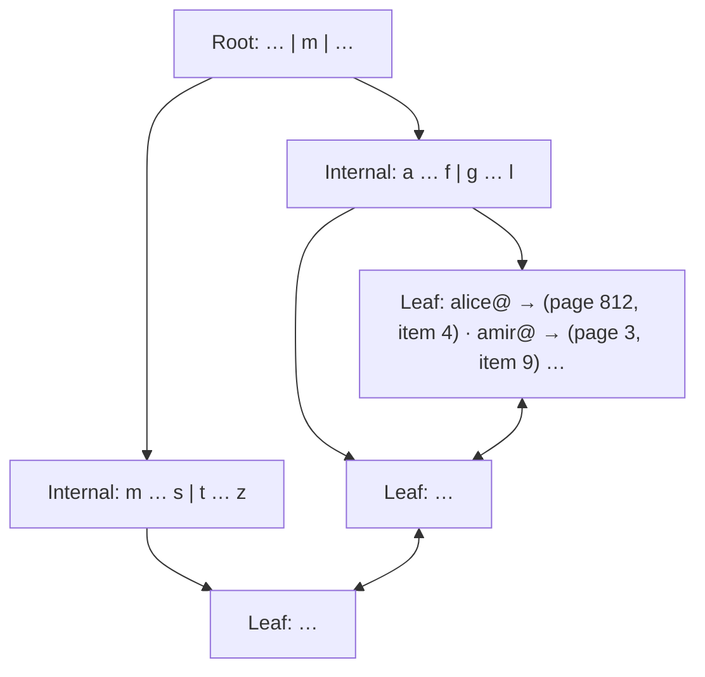

## Why it matters

The single most common cause of a slow backend is a query doing far more work than needed, usually scanning a whole table because the right index doesn't exist or can't be used. Indexing is high-leverage, cheap and reversible. But you have to *measure*: guessing leads to useless indexes that slow every write.

> This lab gives you no performance numbers to memorise. You'll generate data and measure on your own machine. Results vary with hardware, data distribution, cache state and Postgres version, so the habit of measuring matters more than any single number.

## How a B-tree finds a row

Without an index, finding `WHERE email = 'x'` means reading every page of the table: a **sequential scan**, O(n).

A **B-tree** index keeps keys sorted in a balanced tree of pages (8 KB each in Postgres):



- Each internal page holds hundreds of keys, so the tree is very shallow: a few levels cover millions or billions of rows.
- A lookup walks root → internal → leaf: a handful of page reads, O(log n), and the upper levels are almost always cached in memory.
- Leaf pages are linked, so **range scans** and **ORDER BY** read keys in order without sorting.
- Each leaf entry points to the row's location in the table (the **heap**). Fetching rows means extra random reads, which is why returning many rows through an index can lose to a sequential scan.

B-trees support `=`, `<`, `>`, `BETWEEN`, `IN`, `IS NULL`, prefix `LIKE 'abc%'` (with the right collation or operator class) and ordering.

## How the planner decides

For every query, Postgres's planner estimates the cost of alternative plans using **table statistics** (row counts, value distributions, most common values, correlation) gathered by `ANALYZE` (autovacuum runs it automatically). It picks the cheapest estimate. Main scan types:

| Scan | When it's chosen |
| --- | --- |
| **Seq Scan** | No usable index, or the query returns a large fraction of the table |
| **Index Scan** | Selective condition; walks the index and fetches matching heap rows |
| **Index Only Scan** | Every needed column is in the index and pages are all-visible |
| **Bitmap Index Scan + Bitmap Heap Scan** | Medium selectivity, or combining several indexes; collects row locations, then reads heap pages in physical order |

Join strategies: **Nested Loop** (great when the outer side is small and the inner side is indexed), **Hash Join** (large unsorted inputs, equality), **Merge Join** (both inputs sorted on the join key).

## Reading EXPLAIN ANALYZE

```sql
explain (analyze, buffers)
select id, total_minor from orders
where customer_id = 4242
order by created_at desc
limit 20;
```

Without a suitable index you'll see something like this (the numbers here are illustrative placeholders; yours will differ):

```
Limit  (cost=… rows=20) (actual time=… rows=20 loops=1)
  ->  Sort  (cost=… rows=…) (actual time=… rows=20 loops=1)
        Sort Key: created_at DESC
        Sort Method: top-N heapsort
        ->  Seq Scan on orders  (cost=… rows=…) (actual time=… rows=… loops=1)
              Filter: (customer_id = 4242)
              Rows Removed by Filter: …
        Buffers: shared hit=… read=…
```

How to read it:

- Plans are trees. Read from the **innermost, most indented** node outward. Each node's `actual time` is *start..end* in milliseconds, per loop.
- **`Rows Removed by Filter`** in the hundreds of thousands means the database read many rows to keep a few: the classic sign of a missing index.
- **Estimated vs actual rows**: big mismatches mean bad statistics, which mean bad plan choices.
- **`loops`**: a node inside a nested loop runs once per outer row, so multiply its time by loops.
- **`Buffers: shared hit`** are pages found in Postgres's cache; **`read`** came from the OS or disk. Run the query twice to see cold vs warm behaviour.

After `create index on orders (customer_id, created_at desc);` the plan becomes an `Index Scan` with no `Sort` node, reading only the rows it returns.

## Composite indexes: order matters

A composite index on `(a, b, c)` is sorted by `a`, then `b` within each `a`, then `c`. It can serve queries that constrain a **leftmost prefix**:

| Query | Uses (a, b, c)? |
| --- | --- |
| `WHERE a = 1` | ✅ |
| `WHERE a = 1 AND b = 2` | ✅ |
| `WHERE a = 1 AND b = 2 ORDER BY c` | ✅ and no sort needed |
| `WHERE a = 1 AND c = 3` | Partially (uses `a`, filters `c`) |
| `WHERE b = 2` | ❌ (Postgres 18 can sometimes use *skip scan* for this when `a` has few distinct values; don't rely on it) |

**Rule of thumb: equality columns first, then the range or sort column.** For `WHERE tenant_id = $1 AND status = $2 AND created_at > $3 ORDER BY created_at`, the index is `(tenant_id, status, created_at)`.

## Other index shapes

```sql
-- Covering: answer from the index alone (Index Only Scan)
create index on orders (customer_id, created_at desc) include (total_minor, status);

-- Partial: index only the hot subset; tiny and fast
create index on jobs (run_at) where status = 'pending';

-- Expression: index exactly what the query computes
create index on users (lower(email));

-- Unique partial: business rule as an index
create unique index on subscriptions (user_id) where status = 'active';

-- GIN: jsonb containment, arrays, full-text search
create index on products using gin (attributes jsonb_path_ops);
create index on articles using gin (to_tsvector('english', title || ' ' || body));

-- Trigram (pg_trgm extension): fast ILIKE '%term%' search
create extension if not exists pg_trgm;
create index on products using gin (name gin_trgm_ops);

-- BRIN: huge append-only tables ordered by time (very small index)
create index on events using brin (created_at);
```

## What indexes cost

Every index:

- Must be updated on every `INSERT`, on `UPDATE`s of its columns (and, in Postgres, on any update that can't be done as a HOT update), and on `DELETE`.
- Uses disk and memory, competing with table data for cache.
- Adds planning work.

Find unused indexes and drop them:

```sql
select relname as table, indexrelname as index, idx_scan, pg_size_pretty(pg_relation_size(indexrelid)) as size
from pg_stat_user_indexes
order by idx_scan asc, pg_relation_size(indexrelid) desc;
```

Find the queries worth optimising with `pg_stat_statements`, sorted by **total** time (a 2 ms query run a million times matters more than a 2 s query run once):

```sql
create extension if not exists pg_stat_statements;   -- also needs shared_preload_libraries
select calls, round(total_exec_time) as total_ms, round(mean_exec_time, 2) as mean_ms, query
from pg_stat_statements order by total_exec_time desc limit 10;
```

## Common slow-query patterns

| Pattern | Why it's slow | Fix |
| --- | --- | --- |
| Function on an indexed column: `WHERE date(created_at) = …` | Index values don't match the expression | Range condition (`created_at >= d AND created_at < d + 1`) or an expression index |
| Leading wildcard `LIKE '%term%'` | B-tree can't seek | Trigram GIN index or full-text search |
| Implicit cast: comparing a `text` column to a number | Index unusable | Match types |
| `OR` across different columns | One index can't serve both | `UNION ALL` of two indexed queries, or a bitmap OR |
| `OFFSET 100000` | Reads and discards rows | Keyset pagination |
| N+1 queries from an ORM | Thousands of tiny round trips | Join or batch `WHERE id = ANY($1)` |
| Low-selectivity filter (`WHERE active = true` when 95% are active) | Index barely helps | Partial index on the rare value, or no index |

## The lab

### 1. Generate realistic data

```sql
create table customers (id bigint primary key, email text not null, country char(2) not null);
create table orders (
  id bigint generated always as identity primary key,
  customer_id bigint not null,
  status text not null,
  total_minor bigint not null,
  created_at timestamptz not null
);

insert into customers
select g, 'user' || g || '@example.com', (array['IN','US','DE','BR','JP'])[1 + (g % 5)]
from generate_series(1, 200000) g;

insert into orders (customer_id, status, total_minor, created_at)
select 1 + (random() * 199999)::int,
       (array['pending','paid','paid','paid','shipped','cancelled'])[1 + (random() * 5)::int],
       (random() * 100000)::int,
       now() - random() * interval '730 days'
from generate_series(1, 5000000);

analyze;
```

### 2. Measure the baseline

For each query below, run `explain (analyze, buffers)` three times and record the median execution time and the plan's top node:

```sql
-- Q1: a customer's recent orders
select * from orders where customer_id = 4242 order by created_at desc limit 20;
-- Q2: pending orders in the last day
select count(*) from orders where status = 'pending' and created_at > now() - interval '1 day';
-- Q3: case-insensitive email lookup
select * from customers where lower(email) = 'user4242@example.com';
-- Q4: deep offset pagination
select * from orders order by created_at desc offset 1000000 limit 20;
```

### 3. Add one index at a time

After each, re-measure only the queries it should affect, and also time a batch of 10,000 inserts to see the write cost:

```sql
create index orders_customer_created on orders (customer_id, created_at desc);
create index orders_pending_created on orders (created_at) where status = 'pending';
create index customers_lower_email on customers (lower(email));
-- and rewrite Q4 as keyset pagination using the last created_at and id you saw
```

### 4. Record your results

Fill in a table like this with **your** measurements:

| Query | Before (plan, time) | Index | After (plan, time) | Insert-batch time change |
| --- | --- | --- | --- | --- |
| Q1 | | | | |
| Q2 | | | | |
| Q3 | | | | |
| Q4 | | keyset rewrite | | — |

Then experiment: drop `orders_customer_created` and create `(created_at, customer_id)` instead. Why does Q1 get worse?

## Common mistakes

- Indexing every column individually instead of designing composite indexes for real queries.
- Optimising with `EXPLAIN` (estimates) instead of `EXPLAIN ANALYZE` (actual), or measuring only once on a cold cache.
- Testing on a tiny local table where every plan is a seq scan.
- `CREATE INDEX` without `CONCURRENTLY` on a busy production table, which blocks writes for the duration.
- Never dropping unused indexes.

## Security considerations

- Expose sorting and filtering only on allowlisted, indexed columns. Arbitrary sort or filter fields are both an injection risk and a denial-of-service vector (unindexed full scans on demand).
- Set `statement_timeout` for the application role so a pathological query can't hold resources forever.

## Hands-on exercise

Complete the lab above and write up your results table with a paragraph per query explaining *why* the plan changed. Then pick one slow endpoint from a project you've built, find its query in `pg_stat_statements`, and fix it with evidence from before-and-after plans.

## Completion criteria

- You can read an `EXPLAIN ANALYZE` plan and point at the expensive node.
- You design composite, partial, covering and expression indexes deliberately.
- You never claim a performance improvement you haven't measured.
