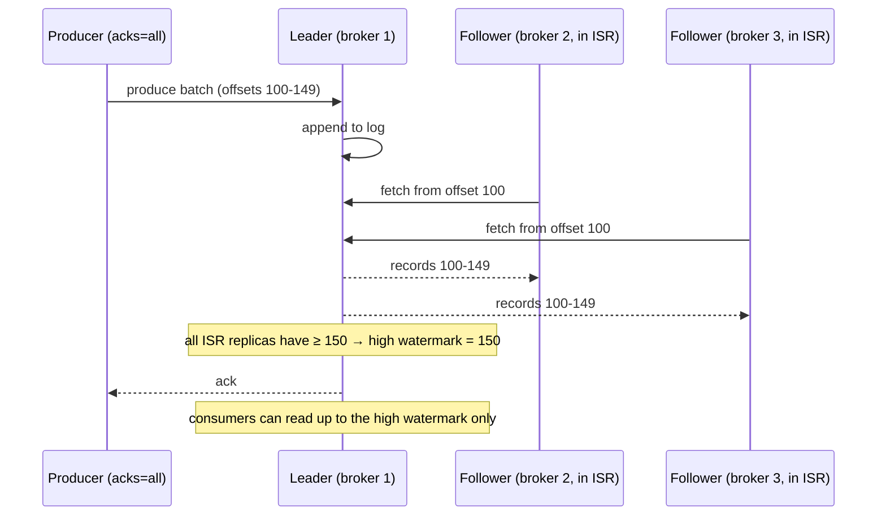

## Why it matters

Kafka (and compatible systems such as Redpanda, plus cloud equivalents like Kinesis, Event Hubs and Pub/Sub) is the backbone of event-driven architectures, CDC pipelines and real-time analytics. Using it well requires understanding what it actually guarantees. Most Kafka incidents come from misunderstood durability settings, rebalance storms, consumer lag, or "exactly-once" assumptions. Stream processing then turns those event streams into continuously updated results, and has its own hard problems with time and state.

## Storage: a partition is a log of segment files

Each **partition** is an ordered, append-only sequence of records, each with an **offset**. On disk, it's a directory of **segment** files:

```
orders-3/
  00000000000000000000.log        # records (batched, possibly compressed)
  00000000000000000000.index      # sparse offset → byte position index
  00000000000000000000.timeindex  # timestamp → offset index
  00000000000004718592.log        # next segment, named by its first offset
  ...
```

- Producers append to the **active segment**. When it reaches a size or age limit, it's closed and a new one starts.
- Retention deletes whole old segments (cheap), or **compaction** rewrites them keeping the latest record per key.
- A consumer fetch for offset N uses the sparse index to find the position, then reads sequentially.

### Why it's fast

- **Sequential writes and reads**, which disks and SSDs handle efficiently.
- The **OS page cache** serves most reads of recent data from memory. Kafka doesn't maintain its own cache.
- **Zero-copy** (`sendfile`): data goes from page cache to socket without being copied through the JVM heap (when TLS isn't used; TLS requires encryption in user space).
- **Batching and compression** end to end: producers batch records per partition (`linger.ms`, `batch.size`), compress the batch (lz4, zstd), and the broker stores and serves it as-is.
- Brokers keep no per-message delivery state: consumers track their own offsets.

## Replication: leaders, followers, ISR and the high watermark

Each partition has a **leader** (handles all produce and, by default, consume requests) and followers that fetch from it. Replicas that are caught up within `replica.lag.time.max.ms` form the **in-sync replica set (ISR)**.



- The **high watermark** is the highest offset replicated to all ISR members. Consumers only see records below it, so they never read data that could be lost on leader failover.
- If the leader fails, the controller elects a new leader **from the ISR**, so it has every acknowledged record.
- **`unclean.leader.election.enable=false`** (the default) refuses to elect an out-of-sync replica, choosing unavailability over data loss.

### Durability settings

| Setting | Effect |
| --- | --- |
| `acks=0` | Fire and forget: fastest, may lose data |
| `acks=1` | Leader wrote it: lost if the leader dies before followers copy it |
| `acks=all` | All current ISR members have it |
| `min.insync.replicas=2` (with RF 3) | Writes with `acks=all` fail if fewer than 2 replicas are in sync, so an acknowledged write always lives on ≥ 2 brokers |

The common durable configuration is **replication factor 3, `min.insync.replicas=2`, `acks=all`**, tolerating one broker loss without losing acknowledged data or availability. Note that Kafka acknowledges after replicas have the data in memory or page cache, not necessarily fsynced; durability comes from replication across brokers (and racks or zones), not from per-write fsync.

**Metadata** (topics, partitions, leaders, ISRs) lives in a Raft-based controller quorum (**KRaft**), which replaced ZooKeeper; ZooKeeper mode is removed in Kafka 4.0.

## Producers: ordering, idempotence and transactions

- **Partitioning:** records with the same key go to the same partition (by murmur2 hash of the key by default), preserving per-key order. No key means records are spread across partitions (sticky batching).
- **Retries could reorder or duplicate** records. **Idempotent producers** (`enable.idempotence=true`, the default in recent clients) attach a producer ID and per-partition sequence numbers, so the broker discards duplicates from retries and preserves order.
- **Transactions** let a producer write to multiple partitions **and commit consumer offsets** atomically: either all of the outputs and the offset commit become visible, or none do. Consumers using `isolation.level=read_committed` see only committed transactional data.

That combination gives **exactly-once processing for read-process-write pipelines inside Kafka**: consume from topic A, transform, produce to topic B, commit offsets, all atomically. It does not make external side effects (database writes, emails, HTTP calls) exactly-once. Those need idempotency, or a sink that participates (some Kafka Connect sinks write offsets together with the data).

## Consumers and consumer groups

- Consumers in a **group** split the topic's partitions; each partition is assigned to exactly one group member. Different groups consume independently.
- Consumers **commit offsets** to the internal `__consumer_offsets` topic. Commit after processing for at-least-once; before processing for at-most-once.
- **Rebalancing** reassigns partitions when members join, leave or are considered dead (missed heartbeats, or exceeding `max.poll.interval.ms` between polls).
  - Eager rebalancing stops *all* consumers ("stop the world").
  - **Cooperative incremental** rebalancing moves only the partitions that need to move.
  - **Static membership** (`group.instance.id`) avoids rebalances on quick restarts.
  - Kafka 4.0 made the new consumer group protocol (KIP-848), with server-side incremental assignment, generally available.
- **Consumer lag** (log end offset minus committed offset per partition) is the key health metric: alert when it grows.

Try parallelism and lag in the simulation:

<div data-viz="kafka-partitions"></div>

### Choosing partition counts

- Max consumer parallelism per group = number of partitions.
- More partitions mean more throughput headroom, but also more open files, more metadata, longer leader elections on failure, and more end-to-end latency at very high counts.
- Adding partitions later changes `hash(key) % partitions`, breaking per-key ordering for existing keys going forward. Plan for peak consumer parallelism up front.

## Kafka Connect and schemas

- **Kafka Connect** runs source connectors (Debezium CDC from Postgres or MySQL, JDBC, S3) and sink connectors (Elasticsearch, S3, warehouses) without custom code.
- A **schema registry** with Avro, Protobuf or JSON Schema enforces compatible evolution (backward or forward compatibility rules) so producers can't break consumers.

## Stream processing

Batch processing answers questions about a bounded dataset ("yesterday's revenue"). **Stream processing** maintains answers continuously over unbounded data ("revenue in the last 5 minutes, updated every second", "flag this card if it's used in two countries within an hour").

### Time: event time vs processing time

- **Event time:** when the event actually happened (a timestamp in the event).
- **Processing time:** when your processor sees it.

They diverge: phones go offline and upload hours later; networks delay; replays reprocess old data. Correct results need **event time**.

### Windows

| Window | Shape | Example |
| --- | --- | --- |
| **Tumbling** | Fixed, non-overlapping | Orders per minute |
| **Hopping / sliding** | Fixed size, overlapping (advance smaller than size) | 5-minute average updated every minute |
| **Session** | Activity separated by gaps of inactivity | A user's browsing session (30 min gap) |

### Watermarks and lateness

A **watermark** is the processor's assertion that "no more events with event time earlier than T are expected". When the watermark passes the end of a window, the window can emit its result. Events arriving after that are **late**: drop them, send them to a side output, or update the result if within an **allowed lateness**. The watermark strategy (for example "max event time seen minus 30 seconds") trades latency (waiting longer) against completeness.

### State and exactly-once

Aggregations, joins and pattern detection need **state** (counts per key, the last-seen location per card). Stream processors keep state locally (often in RocksDB, an LSM engine; see [storage engines](/learn/storage-engines/)), partitioned by key alongside the input partitions, and make it fault-tolerant:

- **Kafka Streams:** state stores backed by compacted **changelog topics** in Kafka; restore by replaying the changelog. Exactly-once via Kafka transactions.
- **Apache Flink:** periodic **distributed snapshots** (checkpoints, based on the Chandy–Lamport algorithm via barriers flowing through the dataflow) of all operator state plus source offsets. On failure, restore the last checkpoint and rewind the sources. Exactly-once results inside Flink; end-to-end exactly-once with transactional or idempotent sinks.

### A Flink SQL example

```sql
-- Revenue per product category per 1-minute tumbling window, by event time
CREATE TABLE orders (
  order_id STRING,
  category STRING,
  amount   DECIMAL(12, 2),
  ts       TIMESTAMP(3),
  WATERMARK FOR ts AS ts - INTERVAL '30' SECOND        -- tolerate 30 s of out-of-orderness
) WITH (
  'connector' = 'kafka',
  'topic' = 'orders',
  'properties.bootstrap.servers' = 'kafka:9092',
  'format' = 'json',
  'scan.startup.mode' = 'earliest-offset'
);

SELECT window_start, window_end, category, SUM(amount) AS revenue, COUNT(*) AS orders
FROM TABLE(TUMBLE(TABLE orders, DESCRIPTOR(ts), INTERVAL '1' MINUTE))
GROUP BY window_start, window_end, category;
```

### Kafka Streams vs Flink vs a plain consumer

| | Plain consumer | Kafka Streams | Apache Flink |
| --- | --- | --- | --- |
| Deployment | Your service | A library inside your JVM service | A separate cluster (or managed service) |
| State | You manage (DB, Redis) | Local stores + changelog topics | Managed state with checkpoints |
| Sources and sinks | Anything you code | Kafka in, Kafka out | Many (Kafka, files, databases, CDC) |
| Event time, windows, watermarks | You build them | Built in | Built in, very rich |
| Best for | Simple per-event handling | Kafka-centric stateful apps | Complex, large-scale, multi-source streaming and analytics |

Start with plain consumers for per-event work (send an email per order). Reach for Kafka Streams or Flink when you need windows, joins or large fault-tolerant state.

## Real-world use cases

- **CDC pipelines:** Debezium streams Postgres changes into Kafka; consumers update search indexes, caches and warehouses.
- **Fraud detection:** Flink keyed by card ID, with state and session windows, emitting alerts in seconds.
- **Real-time analytics:** clickstreams into Kafka, aggregated by Flink into ClickHouse or Druid dashboards.
- **Event-driven microservices:** order events consumed by billing, shipping and notifications independently.

## Common mistakes

- `acks=1` or `min.insync.replicas=1` for data you can't lose.
- Too few partitions for future parallelism, or thousands of partitions "just in case".
- Slow processing inside the poll loop, causing rebalance storms.
- Assuming exactly-once covers external side effects.
- Windowing by processing time and getting wrong results under delays and replays.
- No schema management, then a producer change breaks every consumer.

## Security considerations

- Enable TLS and authentication (SASL/SCRAM, mTLS or OAuth) and ACLs per topic; otherwise anyone on the network can read or write any topic.
- Events often contain personal data and are retained for days or forever (compacted topics): minimise, encrypt sensitive fields, and plan for deletion requirements.

## Performance considerations

- Throughput levers: batching (`linger.ms`, `batch.size`), compression (zstd, lz4), more partitions, and enough consumers.
- Latency levers: smaller batches, fewer hops, avoiding `acks=all` only when durability allows (rarely).
- Monitor under-replicated partitions, ISR shrink and expand rates, request latency, consumer lag and rebalance frequency.

## Hands-on exercise

1. Run a 3-broker Kafka cluster (KRaft mode) or Redpanda with Docker Compose. Create a topic with 6 partitions and RF 3, `min.insync.replicas=2`.
2. Produce keyed messages with `acks=all`; stop one broker and confirm production continues; stop a second and confirm writes with `acks=all` are rejected (`NotEnoughReplicas`).
3. Run a consumer group, scale it from 1 to 6 to 8 members, and watch assignments, rebalances and lag (`kafka-consumer-groups.sh --describe`).
4. Make a consumer slower than `max.poll.interval.ms` and observe the rebalance and duplicate processing; fix it.
5. Write a stream job (Kafka Streams, Flink SQL, or Faust/Bytewax in Python) computing orders per category per minute by event time, then send late events and observe watermark behaviour.

## Completion criteria

- You can configure Kafka for durability and explain exactly what an acknowledgement guarantees.
- You can explain rebalancing and size partitions for a workload.
- You understand event time, windows, watermarks and state, and can choose between a consumer, Kafka Streams and Flink.
