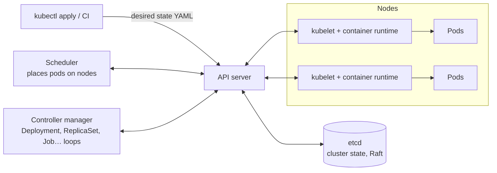

## Why it matters

Kubernetes has become the standard platform for running containers at scale: deployments, scaling, self-healing, service discovery and configuration across a fleet of machines. Even if you never administer a cluster, as a backend engineer you'll write manifests, debug pods, set probes and resources, and reason about rollouts. And you should know when it's overkill.

## The core idea: declare desired state, let controllers reconcile

You don't tell Kubernetes *what to do*; you tell it *what you want* ("3 replicas of image X, reachable on port 80"). **Controllers** watch the actual state and continuously act to make it match. Kill a pod and a new one appears; a node dies and its pods are rescheduled elsewhere.



- **Control plane:** API server (the only thing that talks to etcd), etcd (state, via Raft consensus; see [consensus and time](/learn/consensus-and-time/)), scheduler, controller manager. Managed services (EKS, GKE, AKS) run this for you.
- **Nodes:** kubelet (runs pods), a container runtime (containerd), and kube-proxy or an eBPF-based network plugin for service routing.

## The objects you'll use daily

| Object | Purpose |
| --- | --- |
| **Pod** | One or more containers sharing a network namespace and volumes; the unit of scheduling. Ephemeral. |
| **Deployment** | Manages ReplicaSets for stateless apps: desired replicas, rolling updates, rollback |
| **Service** | Stable virtual IP and DNS name load-balancing to matching pods |
| **Ingress / Gateway** | HTTP(S) routing from outside the cluster to Services (hosts, paths, TLS) |
| **ConfigMap / Secret** | Configuration and sensitive values injected as env vars or files |
| **HorizontalPodAutoscaler** | Scales replicas from metrics |
| **Job / CronJob** | Run-to-completion and scheduled work |
| **StatefulSet** | Stable identities and per-pod storage (databases, Kafka); harder to run well |
| **Namespace** | A scope for names, quotas and access control |

## A complete web service

```yaml
# deployment.yaml
apiVersion: apps/v1
kind: Deployment
metadata:
  name: api
  labels: { app: api }
spec:
  replicas: 3
  selector:
    matchLabels: { app: api }
  strategy:
    type: RollingUpdate
    rollingUpdate: { maxSurge: 1, maxUnavailable: 0 }   # never drop below desired capacity during deploys
  template:
    metadata:
      labels: { app: api }
    spec:
      securityContext: { runAsNonRoot: true }
      terminationGracePeriodSeconds: 30
      containers:
        - name: api
          image: ghcr.io/acme/api:3f9c1a2          # immutable tag (git SHA)
          ports: [{ containerPort: 3000 }]
          envFrom:
            - configMapRef: { name: api-config }
          env:
            - name: DATABASE_URL
              valueFrom: { secretKeyRef: { name: api-secrets, key: database-url } }
          resources:
            requests: { cpu: 250m, memory: 256Mi }   # what the scheduler reserves
            limits: { memory: 512Mi }                # exceeding memory → OOMKilled
          startupProbe:                              # gives slow starters time before liveness kicks in
            httpGet: { path: /healthz, port: 3000 }
            failureThreshold: 30
            periodSeconds: 2
          livenessProbe:                             # "am I stuck?" → restart
            httpGet: { path: /healthz, port: 3000 }
            periodSeconds: 10
            failureThreshold: 3
          readinessProbe:                            # "can I take traffic?" → add/remove from Service
            httpGet: { path: /readyz, port: 3000 }
            periodSeconds: 5
          lifecycle:
            preStop: { exec: { command: ["sleep", "5"] } }   # let endpoints update before SIGTERM
          securityContext:
            allowPrivilegeEscalation: false
            readOnlyRootFilesystem: true
---
apiVersion: v1
kind: Service
metadata: { name: api }
spec:
  selector: { app: api }
  ports: [{ port: 80, targetPort: 3000 }]
---
apiVersion: v1
kind: ConfigMap
metadata: { name: api-config }
data:
  LOG_LEVEL: info
  PORT: "3000"
---
apiVersion: networking.k8s.io/v1
kind: Ingress
metadata:
  name: api
  annotations: { cert-manager.io/cluster-issuer: letsencrypt }
spec:
  ingressClassName: nginx
  tls: [{ hosts: [api.example.com], secretName: api-tls }]
  rules:
    - host: api.example.com
      http:
        paths:
          - path: /
            pathType: Prefix
            backend: { service: { name: api, port: { number: 80 } } }
```

Inside the cluster, other pods reach the service at `http://api` (same namespace) or `http://api.<namespace>.svc.cluster.local`. The newer **Gateway API** is the successor to Ingress, with richer routing and role separation.

## Probes, done right

| Probe | Question | On failure | Should check |
| --- | --- | --- | --- |
| **Startup** | Has the app finished starting? | Keep waiting (then restart) | The app's own init |
| **Liveness** | Is the process hopelessly stuck? | **Restart the container** | Only the process itself (event loop responsive), *not* dependencies |
| **Readiness** | Should this pod receive traffic right now? | Remove from Service endpoints | Can serve: warmed up, not draining, critical local resources OK |

The classic outage: a liveness probe that checks the database, so a database blip restarts every pod simultaneously. Keep liveness trivial. Be careful even with readiness dependency checks: if every pod depends on the same database, they all go unready together and the Service has no endpoints, so you return errors either way, but with extra churn.

### Graceful shutdown in Kubernetes

On pod termination: the pod is marked terminating and removed from Service endpoints (asynchronously, across all nodes), the `preStop` hook runs, then `SIGTERM` is sent; after `terminationGracePeriodSeconds`, `SIGKILL`. Your app should stop accepting new connections on `SIGTERM`, finish in-flight requests, and exit. The short `preStop` sleep covers the window where some nodes still route new traffic to the pod.

## Resources: requests and limits

- **Requests:** what the scheduler reserves for the pod. They determine placement and the CPU share under contention.
- **Limits:** the cap. CPU over the limit is **throttled** (which can cause latency spikes); memory over the limit is **OOM-killed**.
- Common practice: set memory request equal to limit (predictable), set CPU requests based on measured usage, and be cautious with CPU limits for latency-sensitive services (throttling hurts tail latency).
- Make runtimes container-aware: Node's heap size (`--max-old-space-size` below the memory limit), JVM `-XX:MaxRAMPercentage`.
- **ResourceQuotas** and **LimitRanges** per namespace stop one team from consuming the cluster.

## Autoscaling

```yaml
apiVersion: autoscaling/v2
kind: HorizontalPodAutoscaler
metadata: { name: api }
spec:
  scaleTargetRef: { apiVersion: apps/v1, kind: Deployment, name: api }
  minReplicas: 3
  maxReplicas: 30
  metrics:
    - type: Resource
      resource: { name: cpu, target: { type: Utilization, averageUtilization: 65 } }   # % of CPU *request*
  behavior:
    scaleDown: { stabilizationWindowSeconds: 300 }    # avoid flapping
```

- The HPA scales on CPU or memory relative to **requests**, or on custom and external metrics (requests per second, queue depth) via an adapter. **KEDA** makes event-driven scaling easy (scale workers on Kafka lag or SQS depth, including to zero).
- The **Cluster Autoscaler** or Karpenter adds nodes when pods can't be scheduled.
- Scaling takes time (pull image, start, warm up, pass readiness), so keep headroom (`minReplicas`, a lower target utilisation) for spikes.
- **PodDisruptionBudgets** keep a minimum number of pods running during voluntary disruptions such as node upgrades.

## Rollouts and rollbacks

```bash
kubectl apply -f k8s/                                   # declare the new state
kubectl rollout status deploy/api                       # watch the rolling update
kubectl rollout history deploy/api
kubectl rollout undo deploy/api                         # back to the previous ReplicaSet
kubectl set image deploy/api api=ghcr.io/acme/api:9e1b7c0
```

A rolling update creates new pods (up to `maxSurge`), waits for readiness, then removes old ones (respecting `maxUnavailable`). Readiness probes are what make it safe: an image that never becomes ready stalls the rollout instead of taking the service down. Canary and blue-green rollouts need extra tooling (Argo Rollouts, Flagger, or a service mesh), covered in [CI/CD and infrastructure as code](/learn/cicd-and-iac/).

## Jobs and CronJobs

```yaml
apiVersion: batch/v1
kind: CronJob
metadata: { name: nightly-report }
spec:
  schedule: "0 2 * * *"
  concurrencyPolicy: Forbid             # don't start a new run if the last is still going
  jobTemplate:
    spec:
      backoffLimit: 3
      activeDeadlineSeconds: 3600
      template:
        spec:
          restartPolicy: OnFailure
          containers:
            - name: report
              image: ghcr.io/acme/api:3f9c1a2
              command: ["node", "dist/jobs/nightly-report.js"]
```

Database migrations are often run as a Job (or an init step in the deploy pipeline) before the new Deployment rolls out, and must be backward-compatible with the old version ([expand/contract](/learn/sql-fundamentals/)).

## Debugging toolkit

```bash
kubectl get pods -o wide                        # status, restarts, node
kubectl describe pod api-7d9f-x2x4k             # events: scheduling, image pulls, probe failures, OOMKilled
kubectl logs api-7d9f-x2x4k --previous          # logs from the crashed container
kubectl logs -l app=api -f --max-log-requests 10
kubectl exec -it api-7d9f-x2x4k -- sh           # (if the image has a shell)
kubectl debug -it api-7d9f-x2x4k --image=busybox --target=api   # ephemeral debug container for distroless images
kubectl port-forward svc/api 8080:80            # reach a service from your laptop
kubectl top pods                                # CPU / memory (needs metrics-server)
kubectl get events --sort-by=.lastTimestamp
```

| Status | Usually |
| --- | --- |
| `Pending` | Not enough resources to schedule; unbound volume; node selectors don't match |
| `ImagePullBackOff` | Wrong image name or tag, or registry credentials missing |
| `CrashLoopBackOff` | The app exits on start: missing config, can't reach a dependency, bad command |
| `OOMKilled` | Memory limit exceeded |
| Running but not Ready | Readiness probe failing |

## Packaging: Helm and Kustomize

Raw YAML gets repetitive across environments. **Kustomize** (built into kubectl) layers environment-specific patches over a base; **Helm** templates manifests into versioned charts with values files. Many teams combine either with **GitOps** (Argo CD or Flux): the cluster continuously syncs to manifests in a Git repository, so Git is the source of truth and every change is a reviewed commit.

## When Kubernetes is worth it, and when it isn't

**Worth it:** many services and teams that benefit from one standard platform; steady workloads where bin-packing saves money; portability needs; a platform team (or a fully managed offering such as GKE Autopilot) to own it.

**Probably not:** one or a few services, a small team, spiky traffic, no platform expertise. Managed containers (Cloud Run, ECS on Fargate, Fly.io, Render) give you most of the benefits with a fraction of the operational load. See [technology decision guides](/learn/technology-decision-guides/#kubernetes-vs-serverless).

## Common mistakes

- Liveness probes that check dependencies.
- No resource requests (bad scheduling, noisy neighbours) or memory limits below real usage (OOM loops).
- `:latest` image tags (no reproducibility, no reliable rollback).
- Ignoring `SIGTERM` (dropped requests on every deploy).
- Running stateful databases on Kubernetes without the expertise; managed databases are usually the better choice.
- Secrets committed to Git as plain YAML.

## Security considerations

- RBAC with least privilege; separate namespaces per team or environment.
- Pod security: non-root, no privilege escalation, read-only root file system, the Pod Security Admission "restricted" profile.
- NetworkPolicies to restrict pod-to-pod traffic (default deny, then allow).
- Secrets: enable encryption at rest, or use an external secrets operator backed by a cloud secrets manager; never commit plain Secret manifests.
- Scan images and keep the cluster version supported and patched.

## Performance considerations

- CPU throttling from tight limits shows up as tail latency; check throttling metrics.
- Spread replicas across nodes and zones (topology spread constraints, anti-affinity) for resilience.
- Image size and startup time determine how fast you can scale.

## Hands-on exercise

1. Create a local cluster with `kind create cluster` (or minikube). Install an ingress controller and metrics-server.
2. Deploy your containerised API with the manifests above (adapted), plus Postgres via a managed-style Helm chart for local use only.
3. Kill pods and watch them come back. Break the image tag and observe `ImagePullBackOff`. Make readiness fail and watch the pod leave the Service endpoints (`kubectl get endpointslices`).
4. Deploy a new version while running a constant `hey` or k6 load and confirm zero failed requests (requires correct readiness, `maxUnavailable: 0` and graceful shutdown). Then `rollout undo`.
5. Add an HPA, generate CPU load, and watch it scale out and back in.
6. Run your database migration as a Job and a nightly CronJob.

## Completion criteria

- You can explain the reconciliation model and the main control-plane components.
- You can write and debug Deployment, Service, Ingress, ConfigMap, Secret, HPA and CronJob manifests.
- Your services roll out with zero dropped requests and correctly configured probes and resources.
