## Why it matters

Monitoring tells you *that* something is wrong. Observability lets you ask *why* without shipping new code. In a system of several services, queues and databases, "the checkout is slow" could be caused by any of them. With correlated logs, metrics and traces, you can go from a symptom to the exact slow query or failing dependency in minutes. Without them, you're guessing in production.

## The three signals, and how they fit together

| Signal | Answers | Strength | Weakness |
| --- | --- | --- | --- |
| **Metrics** | How much, how fast, how often? Is it getting worse? | Cheap, aggregatable, great for dashboards and alerts | No per-request detail; cardinality limits |
| **Logs** | What exactly happened in this event? | Rich detail, arbitrary fields | Expensive at volume; hard to aggregate unless structured |
| **Traces** | Where did the time go across services for this request? | Shows causality and latency per hop | Sampling; needs instrumentation and context propagation |

The workflow: **metrics alert** you (error rate burning the SLO) → a **dashboard** narrows it down (one endpoint, one dependency) → **exemplars or logs** give you example trace IDs → the **trace** shows the slow span → the span's **logs** show the details. The glue is a shared `trace_id` on every signal.

## Structured logging

Log JSON, one event per line, with consistent field names:

```json
{"time":"2026-11-10T10:42:13.481Z","level":"error","service":"checkout","env":"prod","version":"3f9c1a2",
 "trace_id":"4bf92f3577b34da6a3ce929d0e0e4736","span_id":"00f067aa0ba902b7","request_id":"req_6c1f9a",
 "user_id":"u_42","route":"POST /checkout","status":502,"duration_ms":2513,
 "msg":"payment provider call failed","error":"upstream timeout","provider":"acmepay","attempt":3}
```

```ts
import pino from "pino";
export const logger = pino({
  level: process.env.LOG_LEVEL ?? "info",
  base: { service: "checkout", env: process.env.ENV, version: process.env.GIT_SHA },
  redact: { paths: ["req.headers.authorization", "req.headers.cookie", "*.password", "*.card_number"], censor: "[redacted]" },
});
// Per request: a child logger carrying request_id and trace_id, so every line is correlated
req.log = logger.child({ request_id: req.id, trace_id: currentTraceId() });
req.log.info({ route: "POST /checkout", status: 201, duration_ms: 87 }, "request completed");
```

Guidelines:

- **Levels:** `error` (needs attention), `warn` (unexpected but handled), `info` (significant events: request completed, job processed), `debug` (off in production by default).
- Log at **boundaries**: one line per request (method, route, status, duration, ids), external call failures, job outcomes. Not every function call.
- Include `trace_id`, `request_id`, `service`, `version`, `env`, and tenant or user IDs (if your policy allows).
- **Never log** passwords, tokens, cookies, full card numbers, or more personal data than needed. Redact by default.
- Write logs to **stdout**; let the platform ship them (Fluent Bit, Vector, the OpenTelemetry Collector) to a central store (Loki, Elasticsearch/OpenSearch, CloudWatch, Datadog).
- Control volume: sample noisy success logs, keep all errors, set retention by value.

## Metrics with Prometheus

Prometheus **scrapes** (pulls) a `/metrics` endpoint from each instance every few seconds and stores time series identified by a metric name plus labels.

### Metric types

| Type | Behaviour | Examples |
| --- | --- | --- |
| **Counter** | Only goes up (resets on restart) | `http_requests_total`, `jobs_failed_total`. Query with `rate()` |
| **Gauge** | Goes up and down | `queue_depth`, `db_pool_in_use`, `memory_bytes` |
| **Histogram** | Counts observations into buckets | `http_request_duration_seconds`: percentiles via `histogram_quantile()` |
| **Summary** | Client-side quantiles | Rarely the right choice (can't aggregate across instances) |

```ts
import client from "prom-client";
client.collectDefaultMetrics();   // process CPU, memory, event-loop lag, GC

const httpDuration = new client.Histogram({
  name: "http_request_duration_seconds",
  help: "HTTP request duration",
  labelNames: ["method", "route", "status_class"],
  buckets: [0.005, 0.01, 0.025, 0.05, 0.1, 0.25, 0.5, 1, 2.5, 5],   // cover your SLO threshold
});

app.addHook("onResponse", async (req, reply) => {
  httpDuration
    .labels(req.method, req.routeOptions.url ?? "unmatched", `${Math.floor(reply.statusCode / 100)}xx`)   // route TEMPLATE, never raw URL
    .observe(reply.elapsedTime / 1000);
});
app.get("/metrics", async (_req, reply) => reply.type(client.register.contentType).send(await client.register.metrics()));
```

**Cardinality** is the number one way to break a metrics system: every unique label combination is a separate series. Labels must have small, bounded value sets (method, route template, status class, region). User IDs, emails, raw paths, and request IDs belong in logs and traces, not labels.

### RED and USE

- **RED** for every service and endpoint: **R**ate (requests/s), **E**rrors (failed/s or ratio), **D**uration (latency histogram).
- **USE** for every resource: **U**tilisation, **S**aturation, **E**rrors (CPU, memory, disk, network, connection pools, thread pools, queues).

```promql
# Request rate per route
sum by (route) (rate(http_request_duration_seconds_count[5m]))
# Error ratio
sum(rate(http_request_duration_seconds_count{status_class="5xx"}[5m])) / sum(rate(http_request_duration_seconds_count[5m]))
# p99 latency per route, aggregated correctly across all instances
histogram_quantile(0.99, sum by (le, route) (rate(http_request_duration_seconds_bucket[5m])))
# Saturation: DB pool waiters
max by (instance) (db_pool_waiting)
```

Also instrument business metrics (orders placed, payments failed by provider, signups): they often reveal problems technical metrics miss.

## Distributed tracing with OpenTelemetry

A **trace** is the tree of **spans** for one request as it crosses services. Each span records an operation (an HTTP handler, a DB query, an outbound call, a queue publish) with start and end times, attributes and status. Context (trace ID and parent span ID) is **propagated** in headers: the W3C `traceparent` header.

```
traceparent: 00-4bf92f3577b34da6a3ce929d0e0e4736-00f067aa0ba902b7-01
             ver  trace-id (16 bytes)               parent span id   flags (sampled)
```



```mermaid
gantt
  title Trace 4bf92f…: POST /checkout (2.51 s)
  dateFormat X
  axisFormat %L
  section checkout
  POST /checkout        :0, 2510
  SELECT cart           :20, 45
  section pricing
  GET /prices           :50, 110
  section payments
  POST /charge (try 1)  :120, 920
  POST /charge (try 2)  :1000, 1800
  POST /charge (try 3)  :1850, 2480
```

The trace makes the problem obvious: three slow attempts to the payment provider.

**OpenTelemetry** (OTel) is the vendor-neutral standard: SDKs and auto-instrumentation for HTTP servers and clients, database drivers, gRPC and messaging libraries, exporting via OTLP to any backend (Jaeger, Tempo, Zipkin, Honeycomb, Datadog, New Relic…), usually through the **OpenTelemetry Collector**.

```ts
// tracing.ts — load before anything else: node --import ./tracing.js server.js
import { NodeSDK } from "@opentelemetry/sdk-node";
import { getNodeAutoInstrumentations } from "@opentelemetry/auto-instrumentations-node";
import { OTLPTraceExporter } from "@opentelemetry/exporter-trace-otlp-http";

new NodeSDK({
  serviceName: "checkout",
  traceExporter: new OTLPTraceExporter({ url: "http://otel-collector:4318/v1/traces" }),
  instrumentations: [getNodeAutoInstrumentations()],   // http, express/fastify, pg, redis, …
}).start();
```

Adding a custom span with business attributes:

```ts
import { trace, SpanStatusCode } from "@opentelemetry/api";
const tracer = trace.getTracer("checkout");

await tracer.startActiveSpan("charge-card", async (span) => {
  span.setAttributes({ "payment.provider": "acmepay", "order.id": order.id, "order.amount_minor": order.total });
  try {
    return await payments.charge(order);
  } catch (err) {
    span.recordException(err as Error);
    span.setStatus({ code: SpanStatusCode.ERROR });
    throw err;
  } finally {
    span.end();
  }
});
```

Python has the same model (`opentelemetry-instrument uvicorn app:app` for zero-code auto-instrumentation), as do Go, Java (an agent JAR) and .NET.

### Propagation across queues

HTTP auto-instrumentation propagates context for you. For messages, put the trace context in message headers when publishing and extract it when consuming, so the consumer's spans link to the producer's trace. OTel's messaging instrumentation for Kafka, RabbitMQ and SQS does this.

### Sampling

Tracing every request at high volume is expensive. **Head sampling** (decide at the start, e.g. 10%) is cheap but may miss rare errors. **Tail sampling** in the Collector (decide after the trace completes: keep all errors and slow traces, sample the rest) keeps the interesting ones.

## Health endpoints

```ts
// Liveness: the process can respond at all. Never check dependencies here.
app.get("/healthz", async () => ({ status: "ok" }));

// Readiness: can this instance serve traffic right now?
let draining = false;
process.on("SIGTERM", () => { draining = true; });
app.get("/readyz", async (_req, reply) => {
  if (draining) return reply.code(503).send({ status: "draining" });
  const poolOk = db.pool.waitingCount < 50;                       // local saturation check
  return poolOk ? { status: "ready" } : reply.code(503).send({ status: "saturated" });
});
```

See [Kubernetes essentials](/learn/kubernetes-essentials/) for probe configuration and the classic mistake of checking the database in liveness. External **synthetic checks** (probing your public endpoints from outside, every minute, from several regions) catch problems your internal view can't, such as DNS, certificates and CDN failures.

## Dashboards and alerts

A useful service dashboard, top to bottom:

1. **SLO status:** error budget remaining, burn rate.
2. **RED** per endpoint: rate, error ratio, p50/p95/p99.
3. **Dependencies:** latency and errors of DB queries, caches, downstream services, circuit breaker states.
4. **Saturation:** CPU, memory, pool usage and waiters, queue depth and consumer lag, event-loop lag.
5. **Deploy markers** annotated on graphs (most incidents start with a change).

Alert on **symptoms** (SLO burn rate, from [reliability engineering](/learn/reliability-engineering/)), page only on what's urgent and actionable, and link each alert to a runbook and its dashboard.

## Error tracking

Error trackers (Sentry, Rollbar, Honeybadger, or OTel-based backends) group exceptions by fingerprint, show stack traces with source maps, release versions, affected users and breadcrumbs, and alert on new or regressed error types. They complement logs, which are poor at deduplicating thousands of identical stack traces.

## Audit trails

Audit logs are different from debug logs: they're a **business and security record** of who did what, when, to which resource, from where.

```sql
create table audit_events (
  id          bigint generated always as identity primary key,
  occurred_at timestamptz not null default now(),
  actor_id    uuid,                  -- user or service
  actor_ip    inet,
  action      text not null,          -- 'user.role_changed', 'invoice.deleted', 'api_key.created'
  target_type text not null,
  target_id   text not null,
  tenant_id   uuid,
  metadata    jsonb not null default '{}',
  trace_id    text
);
-- append-only: revoke UPDATE and DELETE from the application role; ship to immutable storage
```

Write audit events in the same transaction as the change they record, make them append-only, retain them per compliance requirements, and restrict who can read them.

## Debugging production: a worked flow

> 10:45. The alert fires: "checkout error budget burn rate 14× over 1h".

1. **Dashboard:** errors are `502` on `POST /checkout` only; started at 10:38; no deploy marker. The payments dependency panel shows p99 latency jumping from 300 ms to 2.5 s, and the circuit breaker state flapping.
2. **Exemplars and logs:** filter `service=checkout level=error route="POST /checkout"` → `"payment provider call failed","error":"upstream timeout","provider":"acmepay"` with trace IDs.
3. **Trace:** three sequential 800 ms attempts to acmepay, overrunning the 2 s gateway timeout. Retries are amplifying the problem.
4. **Mitigate:** flip the feature flag routing payments to the secondary provider. Errors drop within a minute. Post a status update.
5. **Follow-up:** add a per-attempt deadline budget, cap retries at 1 for payments, alert on provider latency directly. Write the postmortem.

## A local observability stack

```yaml
# compose.observability.yaml
services:
  otel-collector:
    image: otel/opentelemetry-collector-contrib:latest
    command: ["--config=/etc/otelcol/config.yaml"]
    volumes: ["./otel-config.yaml:/etc/otelcol/config.yaml"]
    ports: ["4317:4317", "4318:4318"]
  jaeger:
    image: jaegertracing/jaeger:latest          # v2: all-in-one with OTLP ingest and the UI on 16686
    ports: ["16686:16686"]
  prometheus:
    image: prom/prometheus:latest
    volumes: ["./prometheus.yml:/etc/prometheus/prometheus.yml"]
    ports: ["9090:9090"]
  grafana:
    image: grafana/grafana:latest
    ports: ["3001:3000"]
```

(Pin image versions for anything beyond local experiments.) The Collector receives OTLP from your services and forwards traces to Jaeger; Prometheus scrapes `/metrics`; Grafana visualises both, and Loki can be added for logs.

## Common mistakes

- Unstructured log lines that can't be queried; no request or trace IDs.
- High-cardinality metric labels.
- Averages instead of histogram percentiles.
- Tracing only some services, so the trace breaks at the uninstrumented hop.
- Alerting on every resource threshold.
- Logging secrets and personal data.

## Security considerations

- Telemetry often contains sensitive data and is widely accessible: redact at the source, restrict access, and set retention.
- Don't expose `/metrics` or debug endpoints publicly; scrape over the private network.
- Audit logs must be tamper-resistant and access-controlled.

## Performance considerations

- Instrumentation has overhead: sample traces, avoid logging in tight loops, keep metric cardinality bounded.
- Ship telemetry asynchronously, with buffers that drop rather than block the request path when the backend is unavailable.

## Hands-on exercise

Build the [observable service project](/projects/observable-service/), or at minimum:

1. Add pino or structlog JSON logging with request and trace IDs and redaction to two services that call each other (API → worker via HTTP or a queue).
2. Add OpenTelemetry auto-instrumentation plus one custom span with business attributes, exporting to Jaeger through the Collector. Confirm a single trace spans both services, including across the queue.
3. Add Prometheus RED metrics (a histogram with route templates) and a DB pool gauge; build a Grafana dashboard with request rate, error ratio, p99 latency and pool usage.
4. Create a burn-rate alert, inject a fault (slow dependency via Toxiproxy), and walk through the debugging flow above using only your telemetry.
5. Add an `audit_events` table and record role changes and deletions.

## Completion criteria

- Every request you serve produces a correlated log line, metrics and a trace.
- You can build RED/USE dashboards and SLO alerts without high-cardinality mistakes.
- You can find the cause of a slow or failing request from telemetry alone.
