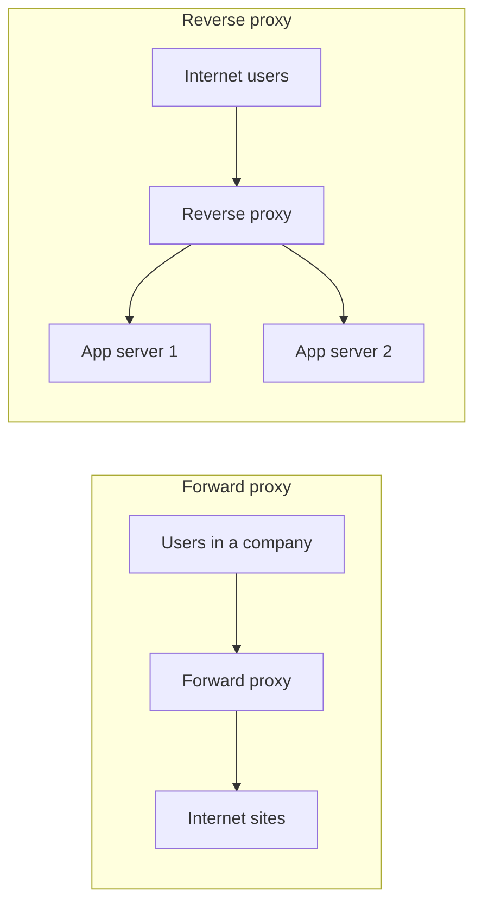
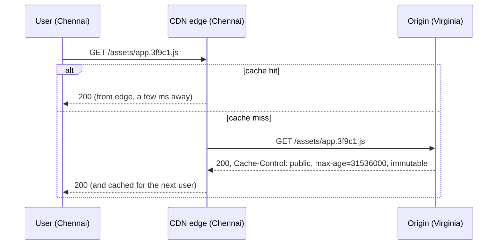

## Why it matters

Between the internet and your application code there is almost always at least one proxy: a load balancer, Nginx, an ingress controller, a CDN or an API gateway. They terminate TLS, spread load, absorb attacks, cache responses and decide where requests go. Misconfiguring them causes some of the most confusing production bugs: wrong client IPs, mysterious 502s and 504s, stale content, broken WebSockets.

## Forward vs reverse proxies



- A **forward proxy** acts on behalf of *clients*: corporate egress filtering, outbound allowlists, privacy proxies. The server sees the proxy.
- A **reverse proxy** acts on behalf of *servers*: clients think they're talking to your site, and the proxy forwards to your backends. This is what backend engineers deploy.

A reverse proxy commonly does several jobs at once:

| Job | Why |
| --- | --- |
| TLS termination | Handle certificates and handshakes in one place; backends speak plain HTTP on a private network (or re-encrypt) |
| Load balancing | Spread requests over many app instances; remove unhealthy ones |
| Routing | `/api` → API pool, `/` → frontend, `ws.` → WebSocket pool |
| Caching and compression | Serve repeated responses without hitting the app |
| Static files | Serve assets far more efficiently than an app server |
| Buffering and limits | Absorb slow clients, cap body sizes, rate limit |
| Security | Hide internal topology; a single place for WAF rules and headers |

An **API gateway** is a reverse proxy specialised for APIs: authentication, API keys, per-consumer rate limits, request transformation and analytics. A **service mesh** puts a small proxy (sidecar) next to every service for internal traffic. They're covered in [architecture styles](/learn/architecture-styles/) and [resilience patterns](/learn/resilience-patterns/).

## Load balancing

### L4 vs L7

| | Layer 4 (transport) | Layer 7 (application) |
| --- | --- | --- |
| Sees | IPs, ports, TCP/UDP | Full HTTP: method, path, headers, cookies |
| Routing by | Address and port | Host, path, header, cookie |
| TLS | Passes through (or terminates) | Terminates (needs certificates) |
| Overhead | Very low | Higher (parses every request) |
| Examples | AWS NLB, HAProxy TCP mode, Linux IPVS | AWS ALB, Nginx, Envoy, HAProxy HTTP mode, Traefik |
| Good for | Raw throughput, non-HTTP protocols, TLS passthrough | Web apps, path routing, retries, header-based decisions |

### Algorithms

| Algorithm | How | Good when | Weakness |
| --- | --- | --- | --- |
| Round robin | Next server in turn | Uniform, short requests | Blind to load |
| Weighted round robin | More turns for bigger servers | Mixed server sizes | Still blind to load |
| Least connections | Fewest open connections or in-flight requests | Variable request durations | Needs state per backend |
| Random / power of two choices | Pick two at random, take the less loaded | Large fleets, many balancers | Small fleets can look uneven |
| IP hash / consistent hash | Same client or key → same server | Session affinity, cache locality | Uneven if few clients; rebalancing moves keys |

Experiment: make a server slow, then compare round robin with least connections.

<div data-viz="load-balancer"></div>

### Health checks

- **Active:** the balancer polls `GET /health` every few seconds and removes backends that fail N times in a row.
- **Passive:** it watches real traffic and ejects backends returning errors or timing out (Nginx's `max_fails`/`fail_timeout`, Envoy's outlier detection).

A health endpoint should be cheap and should reflect whether *this instance* can serve traffic. Don't make it fail just because a shared dependency (the database) is down, or every instance fails at once and the balancer has nothing left. [Observability](/learn/observability-in-practice/) covers liveness vs readiness.

### Sticky sessions

**Session affinity** pins a client to one backend (by cookie or IP hash). It's sometimes needed for stateful protocols such as WebSockets with in-memory state or Socket.IO's long-polling fallback. It also creates uneven load, and losing a server loses its sessions. Prefer stateless servers with shared session storage.

## Nginx in practice

Nginx is an event-driven web server and reverse proxy. A production-shaped configuration that terminates TLS, serves static files, balances an API pool and proxies WebSockets:

```nginx
# /etc/nginx/conf.d/app.conf
upstream api_pool {
    least_conn;                                   # balancing method
    server 10.0.1.11:3000 max_fails=3 fail_timeout=10s;
    server 10.0.1.12:3000 max_fails=3 fail_timeout=10s;
    keepalive 32;                                 # reuse connections to backends
}

server {
    listen 80;
    server_name example.com;
    return 301 https://$host$request_uri;         # force HTTPS
}

server {
    listen 443 ssl;
    http2 on;
    server_name example.com;

    ssl_certificate     /etc/letsencrypt/live/example.com/fullchain.pem;
    ssl_certificate_key /etc/letsencrypt/live/example.com/privkey.pem;
    ssl_protocols TLSv1.2 TLSv1.3;

    add_header Strict-Transport-Security "max-age=31536000; includeSubDomains" always;
    client_max_body_size 10m;                     # reject bigger uploads with 413

    # Static, fingerprinted assets: cache forever
    location /assets/ {
        root /srv/web;
        expires 1y;
        add_header Cache-Control "public, immutable";
    }

    # API
    location /api/ {
        proxy_pass http://api_pool;
        proxy_http_version 1.1;
        proxy_set_header Connection "";           # required for upstream keepalive
        proxy_set_header Host $host;
        proxy_set_header X-Real-IP $remote_addr;
        proxy_set_header X-Forwarded-For $proxy_add_x_forwarded_for;
        proxy_set_header X-Forwarded-Proto $scheme;
        proxy_connect_timeout 2s;
        proxy_read_timeout 30s;                   # > this → 504 Gateway Timeout
    }

    # WebSockets need the Upgrade handshake forwarded
    location /ws/ {
        proxy_pass http://api_pool;
        proxy_http_version 1.1;
        proxy_set_header Upgrade $http_upgrade;
        proxy_set_header Connection "upgrade";
        proxy_read_timeout 1h;                    # long-lived connections
    }

    location / {
        root /srv/web;
        try_files $uri /index.html;               # SPA fallback
    }
}
```

```bash
sudo nginx -t                 # validate config before reloading
sudo systemctl reload nginx   # graceful reload: old workers finish their requests
```

### Decoding proxy errors

| You see | Usually means |
| --- | --- |
| `502 Bad Gateway` | The upstream refused or reset the connection, crashed, or sent an invalid response. Check the app is listening on that address and port. |
| `504 Gateway Timeout` | The upstream didn't respond within `proxy_read_timeout`. A slow query, a deadlock, or an exhausted pool. |
| `413 Request Entity Too Large` | Body exceeds `client_max_body_size`. |
| WebSocket connects then drops after 60 s | Missing `Upgrade` headers, or `proxy_read_timeout` too short with no heartbeats. |
| App logs show the proxy's IP for every user | App isn't reading `X-Forwarded-For` (or trusts it from anyone). |

### Trusting forwarded headers

Your framework must be told which proxies to trust (Express: `app.set("trust proxy", "loopback, 10.0.0.0/8")`; Django: `SECURE_PROXY_SSL_HEADER`; Nginx itself: `set_real_ip_from`). If you trust `X-Forwarded-For` from anyone, attackers can spoof their IP and dodge IP-based rate limits or audit logs.

## CDNs: caching at the edge

A **CDN** runs hundreds of edge locations worldwide. Users connect to a nearby edge, which:

1. Terminates TCP and TLS close to the user, saving round trips.
2. Serves the response from its cache if it has a fresh copy (**hit**).
3. Otherwise fetches from your origin (**miss**), caches it according to your headers, and returns it.



### Cache keys and what gets cached

The **cache key** is usually scheme + host + path + query string. Anything else that changes the response must be in the key or declared with `Vary`, otherwise users get each other's content. Most CDNs by default don't cache responses that set cookies or carry `Cache-Control: private`/`no-store`.

| Content | Strategy |
| --- | --- |
| Fingerprinted JS/CSS/images | `public, max-age=31536000, immutable` |
| HTML pages | Short TTL or `no-cache` with ETags, so deploys show up quickly |
| Public API responses (product catalogue) | `public, s-maxage=60, stale-while-revalidate=300` |
| Per-user or authenticated responses | `private` or `no-store`. Never cache at the CDN. |

### Invalidation

- **Versioned URLs** (content hashes): the best approach, since there's nothing to invalidate.
- **Purge APIs**: purge by URL, by prefix, or by **cache tag** (`Cache-Tag: product-42`) when data changes.
- **Short TTL + stale-while-revalidate**: tolerate a little staleness in exchange for simplicity.

CDNs also absorb DDoS traffic, run WAF rules, and increasingly run code at the edge (Cloudflare Workers, Lambda@Edge), covered in [hosting and deployment](/learn/hosting-and-deployment/).

## Build a basic reverse proxy

A tiny round-robin reverse proxy in Node, to see the mechanics:

```js
import http from "node:http";

const backends = ["http://127.0.0.1:3001", "http://127.0.0.1:3002"];
let i = 0;
const agent = new http.Agent({ keepAlive: true });     // reuse upstream connections

http.createServer((req, res) => {
  const target = new URL(req.url, backends[i++ % backends.length]);
  const upstream = http.request(
    target,
    {
      method: req.method,
      agent,
      timeout: 5000,
      headers: { ...req.headers, "x-forwarded-for": req.socket.remoteAddress, "x-forwarded-proto": "http" },
    },
    (up) => {
      res.writeHead(up.statusCode, up.headers);
      up.pipe(res);                                     // stream the response, don't buffer it
    },
  );
  upstream.on("timeout", () => upstream.destroy(new Error("upstream timeout")));
  upstream.on("error", (err) => {
    if (!res.headersSent) res.writeHead(err.message === "upstream timeout" ? 504 : 502);
    res.end();
  });
  req.pipe(upstream);                                   // stream the request body
}).listen(8080);
```

It's missing health checks, retries, header sanitisation (hop-by-hop headers such as `Connection` must not be forwarded), WebSocket upgrades and limits, which is exactly why you use Nginx, HAProxy or Envoy in production.

## Common mistakes

- Default proxy timeouts that are shorter than legitimate requests (exports, uploads), or much longer than users will wait.
- Not forwarding `Host` and `X-Forwarded-*`, which breaks redirects, absolute URLs and client IPs.
- Caching authenticated responses at the CDN.
- Health checks that depend on the database, taking the whole fleet out during a DB blip.
- Forgetting WebSocket upgrade headers.
- Sticky sessions as a substitute for stateless design.

## Security considerations

- Terminate TLS with modern settings; redirect HTTP to HTTPS and send HSTS.
- Set body and header size limits and connection limits at the edge.
- Strip or overwrite client-supplied `X-Forwarded-*` headers at your outermost proxy.
- The CDN or WAF is a good place for bot and DDoS protection, but your app must still validate everything.

## Performance considerations

- Keep-alive between proxy and backends avoids a TCP/TLS handshake per request.
- Serving static files from Nginx or a CDN frees app workers for dynamic work.
- Response buffering at the proxy protects app servers from slow clients holding connections open.

## Hands-on exercise

With Docker Compose:

1. Run three copies of a tiny API that returns its hostname, plus Nginx with an `upstream` block. `curl` it 9 times and confirm round robin.
2. Switch to `least_conn`. Add a `/slow` endpoint that sleeps 3 s on one instance only, fire concurrent requests with `hey` or `xargs -P`, and compare the distribution.
3. Stop one container and observe passive failover (`max_fails`). Then add an active health check pattern by having the app return `503` from `/health` while "draining".
4. Add a cached location with `proxy_cache` for `GET /api/catalog` (10 s) and show hits with an `X-Cache-Status: $upstream_cache_status` header.
5. Replace Nginx with the Node reverse proxy above and add a health check loop that removes failing backends.

## Completion criteria

- You can explain where TLS terminates, how requests are routed, and how client IPs survive the trip.
- You can configure Nginx as a load-balancing reverse proxy with WebSocket support.
- You can design CDN caching for static assets, HTML and public APIs, and invalidate it safely.
