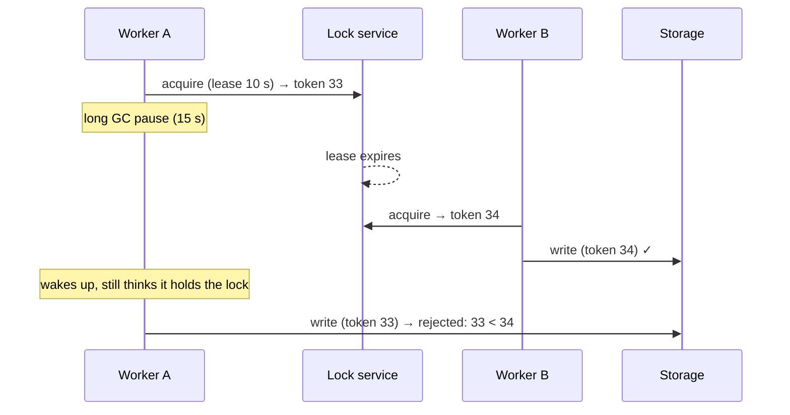

## Why it matters

In a distributed system, something is always failing: a node restarting, a network blip, a slow disk, a dependency deploying. The question isn't whether failures happen, it's whether one failure stays small or cascades into an outage. Most large outages are cascades: a slow dependency ties up threads, retries multiply load, queues fill, health checks fail, and healthy instances get removed. Resilience patterns are how you contain blast radius.

## Failure modes to design for

- **Crash:** the process dies, and connections are reset. Easy to detect.
- **Slowness:** the dependency still answers, just slowly. **Worse than a crash**: callers wait, holding threads, connections and memory, and the slowness spreads upstream.
- **Partial failure:** some requests or some instances fail.
- **Unknown outcome:** a timeout after sending a request. Did it happen or not?
- **Overload:** more work arrives than capacity, latency grows, and timeouts cause retries, which add more work.

## Timeouts and deadlines

**Every network call needs a timeout.** Many client libraries' defaults are effectively infinite or very long.

```ts
const res = await fetch(url, { signal: AbortSignal.timeout(800) });            // Node / browsers
```

```python
httpx.get(url, timeout=httpx.Timeout(connect=0.5, read=1.0, write=1.0, pool=0.5))
```

```go
ctx, cancel := context.WithTimeout(ctx, 800*time.Millisecond)
defer cancel()
req, _ := http.NewRequestWithContext(ctx, "GET", url, nil)
```

Choosing values: base them on the dependency's observed latency (for example a little above its p99.9), not guesses, and keep them **smaller than the caller's own timeout**. Better than fixed timeouts per hop is **deadline propagation**: the edge sets a total budget (say 2 s), and each hop passes the remaining time down (gRPC deadlines, Go's `context`), so deep calls don't keep working on requests the user has already abandoned.

Set database timeouts too: `statement_timeout` and `lock_timeout` in Postgres, and pool acquisition timeouts, so requests fail fast instead of queueing forever.

## Retries, done safely

Retries fix **transient** failures (a dropped connection, a 503 during a deploy) and **make persistent failures worse**. Rules:

1. **Only retry retryable errors:** connection errors, timeouts (if idempotent), `429`, `502`, `503`, `504`. Never `400`, `401`, `403`, `404`, `422`.
2. **Only retry idempotent operations,** or make them idempotent with an idempotency key.
3. **Exponential backoff with jitter:** delays of roughly 100 ms, 200 ms, 400 ms… each randomised, so clients don't retry in synchronized waves.
4. **Cap attempts and total time,** and respect `Retry-After`.
5. **Retry at one layer,** usually the one closest to the failing dependency, to avoid multiplication.
6. **Retry budgets:** allow retries to add at most, say, 10% extra load. When the budget is exhausted, fail fast.

```ts
async function withRetry<T>(fn: () => Promise<T>, { attempts = 3, base = 100, cap = 2000 } = {}): Promise<T> {
  for (let i = 0; ; i++) {
    try {
      return await fn();
    } catch (err: any) {
      const retryable =
        err.retryable ??
        ([429, 502, 503, 504].includes(err.status) || ["ECONNRESET", "ETIMEDOUT"].includes(err.code) || err.name === "TimeoutError");
      if (!retryable || i + 1 >= attempts) throw err;
      const backoff = Math.min(cap, base * 2 ** i);
      await sleep(Math.random() * backoff);                 // "full jitter"
    }
  }
}
```

## Circuit breakers

When a dependency is failing, continuing to call it wastes your resources (threads waiting on timeouts) and hammers something that's trying to recover. A **circuit breaker** wraps calls and tracks outcomes:

- **Closed:** calls pass through; failures are counted.
- **Open:** after a threshold (a failure rate over a sliding window, or N consecutive failures), calls **fail immediately** without touching the dependency, for a cooldown period.
- **Half-open:** after the cooldown, a few trial calls are allowed. Success closes the breaker; failure reopens it.

<div data-viz="circuit-breaker"></div>

```ts
class CircuitBreaker {
  private state: "closed" | "open" | "half-open" = "closed";
  private failures = 0;
  private openedAt = 0;
  constructor(private threshold = 5, private cooldownMs = 10_000) {}

  async call<T>(fn: () => Promise<T>, fallback?: () => T): Promise<T> {
    if (this.state === "open") {
      if (Date.now() - this.openedAt < this.cooldownMs) {
        if (fallback) return fallback();
        throw new Error("circuit open");
      }
      this.state = "half-open";                       // cooldown over: allow a trial
    }
    try {
      const result = await fn();
      this.state = "closed";
      this.failures = 0;
      return result;
    } catch (err) {
      if (this.state === "half-open" || ++this.failures >= this.threshold) {
        this.state = "open";
        this.openedAt = Date.now();
      }
      if (fallback) return fallback();
      throw err;
    }
  }
}
```

(A production breaker also limits concurrent half-open trials and tracks a failure *rate* over a window; use resilience4j, Polly, opossum, or your service mesh's outlier detection.)

Use one breaker **per dependency** (and sometimes per endpoint), and export its state as a metric: an open breaker is an important signal.

## Bulkheads

Isolate resources so one failing dependency can't consume everything:

- **Separate connection pools** (or semaphores) per downstream service: recommendations can use at most 20 concurrent calls; checkout's payment calls have their own pool.
- **Separate worker pools or queues** for different job types, so a flood of report-generation jobs can't starve password-reset emails.
- **Per-tenant limits** so one heavy customer can't degrade everyone.
- **Separate deployments** for critical vs non-critical paths (the checkout API scaled and deployed independently from the admin API).

```ts
import pLimit from "p-limit";
const recommendationsBulkhead = pLimit(20);   // at most 20 concurrent calls, the rest queue (with a timeout)
const recs = await recommendationsBulkhead(() => withTimeout(fetchRecs(userId), 300)).catch(() => []);
```

## Load shedding and backpressure

When demand exceeds capacity, a server that tries to do everything gets slower for everyone until timeouts make all the work useless. It's better to **reject some requests quickly** so the rest succeed:

- Cap concurrent in-flight requests per instance; beyond the cap, return `503` with `Retry-After` immediately.
- Bound queues, and drop or reject when full; don't let them grow without limit.
- Prioritise: shed analytics and recommendations before checkout and login.
- Drop requests whose deadline has already passed (the client has given up).
- Propagate **backpressure** upstream: bounded queues and `429`/`503` tell producers to slow down.

## Graceful degradation and fallbacks

Decide in advance what the product does when a dependency is unavailable:

| Dependency down | Fallback |
| --- | --- |
| Recommendations | Show bestsellers (cached) or hide the widget |
| Reviews | Render the page without reviews |
| Personalised pricing | Show the list price |
| Search | Basic database search, or a "search is temporarily limited" message |
| Payment provider A | Route to provider B, or queue the order for later capture |

Fallbacks should be simple and well tested. A fallback path that's never exercised will fail when you need it, so test it with fault injection ([reliability engineering](/learn/reliability-engineering/)).

## Idempotency everywhere

Retries, redeliveries and duplicate clicks are inevitable, so operations should be safe to repeat: idempotency keys on unsafe API calls, upserts and conditional updates in the database, deduplication by message id in consumers. Idempotency turns "at-least-once" into "effectively once".

## Distributed locks and fencing tokens

Sometimes only one process may do something at a time (a cron job across many instances, processing one account's ledger). Options, in order of preference:

1. **Avoid the lock:** make the operation idempotent, or partition work so one consumer owns each key (Kafka partitions).
2. **Use the database:** row locks, `SELECT … FOR UPDATE SKIP LOCKED`, Postgres advisory locks, or unique constraints. These are transactional with your data.
3. **A lease in Redis, etcd or ZooKeeper,** with care.

The trap with lease-based locks:



A lease can expire while its holder is paused (GC, a slow disk, a network partition) without the holder knowing. Without protection, two workers both believe they hold the lock. **Fencing tokens** fix it: the lock service issues a monotonically increasing number with each grant, and the protected resource rejects writes with a token lower than the highest it has seen:

```sql
update jobs set result = $1, fence = $2
where id = $3 and fence < $2;      -- 0 rows → a newer lock holder already wrote; abort
```

Redis's single-instance `SET key value NX PX 10000` lock is fine for efficiency (avoiding duplicate work occasionally is acceptable). For correctness-critical mutual exclusion, use fencing tokens with a consensus-backed store (etcd, ZooKeeper) or the database itself. The Redlock algorithm is debated precisely because it relies on timing assumptions; read Kleppmann's analysis above.

## Health checks and self-protection

- **Liveness:** "am I stuck?" Restart if not. Keep it trivial; don't check dependencies.
- **Readiness:** "can I take traffic now?" Fail while starting, draining, or when critical *local* resources are exhausted.
- Don't make every instance's readiness depend on a shared dependency, or a database blip removes your entire fleet.

## Real-world scenarios

- A product page fans out to six services under a 300 ms deadline; recommendations and reviews have fallbacks, and a breaker trips when reviews degrade.
- A payment service retries provider calls with idempotency keys, a retry budget and a breaker that fails over to a second provider.
- A queue consumer uses a bulkhead per job type so marketing emails can't starve password resets.

## Common mistakes

- No timeouts, or timeouts longer than the caller's.
- Retrying non-idempotent operations, or retrying at every layer.
- Retrying 4xx errors.
- Fallbacks that were never tested.
- Unbounded queues and thread pools.
- Trusting a TTL lock for correctness.

## Security considerations

- Resilience controls double as DoS protection: timeouts, concurrency caps and rate limits prevent attackers from tying up resources.
- Fail closed for security decisions: if the authorisation service is down, deny rather than allow.

## Performance considerations

- Timeouts set from latency percentiles, plus hedged requests (send a duplicate request after the p95 latency to a different replica, take the first answer) can cut tail latency for idempotent reads, at the cost of extra load.
- Shedding load early keeps p99 latency for accepted requests healthy.

## Hands-on exercise

1. Build two services: `api` calls `flaky`, which can be configured at runtime to be healthy, slow (2 s) or failing.
2. Without protection, load-test `api` at 50 req/s and switch `flaky` to slow. Record `api`'s latency and error rate, and how many concurrent requests pile up.
3. Add, one at a time, measuring each: a 300 ms timeout; retries with jitter (show retry amplification when `flaky` is down); a circuit breaker with a cached fallback; a bulkhead of 10 concurrent calls; load shedding at 100 in-flight requests.
4. Implement a fencing-token check on a shared resource and write a test that simulates a paused lock holder.

## Completion criteria

- Every network call you write has a timeout, and retries are bounded, jittered, and only for idempotent operations.
- You can implement and tune a circuit breaker and a bulkhead.
- You can explain why distributed locks need fencing, and prefer database guarantees where possible.
