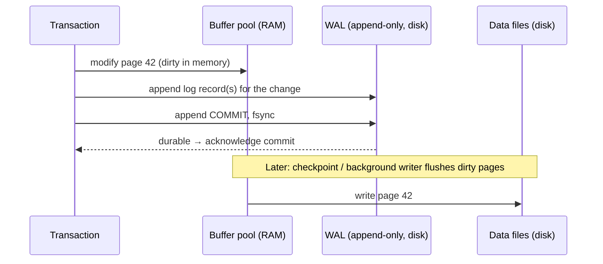
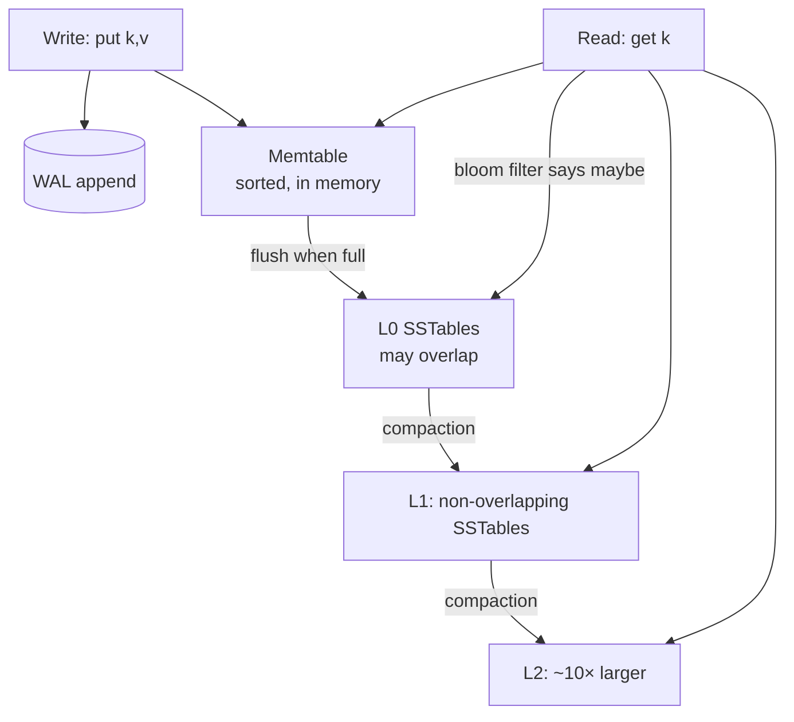

## Why it matters

You don't need to write a database to benefit from knowing how one works. Understanding storage engines explains why Postgres needs VACUUM, why Cassandra writes are so fast but reads touch many files, why `fsync` matters for durability, why random UUID primary keys can hurt insert performance, and how to choose between databases built on fundamentally different designs. It's the foundation under every "Postgres vs Cassandra vs RocksDB" decision.

## Disks, pages and the buffer pool

Storage is organised in fixed-size **pages** (8 KB in Postgres, 16 KB in InnoDB). A page holds many rows (or index entries) plus a header and a slot directory. All reads and writes happen in whole pages.

Disk access patterns matter:

- **Sequential** I/O is much faster than random I/O on spinning disks, and still notably more efficient on SSDs (larger transfers, less write amplification inside the drive).
- SSDs write in pages but erase in larger blocks, so rewriting data in place causes internal write amplification and wear.

The **buffer pool** (Postgres's `shared_buffers`, InnoDB's buffer pool) caches pages in memory. Queries read pages through it; modified ("dirty") pages are written back later. Databases manage this themselves rather than relying only on the OS page cache, because they know which pages are hot, when pages can be evicted safely, and how writes must be ordered relative to the log. (Postgres deliberately relies on *both* its own buffers and the OS page cache.)

## The write-ahead log (WAL)

How can a database acknowledge a commit quickly *and* survive a crash, when writing every modified page to disk on commit would be slow and random?

**Write-ahead logging:** before any change to a data page reaches disk, a **log record** describing the change is appended to the WAL, a sequential, append-only file. A transaction is committed once its log records (including a commit record) are **flushed** (`fsync`) to stable storage. Data pages are written later, in the background.

**Crash recovery:** on restart, the database finds the last **checkpoint** (a point where all earlier changes were known to be on disk) and **replays** (redoes) WAL records from there, reconstructing any changes that hadn't reached the data files. Transactions without a commit record are ignored or rolled back. (The ARIES algorithm is the classic formalisation of redo/undo recovery.)

The WAL does triple duty:

1. **Durability and crash recovery.**
2. **Replication:** streaming the WAL to replicas (physical replication) or decoding it into logical changes (logical replication).
3. **Change data capture:** tools like Debezium read the WAL to publish database changes as events, which is the basis of the outbox relay in [CQRS and sagas](/learn/cqrs-event-sourcing-sagas/).

Settings like Postgres's `synchronous_commit = off` acknowledge commits before the WAL flush: faster, but a crash can lose the last fraction of a second of acknowledged transactions (without corrupting the database). Know when you've traded durability for latency.

**Full-page writes** (Postgres) protect against torn pages: after a checkpoint, the first change to a page logs the whole page image, so a partially written 8 KB page can be restored.

## B-trees: the read-optimised workhorse

Most relational databases (Postgres, MySQL InnoDB, SQL Server, Oracle, SQLite) store indexes, and in InnoDB the table itself, as **B+trees**:

- Balanced: every leaf is at the same depth.
- High fan-out: each internal page holds hundreds of keys and child pointers, so depth stays small (three or four levels cover huge tables).
- Leaves hold the keys (and either the row or a pointer to it) and are linked for range scans.

**Lookup:** read the root (almost always cached), follow child pointers to a leaf: O(log n) page reads with a very large logarithm base.

**Insert:** find the leaf and insert in sorted position. If the page is full, **split** it into two half-full pages and insert a separator key into the parent (which may split in turn, up to the root). Updates happen **in place** on the page, with the change recorded in the WAL first.

Consequences you'll meet:

- **Random inserts** (random UUIDv4 primary keys) land on random leaves, touching many pages, causing splits throughout the index and poor cache locality. Monotonic keys (identity integers, UUIDv7, ULIDs) append to the rightmost leaf. This matters most for clustered indexes such as InnoDB's primary key.
- **Fragmentation** after many splits and deletes leaves half-empty pages, so indexes may need `REINDEX` occasionally.
- **Postgres MVCC** adds a twist: updates write new row versions (tuples) rather than overwriting, and index entries point to tuples, which is why dead tuples must be vacuumed (see [transactions and MVCC](/learn/transactions-and-concurrency/)). HOT (heap-only tuple) updates avoid touching indexes when no indexed column changes and the page has room.

B-trees give predictable, low read amplification and efficient range scans. The cost is random writes and in-place page updates.

## LSM trees: the write-optimised alternative

**Log-structured merge trees** (LevelDB, RocksDB, Cassandra, ScyllaDB, HBase, and many modern stores) never update data in place:

1. **Write:** append to the WAL (for durability), then insert into an in-memory sorted structure, the **memtable** (a skip list or balanced tree).
2. **Flush:** when the memtable is full, write it out as an immutable, sorted file: an **SSTable** (sorted string table) with a sparse index and a **Bloom filter**.
3. **Compaction:** background processes merge SSTables, keeping the newest version of each key, dropping overwritten values and expired **tombstones** (deletion markers), and producing larger sorted files.
4. **Read:** check the memtable, then SSTables from newest to oldest, skipping files whose Bloom filter says the key is definitely absent, stopping at the first match.

### Compaction strategies

- **Leveled** (RocksDB's default, Cassandra's LCS): each level is ~10× the previous with non-overlapping key ranges, so a read checks about one file per level. Lower read and space amplification; higher write amplification (data is rewritten as it moves down levels).
- **Size-tiered / tiered** (Cassandra's STCS, RocksDB universal): merge similarly sized files together. Lower write amplification; more files to check per read and temporarily more space used.
- **Time-window** compaction groups data by time, efficient for time-series data with TTLs (whole files expire together).

### Bloom filters

A Bloom filter is a bit array plus k hash functions. Adding a key sets k bits; checking a key tests those bits. If any bit is 0, the key is **definitely absent**; if all are 1, it's **possibly present**. With around 10 bits per key the false-positive rate is about 1%, so for absent keys the engine skips almost every SSTable without reading it.

## Amplification: the core trade-off

| | What it measures | B-tree | LSM tree |
| --- | --- | --- | --- |
| **Write amplification** | Bytes written to disk per byte of logical data | WAL + page rewrites (a whole page for a small change) | WAL + rewrites during compaction (can be large with leveled compaction) |
| **Read amplification** | Disk reads per lookup | Low: about tree depth, mostly cached | Higher: memtable + possibly several levels (mitigated by Bloom filters and caches) |
| **Space amplification** | Disk used vs logical data size | Fragmentation, page fill factor, MVCC dead tuples | Obsolete versions and tombstones until compacted |
| **Write pattern** | How changes reach disk | Random, in place | Sequential, batched |
| **Range scans** | Reading ordered key ranges | Excellent | Good (merge across levels) |

The **RUM conjecture** formalises the intuition: an access method can optimise for at most two of **R**ead overhead, **U**pdate (write) overhead and **M**emory/space overhead. Every engine picks a point in that triangle, and compaction and fill-factor settings move you around in it.

**Tombstones** deserve a special warning: in LSM stores a delete is a write. Workloads that delete heavily (queue-like tables in Cassandra) accumulate tombstones that reads must skip until compaction removes them, which is a classic performance trap.

## How real systems choose

| Engine / database | Structure | Notes |
| --- | --- | --- |
| PostgreSQL | Heap tables + B-tree (and GIN, GiST, BRIN…) indexes | MVCC with tuple versions in the heap; VACUUM reclaims space |
| MySQL InnoDB | Clustered B+tree on the primary key; secondary indexes point to primary key values | Primary key choice affects layout |
| SQLite | B-trees, with a rollback journal or WAL mode | Embedded; great for single-node and edge apps |
| RocksDB / LevelDB | LSM | Embedded engine underneath many systems (CockroachDB uses Pebble, an LSM inspired by RocksDB; TiKV uses RocksDB) |
| Cassandra / ScyllaDB | LSM per partition | Write-heavy, wide-column |
| MongoDB WiredTiger | B-tree by default | Document storage with compression |
| ClickHouse | MergeTree: columnar, LSM-like merges of sorted parts | Analytics; scans of a few columns over billions of rows |

**Row vs column storage** is the other big axis. Row stores keep each row's columns together (good for OLTP: read or write a whole record). Column stores keep each column together (good for OLAP: scan two columns across a billion rows, with excellent compression). That's why analytics usually moves to a columnar store.

## Common mistakes

- Turning off `fsync` or durability settings for "performance" on data you can't afford to lose.
- Random UUIDv4 primary keys on very large, write-heavy clustered tables without understanding the cost.
- Heavy delete or overwrite patterns on LSM stores without accounting for tombstones and compaction.
- Running analytics scans on a row-store OLTP database at scale.

## Security considerations

- WAL files, backups and SSTables contain your data (including "deleted" data until compaction or vacuum), so encrypt at rest and control access.
- Secure deletion is hard in both B-trees and LSMs; crypto-shredding (destroying the encryption key) is often the practical answer.

## Performance considerations

- Fast fsync (low-latency storage) bounds commit latency.
- Size the buffer pool or block cache for the hot working set.
- Monitor compaction backlog (LSM) and bloat or vacuum progress (Postgres); both silently degrade performance when they fall behind.

## Hands-on exercise

1. Build a tiny key-value store in your language:
   - Writes append `put`/`delete` records to a log file (fsync on commit) and update an in-memory sorted map (the memtable).
   - When the memtable exceeds N entries, write it to an immutable sorted file with a simple index, and start a new memtable.
   - Reads check the memtable, then files newest-first.
   - Add a Bloom filter per file and measure how many file reads it saves for absent keys.
   - Write a compaction that merges files and drops overwritten and deleted keys.
   - Crash test: kill the process mid-write and verify recovery from the log.
2. In Postgres, insert 10M rows with a `bigint identity` key and 10M with random `uuid` (v4) keys into two tables; compare insert time, index size (`pg_relation_size`) and buffer hit ratios. Record your own numbers.
3. Stretch: the [build your own Redis](/projects/build-your-own-redis/) project adds persistence with an append-only file.

## Completion criteria

- You can explain WAL-based durability and crash recovery.
- You can compare B-trees and LSM trees using read, write and space amplification.
- You can predict how a storage engine will behave for a given workload and choose accordingly.
