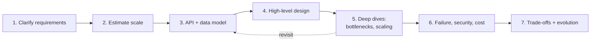
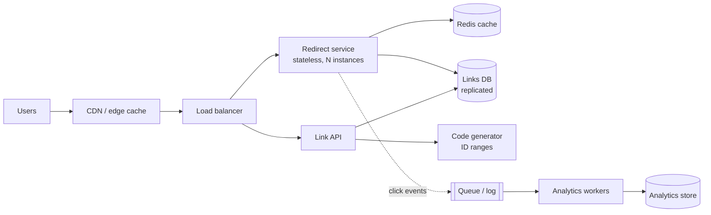

## Why it matters

System design questions are open-ended on purpose: there's no single right answer, only well-reasoned ones. The skill being tested, in interviews and in real design reviews, is structured thinking. Do you clarify before building? Do you size things with numbers rather than vibes? Do you see bottlenecks, failure modes and trade-offs? A repeatable method keeps you from jumping to "Kafka and Kubernetes" before you know what the problem is.

## The method



Budget your time. In a 45-minute interview, roughly: requirements and estimates (8–10 min), API, data and high level (10–12), deep dives (15), failure, trade-offs and wrap-up (5–8). In a real design review, write it down as a design document with the same sections.

## Step 1: clarify requirements

### Functional requirements: what the system does

Write 3–6 concrete capabilities and agree on what's **out of scope**. For a URL shortener:

- Create a short link for a long URL (optionally a custom alias and an expiry).
- Redirect a short link to its target.
- Show click counts per link.
- *Out of scope:* user accounts, link editing, detailed analytics dashboards.

### Non-functional requirements: how well it does it

Make each one measurable:

| Quality | Question | Example target |
| --- | --- | --- |
| Scale | How many users and requests? Read/write ratio? | 100M new links/month; 100:1 reads to writes |
| Latency | Which operation, which percentile? | Redirect p99 < 50 ms at the edge |
| Availability | How much downtime is tolerable? | Redirects 99.99%; creation 99.9% |
| Consistency | Can readers see stale data? | A new link must work within 1 s globally |
| Durability | Can data ever be lost? | Links never lost once acknowledged |
| Security and privacy | Abuse, PII, compliance? | Block malware URLs; GDPR deletion |
| Cost | Budget constraints? | — |

Different parts of one system often have different requirements. Redirects need extreme availability and low latency; analytics can be eventually consistent and minutes late. Saying so explicitly is a sign of maturity.

### Ask, don't assume

Good clarifying questions: Who are the users and where are they? What's the read/write ratio? What happens at peak (sales, sports events, New Year's)? What's the consequence of stale or lost data? Mobile or web? Any hard constraints (existing stack, regions, compliance)?

## Step 2: estimate

Back-of-the-envelope estimates decide whether you need one database or a sharded fleet. State assumptions, round aggressively, and keep units straight.

### Useful constants

| Fact | Value |
| --- | --- |
| Seconds per day | 86,400 (≈ 10⁵) |
| 1 million requests/day | ≈ 12 req/s |
| 1 billion requests/day | ≈ 11,600 req/s |
| Seconds per year | ≈ 3.15 × 10⁷ |
| Peak-to-average factor | Often 2–5×; measure your own traffic when you can |
| KB / MB / GB / TB / PB | 10³ / 10⁶ / 10⁹ / 10¹² / 10¹⁵ bytes (powers of ten are fine for estimates) |

Latency orders of magnitude (see the latency table in [system design basics](/learn/system-design-basics/)): memory reference ~100 ns; SSD random read ~tens to hundreds of µs; round trip within a datacenter ~0.5 ms; cross-continent round trip ~100–150 ms.

### Worked example: URL shortener

**Assumptions** (state them out loud): 100M new links per month; read:write = 100:1; links kept for 5 years; average record 500 bytes (URL, code, metadata).

**Traffic**

- Writes: 100M / (30 × 86,400) ≈ 100M / 2.6M ≈ **40 writes/s** average, peak ~200/s (5×).
- Reads: 100 × 40 = **4,000 redirects/s** average, peak ~20,000/s.

**Storage**

- Links in 5 years: 100M × 12 × 5 = 6 billion.
- 6 × 10⁹ × 500 B = 3 × 10¹² B = **3 TB** (before indexes and replication; with 3 replicas, ~9 TB). That fits on a few machines; no exotic storage is needed.

**Short code length**

- Base62 (a–z, A–Z, 0–9): 62⁶ ≈ 5.7 × 10¹⁰ and 62⁷ ≈ 3.5 × 10¹². Seven characters gives ample headroom for 6 billion links.

**Bandwidth**

- Redirect responses are tiny (~500 B with headers): 20,000/s × 500 B ≈ 10 MB/s at peak. Trivial.

**Cache**

- If 20% of links get 80% of traffic, cache the hottest daily set. 20% of a day's distinct accessed links × 500 B; even caching 100M links is ~50 GB, which fits comfortably in a Redis cluster.

**What the numbers tell us:** writes are small; reads are high but cacheable; storage is moderate. The design problem is low-latency, highly available reads and collision-free code generation, not raw storage.

### Common estimate targets

- **QPS** (average and peak), split by read and write.
- **Storage** per day and per year, including replication and indexes.
- **Bandwidth** in and out (media systems are dominated by this).
- **Memory** for caches and hot working sets.
- **Number of servers:** peak QPS ÷ per-server capacity (and per-server capacity is something you *measure* with load tests, so mark it as an assumption).

## Step 3: API and data model

Define the external API before boxes and arrows; it pins down the scope.

```
POST /v1/links        { "url": "...", "alias"?: "...", "expires_at"?: "..." }  → 201 { "code": "aZ3kP9x", "short_url": "..." }
GET  /{code}          → 301/302 Location: <long url>      (301 is cached by browsers; 302 lets you count every click)
GET  /v1/links/{code}/stats → 200 { "clicks": 1234 }
```

Then the data model and access patterns:

```sql
links(code text primary key, long_url text not null, owner_id uuid, created_at timestamptz, expires_at timestamptz)
-- access pattern: get by code (point lookup) ≫ insert
```

The access patterns choose the database: key-value point lookups at high read volume fit a relational database with a primary key index plus cache, or a key-value store like DynamoDB or Cassandra. Either can be justified; say why.

## Step 4: high-level design

Draw the request paths end to end: clients → DNS/CDN → load balancer → stateless services → caches → databases → async pipelines. Keep it simple first; one box per responsibility.



## Step 5: deep dives

Pick the 2–3 hardest parts and go deep. Typical topics:

- **Hot paths:** how do redirects stay under 50 ms? (CDN caching for popular links, Redis cache-aside, read replicas.)
- **Correctness under concurrency:** how are codes generated without collisions? (Pre-allocated ID ranges per server encoded in base62; or random codes with a unique constraint and retry.)
- **Scaling the data tier:** when does one database stop being enough? (Read replicas, then partitioning by code hash.)
- **Async work:** clicks are counted via a log and aggregated, not with a DB write per redirect.
- **Hot keys:** a viral link. (Edge caching; in-process caching for the hottest codes.)

For every component, ask: *what happens at 10× load?* and *what happens when it fails?*

## Step 6: failure, security and cost

### Availability and single points of failure

Walk through each component and ask what happens if it disappears:

| Component | Failure | Mitigation |
| --- | --- | --- |
| App instance | Crash | Multiple instances, health checks, autoscaling |
| Load balancer | Down | Managed, multi-AZ load balancers |
| Cache | Node lost or flushed | Replicas; database sized to survive a cold cache; stampede protection |
| Primary database | Down | Synchronous standby in another AZ with automatic failover; tested |
| Region | Outage | Multi-region (only if the requirements justify the cost and complexity) |
| Queue | Backed up | Bounded queues, autoscaled consumers, lag alerts |

Availability of **serial** dependencies multiplies: three components at 99.9% each give about 99.7%. **Redundant** components in parallel improve it: two independent instances at 99% each give 1 − 0.01² = 99.99%, assuming independent failures, which shared dependencies (same AZ, same bad deploy) often violate.

### Consistency and durability

Say where you need strong consistency (link creation must not hand out duplicate codes) and where eventual is fine (click counts). Durability: synchronous replication for data that must never be lost, plus backups and point-in-time recovery.

### Security

Authentication and authorisation for write APIs, rate limiting and abuse detection (malware and phishing links), input validation (URL schemes, lengths), and privacy (analytics shouldn't store raw IPs longer than needed).

### Cost

Rough monthly cost drivers: compute instances, database and replicas, cache memory, CDN egress, storage. Note the cheaper alternatives you considered: managed vs self-hosted, a smaller instance count with caching, tiered storage for old data.

## Step 7: trade-offs and evolution

Close by naming your key decisions and their alternatives:

- "301 vs 302: 302 so we can count every click, at the cost of extra load we absorb with caching."
- "Relational database with caching rather than a wide-column store: our scale fits one primary plus replicas for years; we'd revisit past ~X writes/s."
- "Pre-allocated ID ranges vs random codes: predictable and collision-free, but sequential codes are enumerable, so we shuffle the bits."

And how the design evolves: what you'd build first for 10k users, and what you'd add at 1M and 100M.

## A design document template

```markdown
# <System> design
## Context and goals
## Requirements
  Functional · Non-functional (measurable) · Out of scope
## Estimates (with assumptions)
## API
## Data model and access patterns
## Architecture (diagram) and request flows
## Deep dives
## Failure modes and mitigations
## Security and privacy
## Cost
## Alternatives considered and trade-offs
## Rollout plan and open questions
```

## Common mistakes

- Designing before clarifying, and solving a different problem than the one asked.
- Vague non-functional requirements ("scalable", "fast").
- Estimates without stated assumptions, or with unit errors (bits vs bytes, per day vs per second).
- Over-engineering: sharding, microservices and multi-region for a load one server handles.
- Ignoring failure modes, security and cost.
- Not stating trade-offs. Every design choice has a cost; name it.

## Hands-on exercise

Apply the full method to **Pastebin** (users paste text, get a link, and others read it; pastes expire): write requirements (with out-of-scope items), estimates assuming 10M new pastes per month at an average 10 KB with a 10:1 read ratio, the API, the data model (where does the paste *content* live: the database or object storage?), a diagram, two deep dives (expiry cleanup; hot pastes), a failure table, security considerations, and three trade-offs. Keep it to two pages.

## Completion criteria

- You can turn any brief into measurable requirements and back-of-the-envelope numbers.
- You consistently cover APIs, data, architecture, deep dives, failures, security, cost and trade-offs.
- Your designs are as simple as the numbers allow.
