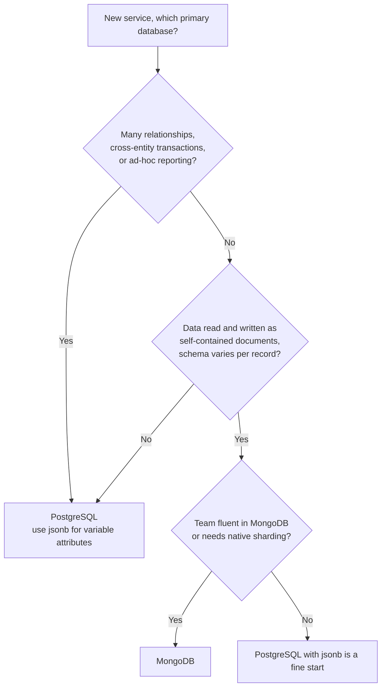
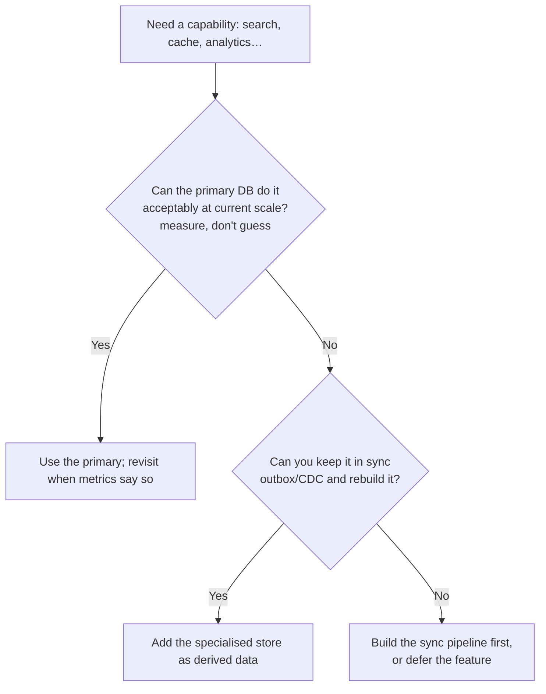
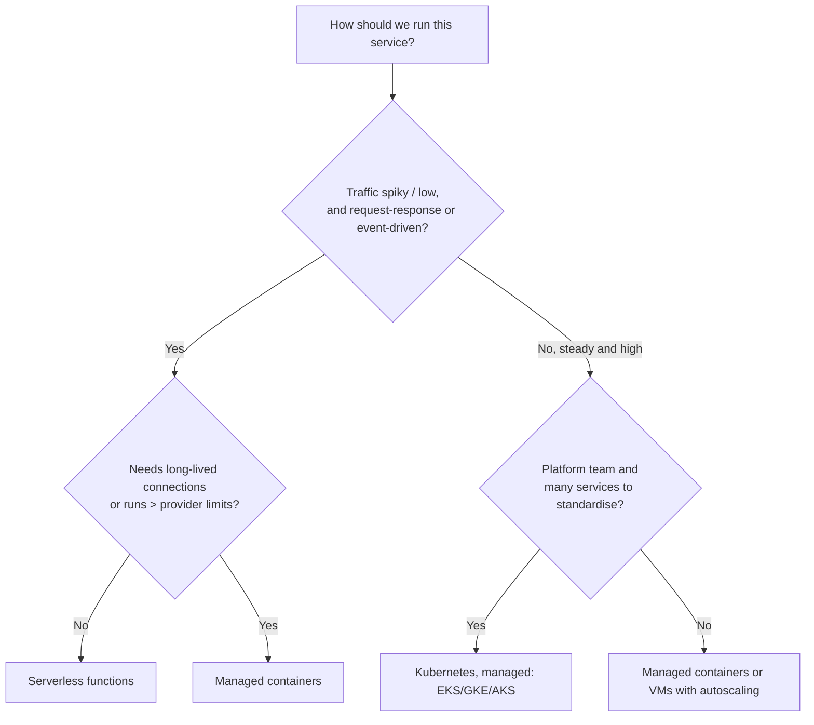

## How to use these guides

Every comparison follows the same frame:

1. **Requirements that favour each option.**
2. Architecture, performance, complexity and operational overhead.
3. Scaling, cost and security.
4. A decision tree for the common case, and the requirements that would flip it.

None of these technologies is universally better. The question is always *better for what, for whom, at what cost*. When two options both fit, prefer the one your team already operates well.

---

## PostgreSQL vs MongoDB

### Requirements that favour PostgreSQL

- Relationships and joins between many entity types (orders ↔ customers ↔ products ↔ payments).
- Multi-row, multi-table transactions and strict integrity (foreign keys, check and exclusion constraints).
- Ad-hoc queries and reporting you can't fully predict.
- Mixed workloads: relational core plus semi-structured attributes (`jsonb`), full-text search, geospatial (PostGIS), vectors (pgvector), time series (TimescaleDB). One store can cover a lot.

### Requirements that favour MongoDB

- Data that is naturally **document-shaped** and read and written as whole aggregates (a product with nested variants, a CMS page with blocks, a user profile with nested settings).
- Highly variable schemas per record, evolving quickly.
- Built-in horizontal sharding as a first-class, managed feature for very large datasets.
- A team and ecosystem already fluent in it.

### Comparison

| Dimension | PostgreSQL | MongoDB |
| --- | --- | --- |
| Data model | Relational tables, plus `jsonb` | JSON-like documents (BSON), nested |
| Schema | Enforced (and migrations) | Flexible; optional JSON Schema validation |
| Joins | First-class, efficient | `$lookup` exists; modelling usually embeds instead |
| Transactions | Full ACID, any rows and tables | Multi-document ACID since 4.0; best kept short; single-document ops are atomic |
| Scaling writes | Vertical first; partitioning; sharding via Citus or app-level | Native sharding by shard key |
| Scaling reads | Read replicas | Replica set secondaries |
| Query language | SQL (standard, portable) | MQL / aggregation pipeline |
| Operations | Mature; huge managed ecosystem | Mature; Atlas is the main managed offering |
| Licensing | PostgreSQL License (permissive) | SSPL for the server (not OSI-approved); Atlas managed |

### Performance

Both are fast for their intended access patterns. Document stores read a whole aggregate in one fetch without joins; relational stores with good indexes make joins cheap. Performance problems in either almost always come from modelling that fights the access pattern (deep joins on unindexed columns; unbounded arrays growing inside documents).

### Decision tree

**What would flip it:** dataset and write volume beyond comfortable single-primary Postgres with no natural partitioning plan (consider native-sharded options, including MongoDB, Cassandra or distributed SQL like CockroachDB or Yugabyte); or a document-centric product where nearly every read is a whole aggregate.

**Real examples:** Postgres underpins many large SaaS products (often via managed services); MongoDB is common for content platforms, catalogues and apps whose data is naturally document-shaped.

---

## Single database vs polyglot persistence

### Requirements that favour one database

- Small to medium team; operational simplicity matters.
- Strong consistency across all data (one transaction can update everything).
- Postgres extensions cover the "special" needs well enough: `jsonb`, full-text search, PostGIS, pgvector, partitioning.

### Requirements that favour adding stores

- A workload the primary store handles poorly **at your scale**: full-text relevance ranking and faceting at large scale (Elasticsearch/OpenSearch), sub-millisecond shared caching (Redis), huge analytical scans (a columnar warehouse such as ClickHouse, BigQuery or Snowflake), extreme write throughput (Cassandra), graph traversals (Neo4j).
- Isolation: keep analytics queries off the transactional database.

### Costs of each extra store

Backups and restore drills, monitoring, upgrades, security patches and access control, capacity planning, on-call knowledge, and **keeping data in sync**. The derived store needs a pipeline (outbox or CDC), handles lag, and must be rebuildable from the source of truth.

### Decision rule

Start with one well-chosen primary store. Add a store when you can name the specific requirement, measured, that the primary can't meet, and you have a plan for keeping the copy in sync and rebuilding it. Treat every non-primary store as **derived data**.

---

## Redis vs Memcached

| Dimension | Redis (and Valkey) | Memcached |
| --- | --- | --- |
| Data types | Strings, hashes, lists, sets, sorted sets, streams, HyperLogLog, geo, bitmaps | Strings (opaque blobs) |
| Persistence | Optional RDB snapshots / AOF | None (pure cache) |
| Replication and failover | Built in (replicas, Sentinel, Cluster) | Not built in; clients shard across nodes |
| Threading | Command execution on a main thread (I/O threads available) | Multi-threaded |
| Atomic operations | Rich (INCR, Lua scripts, transactions) | Basic (incr/decr, CAS) |
| Pub/sub, streams | Yes | No |
| Memory efficiency for plain small values | Good | Very good (slab allocator) |
| Typical uses | Cache, sessions, rate limits, leaderboards, queues, locks | Large, simple look-aside caches |

**Choose Memcached** when you need a big, simple, multi-threaded look-aside cache of opaque values and nothing else. **Choose Redis** when you need data structures, atomic counters or scripts, persistence, replication, or pub/sub. Most teams default to Redis because one system covers caching *and* those adjacent needs. Licensing note: Redis's 2024 licence change led to the Linux Foundation fork **Valkey**, which managed services widely offer.

---

## Kubernetes vs serverless

### Requirements that favour serverless (functions, managed containers like Cloud Run or Fargate)

- Spiky, unpredictable, or low traffic; scale-to-zero matters.
- Small team; no desire to run clusters.
- Event-driven glue: webhooks, queue consumers, scheduled tasks, file processing.
- Fast time to market.

### Requirements that favour Kubernetes (or containers on VMs)

- Steady, high utilisation where reserved capacity is cheaper.
- Long-running processes, WebSockets, background workers, stateful sidecars, custom networking.
- Portability across clouds and on-prem; avoiding provider-specific runtimes.
- Many services needing uniform deployment, scaling, service discovery and policy, with a platform team to run it.

### Comparison

| Dimension | Serverless functions | Managed containers (Cloud Run, Fargate) | Kubernetes |
| --- | --- | --- | --- |
| Operational overhead | Lowest | Low | High (cluster upgrades, networking, add-ons) unless heavily managed |
| Scaling | Automatic, per request; to zero | Automatic; often to zero | HPA/KEDA; nodes via cluster autoscaler |
| Cold starts | Yes (varies by runtime and package size) | Sometimes | No (pods running) |
| Execution limits | Time and memory caps | Longer, configurable | None inherent |
| Long-lived connections | Poor fit | Possible | Natural |
| Cost profile | Pay per invocation and duration; great when idle, can be expensive at sustained load | Per vCPU and memory used | Pay for nodes whether busy or not; efficient at high utilisation |
| Lock-in | Higher (event formats, IAM, runtime APIs) | Medium | Lower (but managed add-ons add some) |

**Security:** serverless shifts patching of the OS and runtime to the provider and gives per-function IAM, but increases the number of event entry points to secure. Kubernetes gives fine-grained control (network policies, pod security, admission policies) that you must actually configure.

---

## RabbitMQ vs Kafka

| | RabbitMQ (classic and quorum queues) | Kafka |
| --- | --- | --- |
| Model | Smart broker routes messages to queues; consumers ack individual messages | Partitioned, replicated append-only log; consumers track offsets |
| After consumption | Message removed | Retained for the configured period, so it can be replayed |
| Ordering | Per queue (with one consumer) | Per partition |
| Routing | Rich (direct, topic, fanout, headers exchanges) | By topic and partition key |
| Per-message features | Priorities, TTLs, delays (via plugins), DLX | Minimal; built for throughput |
| Throughput | High | Very high, sustained |
| Best for | Task queues, RPC-style work distribution, complex routing | Event streaming, event sourcing, analytics pipelines, multiple independent consumers, replay |

**Choose RabbitMQ (or SQS)** to distribute jobs to workers with per-message acknowledgement, retries and routing. **Choose Kafka** (or Redpanda, Kinesis, Pulsar) when many consumers need the same event stream independently, you need replay, or volume is very high. The full comparison, including SQS, Redis Streams and BullMQ, is in [messaging systems and background jobs](/learn/messaging-and-background-jobs/).

---

## REST vs GraphQL vs gRPC

| | REST | GraphQL | gRPC |
| --- | --- | --- | --- |
| Best for | Public APIs, CRUD resources, cacheable reads | Many client screens needing different data shapes from many sources | Internal service-to-service, low latency, streaming, polyglot contracts |
| Contract | OpenAPI (optional) | Schema (required) | Protobuf (required) |
| HTTP caching | Natural | Hard (POST queries; needs persisted queries) | Not applicable |
| Over/under-fetching | Common | Solved by design | Defined per RPC |
| Browser support | Native | Native | Needs gRPC-Web or a proxy |
| Main risks | Endpoint sprawl, chatty clients | N+1 resolvers, expensive queries (needs depth/cost limits) | Tooling friction at the edge |

Default: **REST at the edge, gRPC inside** if you have many internal services, and **GraphQL** when a product has many clients with diverging data needs and a team to manage it. Details in [ways to build an API](/learn/apis/).

---

## WebSockets vs SSE vs polling

| Need | Choose |
| --- | --- |
| Occasional updates, simplest possible | Polling (every N seconds) |
| Server → client stream (notifications, dashboards, LLM token streaming) | **Server-Sent Events** |
| Two-way, low-latency messaging (chat, multiplayer, collaboration) | **WebSockets** (or Socket.IO for fallbacks and rooms) |
| Peer-to-peer audio and video | WebRTC |
| Constrained IoT devices | MQTT |

Scaling notes and worked examples are in [real-time systems](/learn/real-time-systems/).

---

## Monolith vs modular monolith vs microservices

Covered in depth in [architecture styles](/learn/architecture-styles/). The short version: **start with a modular monolith**; move a module to a service when you have a specific need (independent scaling, an independent team, isolation for compliance or failure) and the platform maturity to operate it.

## Common mistakes

- Choosing by popularity, job-market hype, or a benchmark unrelated to your workload.
- Ignoring operational cost; the bill and the on-call load arrive later.
- Adding stores without a sync and rebuild plan.
- Not writing the decision down (use an ADR, as in [architecture styles](/learn/architecture-styles/)).

## Hands-on exercise

For a product you know (or a hypothetical "online course marketplace with video, payments, reviews and search"), make five decisions using these guides: primary database, cache, messaging, API style, and compute platform. For each, write a short ADR with the requirements that drove it, the alternative you rejected, and the specific metric or event that would make you revisit it.

## Completion criteria

- You can make and defend each of these choices from requirements.
- You can name what would flip each decision.
- You treat every additional technology as an operational cost to be justified.
