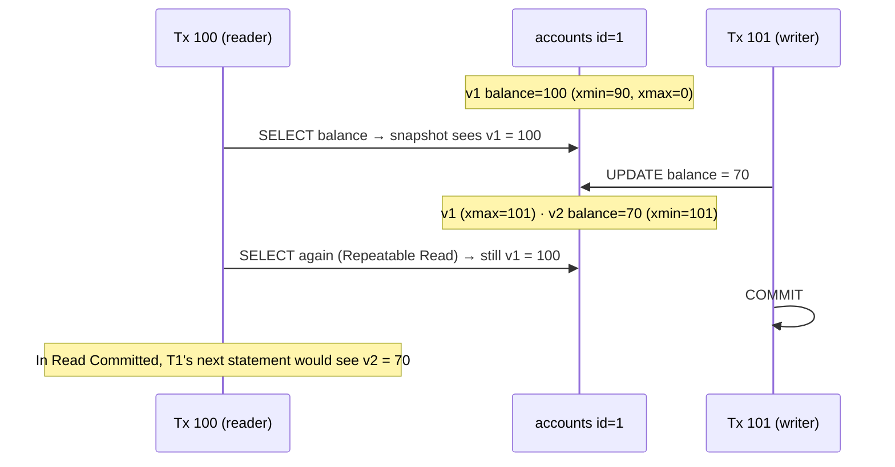

## Why it matters

Concurrency bugs in data are the most expensive bugs there are: double-spent balances, oversold tickets, two users with the same "unique" username, a doctor rota with nobody on call. They don't show up in tests with one user. They appear under load, rarely, and corrupt data permanently. Transactions and isolation are the tools that prevent them, but only if you know exactly what each level guarantees.

## ACID, precisely

| Property | Guarantee | What it does **not** mean |
| --- | --- | --- |
| **Atomicity** | All statements in a transaction take effect, or none do (rollback on error or crash) | Nothing about concurrency |
| **Consistency** | Constraints (FKs, checks, uniques) hold before and after each transaction | That your business rules hold, unless you encoded them as constraints |
| **Isolation** | Concurrent transactions don't interfere *to the degree the isolation level promises* | That they behave as if run one at a time, unless you use SERIALIZABLE |
| **Durability** | Once committed, data survives a crash (written to the write-ahead log and flushed) | That it survives losing the disk; that's replication and backups |

```sql
begin;
update accounts set balance = balance - 500 where id = 1;
update accounts set balance = balance + 500 where id = 2;
insert into transfers (from_id, to_id, amount) values (1, 2, 500);
commit;   -- all three, or (on any error / crash before this point) none
```

## The anomalies

Isolation levels are defined by which of these they allow:

| Anomaly | What happens |
| --- | --- |
| **Dirty read** | You read another transaction's uncommitted change, which may roll back |
| **Non-repeatable read** | You read a row twice in one transaction and get different values, because another transaction committed in between |
| **Phantom read** | You run the same range query twice and new rows appear |
| **Lost update** | Two transactions read a value, both compute from it, and the second write overwrites the first |
| **Write skew** | Two transactions read overlapping data, then each updates *different* rows based on what they read, jointly violating a rule neither would violate alone |

## Isolation levels in PostgreSQL

| Level | Dirty read | Non-repeatable read | Phantom | Lost update | Write skew |
| --- | --- | --- | --- | --- | --- |
| Read Uncommitted (behaves as Read Committed in Postgres) | ✗ | possible | possible | possible | possible |
| **Read Committed** (default) | ✗ | possible | possible | possible* | possible |
| **Repeatable Read** (snapshot isolation) | ✗ | ✗ | ✗ (in Postgres) | ✗ (aborts with 40001) | possible |
| **Serializable** (SSI) | ✗ | ✗ | ✗ | ✗ | ✗ (aborts with 40001) |

\* In Read Committed, a single `UPDATE … SET x = x - 1` is safe because Postgres re-reads the latest row version before applying it. The lost update happens with **read-then-write in application code**.

Other databases differ. MySQL InnoDB's default is Repeatable Read with different locking behaviour, and Oracle's "serializable" is snapshot isolation. Always check your database's documentation rather than the SQL standard's names.

```sql
begin isolation level serializable;
-- ...
commit;
-- or per session: set default_transaction_isolation = 'serializable';
```

## How MVCC works

PostgreSQL uses **multi-version concurrency control**. Instead of overwriting a row in place, an update creates a **new version** of the row (a new *tuple*) and marks the old one as expired.

Each tuple carries hidden system columns:

- `xmin`: the ID of the transaction that created this version.
- `xmax`: the ID of the transaction that deleted or replaced it (0 if still live).

When a transaction (or, in Read Committed, each statement) starts, it takes a **snapshot**: which transaction IDs had committed at that moment. A tuple is visible to you if its `xmin` committed before your snapshot and its `xmax` didn't.



You can see the hidden columns yourself:

```sql
select xmin, xmax, * from accounts where id = 1;
```

**Consequences:**

- **Readers don't block writers and writers don't block readers.** That's why plain `SELECT`s never wait on `UPDATE`s.
- **Writers block writers on the same row.** A second `UPDATE` of a row waits until the first transaction commits or aborts, then (in Read Committed) re-evaluates against the new version, or (in Repeatable Read and above) aborts with a serialization error.
- **Dead tuples accumulate.** Old versions no longer visible to any transaction must be cleaned up by **VACUUM** (run automatically by autovacuum). A long-running or idle-in-transaction session keeps an old snapshot alive, so nothing newer than it can be vacuumed. Tables bloat and queries slow down. Monitor `idle in transaction` sessions and set `idle_in_transaction_session_timeout`.
- Transaction IDs are 32-bit and wrap around. Autovacuum "freezes" old tuples to prevent wraparound problems, so never disable autovacuum.

## The lost update, interactively

Step through four strategies for two concurrent withdrawals:

<div data-viz="lost-update"></div>

## Locks

### Row locks

```sql
select * from accounts where id = 1 for update;          -- exclusive row lock until commit
select * from accounts where id = 1 for no key update;   -- weaker; doesn't block FK checks from children
select * from accounts where id = 1 for share;           -- others may read-lock, not modify
select * from seats where id = 7 for update nowait;      -- error immediately instead of waiting
```

### The job-queue pattern: SKIP LOCKED

```sql
-- Each worker claims one pending job; locked rows are skipped, not waited on
with next_job as (
  select id from jobs
  where status = 'pending' and run_at <= now()
  order by run_at
  limit 1
  for update skip locked
)
update jobs set status = 'running', locked_at = now(), attempts = attempts + 1
from next_job where jobs.id = next_job.id
returning jobs.*;
```

This turns Postgres into a reliable work queue for moderate volumes, with the job and your business data in the same transactional database. Used by Oban, good_job, graphile-worker and others.

### Table-level locks and DDL

Most DDL takes strong table locks. `ALTER TABLE` waiting for an `ACCESS EXCLUSIVE` lock queues behind a long-running query, and then *every new query* queues behind the `ALTER`. A two-second migration becomes an outage. Always set `lock_timeout` for migrations (see [SQL and relational modelling](/learn/sql-fundamentals/)).

### Advisory locks

Application-defined locks that the database manages but that don't lock any row:

```sql
select pg_try_advisory_lock(hashtext('nightly-report'));   -- true if acquired; a cheap "only one runner" guard
select pg_advisory_xact_lock(42);                           -- held until the transaction ends
```

Useful for "only one instance runs this cron job". If your session disconnects, the lock is released, which is a feature. For cross-system locking, see the caveats in [resilience patterns](/learn/resilience-patterns/).

## Deadlocks

```
Tx A: UPDATE accounts SET … WHERE id = 1;   -- locks row 1
Tx B: UPDATE accounts SET … WHERE id = 2;   -- locks row 2
Tx A: UPDATE accounts SET … WHERE id = 2;   -- waits for B
Tx B: UPDATE accounts SET … WHERE id = 1;   -- waits for A → cycle
```

Postgres runs deadlock detection after `deadlock_timeout` (1 s by default), aborts one transaction with `40P01`, and lets the other proceed. Prevention:

- **Consistent lock order:** always touch rows in the same order (for example ascending id). `SELECT … WHERE id IN (1, 2) ORDER BY id FOR UPDATE` locks both up front.
- **Short transactions:** never hold a transaction open across a network call or user think time.
- **Retry** on `40P01` and `40001`.

## Pessimistic vs optimistic concurrency

| | Pessimistic (lock first) | Optimistic (detect conflicts) |
| --- | --- | --- |
| How | `SELECT … FOR UPDATE`, then update | Version column or ETag; `UPDATE … WHERE version = $v`; retry on 0 rows |
| Best when | Conflicts are frequent (hot rows: flash-sale stock, a popular seat) | Conflicts are rare (most user edits) |
| Cost | Waiting, possible deadlocks, holding locks | Wasted work and retries when conflicts happen |
| Works across requests (user edits a form for 5 minutes) | ❌ never hold locks that long | ✅ |

## Retrying transactions correctly

Serialization failures and deadlocks are expected events under contention, not bugs. Wrap transactional units of work in a retry helper:

```ts
const RETRYABLE = new Set(["40001", "40P01"]); // serialization_failure, deadlock_detected

export async function withTransaction<T>(pool: Pool, fn: (c: PoolClient) => Promise<T>, attempts = 5): Promise<T> {
  for (let i = 1; ; i++) {
    const client = await pool.connect();
    try {
      await client.query("begin isolation level serializable");
      const result = await fn(client);
      await client.query("commit");
      return result;
    } catch (err: any) {
      await client.query("rollback").catch(() => {});
      if (!RETRYABLE.has(err.code) || i >= attempts) throw err;
      await new Promise((r) => setTimeout(r, Math.random() * 20 * 2 ** i)); // backoff with jitter
    } finally {
      client.release();
    }
  }
}
```

The whole function, including its reads, re-runs on retry. Don't put non-transactional side effects (sending email, calling a payment API) inside it; record an outbox row instead (see [messaging](/learn/messaging-and-background-jobs/)).

## Choosing an isolation level

- **Read Committed + atomic statements + targeted row locks** covers most web apps.
- **Repeatable Read** for consistent multi-query reports.
- **Serializable** when invariants span multiple rows (rotas, budgets across line items, inventory across warehouses) and you'd rather the database catch every anomaly. Pay with retries; Postgres's SSI is efficient, but contention increases aborts.

## Real-world scenarios

- **Payments:** a ledger insert and balance update in one transaction, guarded by a check constraint (`balance >= 0`) as the last line of defence.
- **Ticketing:** `UPDATE seats SET held_by = $1 WHERE id = $2 AND held_by IS NULL` claims a seat atomically; 0 rows means someone else got it.
- **Rota or quota rules spanning rows:** serializable transactions or explicit locks on the rows being checked.

## Common mistakes

- Read-modify-write in application code under Read Committed.
- Long transactions that wrap HTTP calls.
- Leaving sessions `idle in transaction`, which blocks vacuum and holds locks.
- Assuming "SERIALIZABLE" means the same thing in every database.
- Not retrying 40001 and 40P01.
- Locking rows in inconsistent orders.

## Security considerations

- Race conditions are exploitable: attackers send many parallel requests to redeem a coupon twice, withdraw twice, or bypass a limit (TOCTOU). Enforce invariants with atomic statements, constraints, or serializable transactions.
- Audit tables written in the same transaction as the change can't drift from reality.

## Performance considerations

- Higher isolation means more aborts under contention; measure your retry rate.
- Hot rows (a global counter) serialise all writers. Shard the counter (N rows, summed on read) or aggregate asynchronously.
- Keep transactions short so locks are held briefly and vacuum can keep up.

## Hands-on exercise

With two `psql` sessions against local Postgres:

1. **Non-repeatable read:** in session A, `begin;` and select a row twice, while session B updates and commits in between. Repeat with `begin isolation level repeatable read;` and compare.
2. **Lost update:** reproduce the read-modify-write bug from the simulation, then fix it with an atomic `UPDATE`, then with `FOR UPDATE`.
3. **Write skew:** create `doctors(name, on_call boolean)` with two on-call doctors. In two Repeatable Read sessions, each checks the on-call count is ≥ 2 and sets one doctor off call. Both commit. Repeat at Serializable and observe the 40001 error.
4. **Deadlock:** create one, read the error, then fix it with consistent ordering.
5. **Job queue:** build the SKIP LOCKED worker in your language, run four workers on 1,000 jobs, and prove each job ran exactly once.
6. **MVCC:** update a row 10,000 times in a loop, check `n_dead_tup` in `pg_stat_user_tables`, then run `vacuum (verbose)` and check again.

## Completion criteria

- You can name the anomaly behind a concurrency bug and the isolation level or lock that prevents it.
- You can explain MVCC, dead tuples and why long transactions hurt.
- Your transactional code retries serialization failures and deadlocks correctly.
