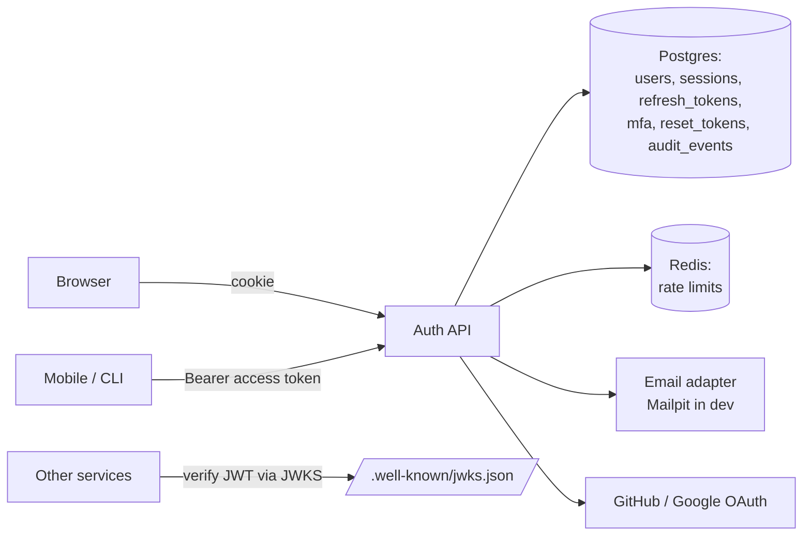

## Project overview

Build the authentication service you'd trust in production. Every feature maps to a specific threat. When you're done you'll be able to explain why each defence exists, and you'll have a reusable service for later projects.

## Requirements

### Functional

- Register (email, password), verify email, log in, log out, log out of all devices.
- Browser clients use an `HttpOnly` session cookie; API and mobile clients use 15-minute JWT access tokens plus rotating refresh tokens.
- Optional TOTP MFA with recovery codes; MFA required for admins.
- Password reset by email; password change requires the current password.
- Social login (GitHub or Google).
- Roles: `viewer`, `member`, `admin` per organisation.

### Non-functional

- Follows OWASP Authentication, Session Management and Password Storage cheat sheets.
- Uniform responses and timing for unknown emails vs wrong passwords.
- Login p95 < 400 ms including hashing (measure and tune Argon2 parameters).
- Every security-relevant event is audited.

## Architecture



## Database design

```sql
create table users (
  id uuid primary key default gen_random_uuid(),
  email citext not null unique,
  password_hash text,                         -- null for social-only accounts
  email_verified_at timestamptz,
  created_at timestamptz not null default now()
);
create table identities (                     -- social logins, keyed by (issuer, subject), never by email
  user_id uuid not null references users(id) on delete cascade,
  issuer text not null, subject text not null,
  primary key (issuer, subject)
);
create table sessions (id_hash bytea primary key, user_id uuid not null references users(id) on delete cascade,
  mfa_passed boolean not null default false, created_at timestamptz not null default now(),
  last_seen_at timestamptz not null default now(), expires_at timestamptz not null, ip inet, user_agent text);
create table refresh_tokens (id_hash bytea primary key, family_id uuid not null, user_id uuid not null,
  used_at timestamptz, revoked_at timestamptz, expires_at timestamptz not null);
create table mfa_totp (user_id uuid primary key references users(id) on delete cascade,
  secret_encrypted bytea not null, enabled_at timestamptz);
create table recovery_codes (user_id uuid not null, code_hash text not null, used_at timestamptz);
create table reset_tokens (id_hash bytea primary key, user_id uuid not null, expires_at timestamptz not null, used_at timestamptz);
create table memberships (user_id uuid not null, org_id uuid not null, role text not null check (role in ('viewer','member','admin')),
  primary key (user_id, org_id));
create table audit_events (id bigint generated always as identity primary key, occurred_at timestamptz not null default now(),
  actor_id uuid, ip inet, action text not null, target text, metadata jsonb not null default '{}');
```

## API contracts

| Method | Path | Notes |
| --- | --- | --- |
| `POST` | `/auth/register` | 202 always (don't reveal whether the email exists); sends verification email |
| `POST` | `/auth/login` | Sets session cookie, or returns `{access_token, refresh_token}` for `client=api`; `401` uniform message; `423`-style lockout avoided in favour of delays |
| `POST` | `/auth/mfa/verify` | Upgrades session to `mfa_passed` |
| `POST` | `/auth/token/refresh` | Rotates; reuse → revoke family, `401` |
| `POST` | `/auth/logout`, `/auth/logout-all` | `204` |
| `POST` | `/auth/password/forgot`, `/auth/password/reset` | Forgot always `202`; reset tokens single-use, 30 min |
| `GET` | `/auth/oauth/github/start`, `/auth/oauth/github/callback` | PKCE + state + nonce |
| `GET` | `/.well-known/jwks.json` | Public keys for JWT verification, with `kid` rotation |
| `GET` | `/me` | Current user, roles |

## Technology selection

Node: Fastify, `argon2`, `jose`, `otplib`, `zod`. Python: FastAPI, `argon2-cffi`, `pyjwt` or `authlib`, `pyotp`, Pydantic. Mailpit in Docker for email in development. RS256 or EdDSA signing keys loaded from configuration, rotated with `kid`.

## Step-by-step implementation

1. Schema and migrations; config validation (keys, secrets, cookie domain).
2. Registration: validate, check the password against the HIBP range API (k-anonymity), hash with Argon2id, send verification.
3. Login: per-IP and per-account rate limits in Redis; dummy hash for unknown users; rehash on login; audit success and failure.
4. Sessions: random 256-bit token in cookie, SHA-256 hash in DB, rotation on login and MFA, idle and absolute expiry.
5. Tokens: short-lived JWTs with `iss`, `aud`, `sub`, `exp`, `kid`; refresh rotation in a transaction with `FOR UPDATE`; family revocation on reuse.
6. MFA: enrol (QR from otpauth URI) → confirm with first code → enable; recovery codes hashed; reject reused codes within the window.
7. Password reset: hashed single-use tokens; invalidate all sessions after reset.
8. OAuth: authorization code + PKCE; validate `state`, `nonce`, ID token (if OIDC) or fetch the GitHub user; link by `(issuer, subject)`.
9. RBAC: `can(user, action, resource)` used by every protected route; `404` for cross-tenant access.
10. Security headers, CSRF protection for cookie-authenticated state-changing routes (SameSite + token or Origin check).

## Starter repository structure

```
auth-service/
├── src/
│   ├── config.ts
│   ├── crypto/ (passwords.ts, tokens.ts, keys.ts)
│   ├── modules/
│   │   ├── auth/ (routes, service, repository)
│   │   ├── mfa/
│   │   ├── oauth/
│   │   └── rbac/
│   ├── middleware/ (rate-limit, csrf, request-context, errors)
│   └── audit.ts
├── migrations/
├── test/
└── compose.yaml   # postgres, redis, mailpit
```

## Testing requirements

- Unit: password hashing and rehash, token signing and verification (wrong `aud`, expired, `alg` swapped), TOTP windows.
- Integration: full flows (register → verify → login → MFA → refresh → logout-all).
- Security tests: refresh reuse revokes the family; login timing for unknown vs known email within noise; 6th failed login is throttled; reset token works once; another org's resource returns 404; CSRF-less cross-origin POST fails.
- Run OWASP ZAP baseline scan against the running service and triage findings.

## Deployment instructions

Docker Compose for local; a multi-stage image running as non-root; secrets from environment or a secrets manager; HTTPS-only with HSTS. Rotate signing keys by publishing the new key in JWKS before using it.

## Evaluation criteria

| Criterion | Meets the bar when… |
| --- | --- |
| Password storage | Argon2id, tuned, rehash on login, breach check |
| Sessions and tokens | Secure cookies, rotation, revocation, refresh reuse detection |
| Enumeration resistance | Uniform responses and timing |
| MFA | Correct enrolment, recovery, no bypass via direct API calls |
| Authorisation | Central `can()`, tenant isolation tested |
| Auditability | All security events recorded without secrets |

## Advanced extensions

- Passkeys (WebAuthn) as a passwordless option.
- Device management UI listing sessions with revoke buttons.
- Risk-based step-up authentication (new device or location triggers MFA).
- Make it an OIDC provider for your other projects.
