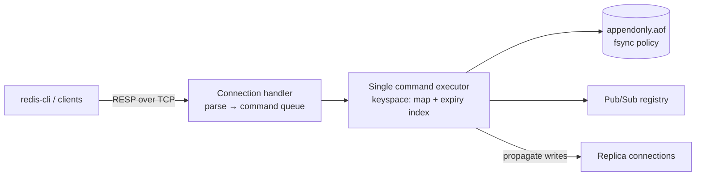

## Project overview

Redis is small enough to understand and sophisticated enough to teach networking, protocols, data structures, concurrency, persistence and replication. Your server should work with the real `redis-cli` and client libraries.

## Requirements

**Functional:** RESP2 protocol; commands listed in the steps; multiple concurrent clients; pipelining; persistence across restarts; a replica that follows a primary.

**Non-functional:** correctness against real clients; no crash on malformed input; benchmark results reported honestly versus real Redis on the same machine.

## Architecture



A single executor (like Redis's main thread) avoids locks on the keyspace; networking can be concurrent.

## API contracts

RESP2 framing: simple strings `+OK\r\n`, errors `-ERR …\r\n`, integers `:1\r\n`, bulk strings `$3\r\nfoo\r\n`, arrays `*2\r\n…`. Commands follow real Redis semantics and error messages closely enough for clients to work (`redis-cli`, `ioredis`/`go-redis`).

## Technology selection

Go (goroutine per connection + one executor goroutine via channels) or Rust (tokio) are natural; Node's event loop mirrors Redis's model directly.

## Step-by-step implementation

1. RESP parser as a pure function over a byte buffer (complete value, need more bytes, or protocol error); test with partial reads.
2. Command dispatch table with arity checks.
3. `SET` options and `GET`; expiry stored as absolute deadlines; lazy deletion on access plus an active cycle sampling 20 keys with TTLs 10 times per second.
4. Lists with a deque; `BLPOP` parks the client until data arrives or timeout.
5. Sorted set: hash map (member → score) plus a skip list ordered by (score, member) for range queries.
6. Pub/Sub: subscribed connections switch mode; publish fans out.
7. AOF: append each write command in RESP; `appendfsync everysec` policy; on startup replay; implement a simple rewrite (compaction) as an extension.
8. Replication: replica connects, receives a snapshot (or replays the AOF), then a live stream of write commands.
9. Benchmark: `redis-benchmark -p 6380 -t set,get -n 100000 -c 50` against yours and real Redis; record results with machine details.

## Starter repository structure

```
myredis/
├── resp/ (parser, writer)
├── server/ (conn, executor, commands/*)
├── store/ (keyspace, expiry, skiplist, list)
├── persistence/aof
├── replication/
└── tests/ (resp, commands, integration with a real client)
```

## Testing requirements

Unit tests for the parser and each data structure; integration tests using an official client library; expiry tests with a controllable clock; crash test (kill -9 after writes, restart, verify AOF replay); replication test (writes on primary appear on replica).

## Deployment instructions

Runs as a single binary and in a container; document configuration flags (port, AOF path, fsync policy, replicaof).

## Evaluation criteria

| Criterion | Meets the bar when… |
| --- | --- |
| Protocol | Works with redis-cli and a client library, including pipelining |
| Semantics | Commands and expiry match Redis behaviour for the implemented subset |
| Persistence | Survives kill -9 with at most one second of loss (everysec) |
| Replication | Replica converges and serves reads |
| Honesty | Benchmarks reported with methodology, compared fairly |

## Advanced extensions

RESP3; `MULTI/EXEC`; Lua scripting (embed a Lua VM); RDB snapshots via fork-like copy-on-write; Redis Cluster hash slots and `MOVED` redirects.
