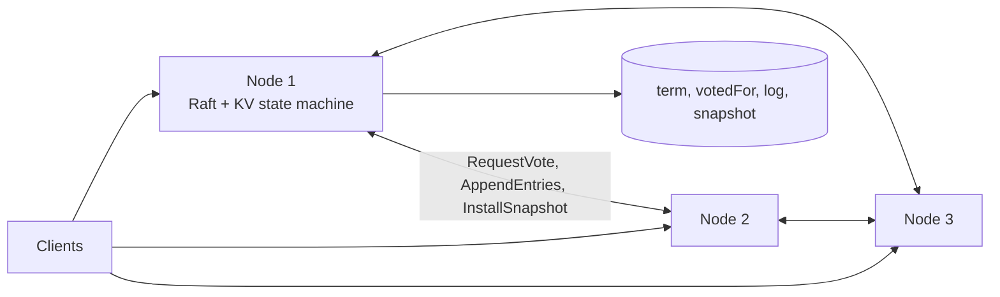

## Project overview

The capstone for distributed systems: implement Raft from the paper (Figure 2 is your specification) and build a key-value store on it. MIT 6.824's labs follow a similar path; use them as a reference for test ideas.

## Requirements

**Functional:** `PUT key value`, `GET key`, `DELETE key`, `CAS key expected new`; any node accepts client requests and redirects to the leader.

**Non-functional:** linearizable operations; tolerates `f` failures with `2f+1` nodes; no committed write is ever lost; makes progress whenever a majority can communicate.

## Architecture



## Database design

Persistent per node: `currentTerm`, `votedFor`, `log[]` (index, term, command), latest snapshot (state machine + last included index/term). Volatile: `commitIndex`, `lastApplied`; leader-only `nextIndex[]`, `matchIndex[]`. Persist before responding to RPCs (fsync).

## API contracts

Client: `PUT /kv/{key}`, `GET /kv/{key}`, `POST /kv/{key}/cas`, each with `client_id` and `seq` for deduplication; non-leaders return `307` (or a gRPC error) with the leader hint. Internal RPCs per the Raft paper.

## Technology selection

Go (goroutines, channels, `net/rpc` or gRPC) is the classic choice. Build a fake network layer for tests that can drop, delay, reorder and partition messages deterministically.

## Step-by-step implementation

1. Persistent state and RPC plumbing over a pluggable transport (real and simulated).
2. Election: randomised timeout (e.g. 150–300 ms), RequestVote with up-to-date log check, one vote per term.
3. Replication: AppendEntries with prevLogIndex/prevLogTerm; conflict handling by truncation; fast backtracking optimisation.
4. Commit: advance `commitIndex` to the highest index replicated on a majority **with an entry from the current term**; apply in order.
5. KV state machine with client deduplication table (`client_id → last seq, result`) so retries are idempotent.
6. Reads: ReadIndex (leader confirms leadership with a heartbeat round before serving) or route reads through the log.
7. Snapshots when the log exceeds a threshold; InstallSnapshot for lagging followers.
8. Fault injection tests and a history recorder; check histories with a linearizability checker (Porcupine for Go, or Knossos/Elle concepts).

## Starter repository structure

```
raftkv/
├── raft/ (state, election, replication, snapshot, persister)
├── kv/ (state machine, dedupe, server)
├── transport/ (grpc, simulated)
├── tests/ (election, replication, partitions, persistence, linearizability)
└── compose.yaml   # 3 or 5 nodes
```

## Testing requirements

Deterministic simulated-network tests: initial election, re-election after leader failure, no election with a healthy leader, agreement despite follower failures, no progress without a majority, partition heal, log conflict resolution, persistence across restarts, snapshots. Run the suite hundreds of times (concurrency bugs are rare). Linearizability check over randomised client histories with partitions.

## Deployment instructions

3- and 5-node Compose clusters; scripts using `docker network disconnect` to partition nodes; document how to observe terms and leaders.

## Evaluation criteria

| Criterion | Meets the bar when… |
| --- | --- |
| Safety | No lost committed writes; histories are linearizable |
| Liveness | Elects a leader and progresses whenever a majority is connected |
| Persistence | Correct after crashes and restarts |
| Compaction | Snapshots bound log growth; lagging nodes catch up |
| Rigor | Test suite with fault injection, run repeatedly |

## Advanced extensions

Membership changes (single-server); multi-Raft sharding by key range with a placement driver; leader leases for fast reads (and their clock assumptions); an LSM storage engine underneath.
