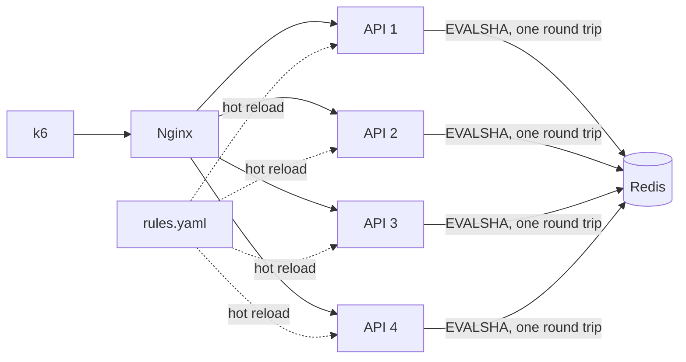

## Project overview

Build the limiter from [infrastructure design cases](/learn/design-cases-infrastructure/) as a library plus a demo API, and measure its accuracy and overhead under distributed load.

## Requirements

**Functional:** limits per API key, user, IP and route; burst plus sustained rates; layered rules (global, per tenant plan, per endpoint); responses with `429`, `Retry-After`, and remaining-quota headers.

**Non-functional:** limiter adds < 2 ms p99 (measure on your hardware); total admitted requests across 4 instances stay within 5% of the configured limit; Redis outage → fail open on normal routes, fail closed on `/login` and `/otp`.

## Architecture



## API contracts

Middleware outputs: `RateLimit-Limit`, `RateLimit-Remaining`, `RateLimit-Reset` (or `X-RateLimit-*`), and on rejection `429` with `Retry-After` and a problem+json body. Demo API: `GET /api/search` (100/min per key, burst 20), `POST /login` (5 per 15 min per account + 20 per 10 min per IP, fail closed).

## Technology selection

Go (`go-redis` with `Script`) or Node (`ioredis` `defineCommand`). Use Redis server time inside the script or pass a timestamp consistently.

## Step-by-step implementation

1. Rule model and key extraction (trusting `X-Forwarded-For` only from the proxy).
2. Token bucket Lua script (see the lesson) returning allowed and remaining; unit test it against a real Redis with simulated time.
3. Sliding window counter script; compare behaviour at window edges with a test.
4. Middleware with headers and problem responses.
5. Failure policy: 5 ms timeout on the Redis call; breaker opens after repeated failures; policy per route.
6. Local deny cache: when a key is over limit, cache "denied until T" in memory to skip Redis.
7. Hot reload rules with validation; reject invalid configs without dropping the old one.
8. Load test: k6 drives 4 instances; count admitted requests per key per window from logs or metrics and compare with the configured limit.

## Starter repository structure

```
ratelimiter/
├── limiter/ (rules, scripts/*.lua, middleware, breaker, localcache)
├── demo-api/
├── loadtest/
└── compose.yaml
```

## Testing requirements

Script tests with time control; concurrency test (1,000 parallel requests for one key admit exactly the bucket size); failure tests (Redis stopped → fail open/closed per route); accuracy and overhead report with your numbers.

## Deployment instructions

Compose with Redis, 4 API instances and Nginx. Document Redis memory sizing from key count and TTLs.

## Evaluation criteria

| Criterion | Meets the bar when… |
| --- | --- |
| Atomicity | No over-admission under concurrency |
| Accuracy | Measured admitted count within tolerance across instances |
| Overhead | Measured latency added reported |
| Resilience | Correct fail-open/closed behaviour; breaker works |
| Usability | Standard headers, clear 429 bodies, hot-reloadable rules |

## Advanced extensions

Redis Cluster with hash tags; per-region limits with async reconciliation; concurrency limits (in-flight requests) in addition to rate limits; adaptive limits based on backend latency (load shedding).
