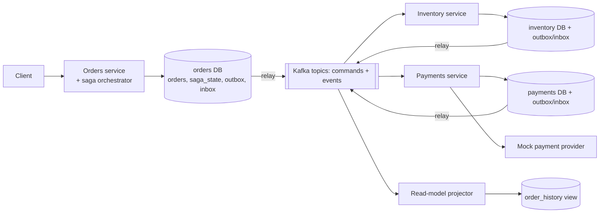

## Project overview

The canonical distributed-transaction problem: placing an order must reserve stock and charge payment across services that don't share a database, without double charges, lost orders or phantom reservations, even when processes crash at the worst moment.

## Requirements

**Functional:** `POST /orders` creates a pending order; the saga reserves stock, charges payment (mock provider failing 20% of the time and timing out 5%), confirms the order; failures compensate (release stock, refund) and cancel the order. Customers can list their orders.

**Non-functional:** every order ends `CONFIRMED` or `CANCELLED`; stock never goes negative; a customer is never charged without a confirmed order (after compensations settle); everything survives crashes of any process at any time.

## Architecture



## Database design

Each service owns its schema. Shared patterns:

```sql
create table outbox (id uuid primary key, topic text not null, key text not null, payload jsonb not null,
  created_at timestamptz default now(), sent_at timestamptz);
create table inbox (message_id uuid primary key, processed_at timestamptz default now());   -- dedupe consumed messages
-- orders service
create table saga_state (order_id uuid primary key, step text not null, status text not null, updated_at timestamptz default now(), deadline timestamptz);
-- inventory service
create table stock (sku text primary key, available int not null check (available >= 0));
create table reservations (order_id uuid primary key, items jsonb not null, status text not null);
-- payments service
create table payments (order_id uuid primary key, amount_minor bigint not null, status text not null, provider_ref text);
```

## API contracts

`POST /orders` (`Idempotency-Key` required) → `202 {order_id, status:"PENDING"}`; `GET /orders/{id}`; `GET /customers/{id}/orders` (read model). Messages: commands `ReserveStock`, `ReleaseStock`, `ChargePayment`, `RefundPayment`; events `StockReserved`, `StockReservationFailed`, `PaymentCaptured`, `PaymentFailed`, `OrderConfirmed`, `OrderCancelled`. Every message carries `message_id`, `order_id`, `traceparent`.

## Technology selection

Redpanda (single binary, Kafka API) keeps Compose light; RabbitMQ also works. Postgres per service (three databases in one container is fine locally). Optionally Temporal as a comparison for the orchestrator.

## Step-by-step implementation

1. Design doc: contexts, message schemas, saga steps with compensations, the invariants above.
2. Each handler: in one transaction, check `inbox` (skip if seen) → apply change → write outbox rows → insert inbox row.
3. Relay: poll unsent outbox rows with `FOR UPDATE SKIP LOCKED`, publish keyed by `order_id`, mark sent; at-least-once.
4. Orchestrator: a state machine persisted in `saga_state`; reacts to events; schedules a deadline per step; on timeout, query the participant or compensate.
5. Payment idempotency: pass `order_id` as the provider idempotency key; on timeout, query status before retrying.
6. Read model projector, idempotent by event position; `rebuild` script replays from the beginning of the topics.
7. Chaos: script runs 1,000 orders while randomly killing (`docker kill`) services and the relay; afterwards a checker verifies invariants across all three databases.

## Starter repository structure

```
orders-saga/
├── services/orders  services/inventory  services/payments  services/projector
├── libs/messaging (outbox, inbox, relay, schemas)
├── chaos/run.sh  chaos/check-invariants.sql
├── docs/design.md  docs/adr/
└── compose.yaml
```

## Testing requirements

Unit tests for each handler's idempotency and the saga state machine (every transition, including timeouts); contract tests for message schemas; the chaos run's invariant report (attach it); distributed traces showing a full saga.

## Deployment instructions

Compose with all services, three Postgres databases, Redpanda, and Jaeger. Document how to run the chaos test.

## Evaluation criteria

| Criterion | Meets the bar when… |
| --- | --- |
| Reliable messaging | Outbox + inbox; no lost or double-applied messages |
| Saga correctness | All orders terminate; compensations restore invariants |
| Failure handling | Timeouts, unknown payment outcomes handled deliberately |
| Read model | Rebuildable from events; eventual consistency explained |
| Evidence | Chaos report with zero invariant violations |

## Advanced extensions

Re-implement the orchestrator with Temporal and compare code size and failure handling; add choreography for a "send confirmation email" step; add a shipping service and a semantic lock preventing order edits during the saga.
