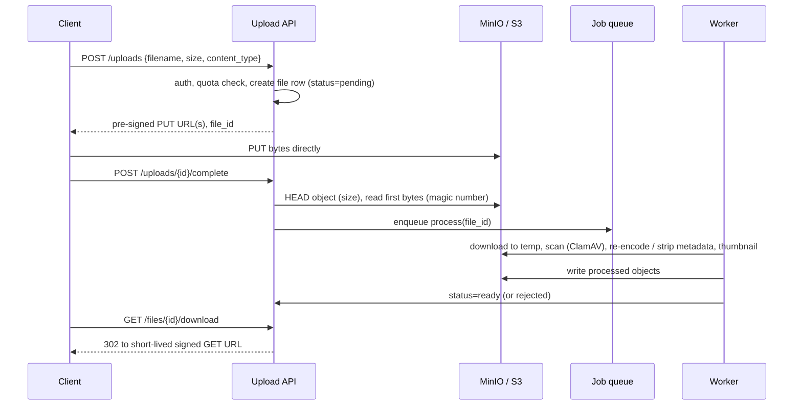

## Project overview

File uploads are a classic source of vulnerabilities (stored XSS via SVG, path traversal, decompression bombs, malware hosting) and of scaling pain (large bodies through app servers). This service handles uploads properly: files go straight to object storage, nothing is trusted until validated, and downloads are controlled.

## Requirements

**Functional:** request an upload, upload directly (resumable multipart for large files), list and download own files, delete; images get thumbnails.

**Non-functional:** app servers never stream file bytes; files are unavailable until scanned and validated; downloads require authorisation; max 100 MB per file, 1 GB per user quota.

## Architecture



## Database design

```sql
create table files (
  id uuid primary key, owner_id uuid not null,
  original_name text not null,           -- display only, never used as a path
  object_key text not null unique,       -- random, e.g. u/{owner}/{uuid}
  declared_type text, detected_type text,
  size_bytes bigint, sha256 text,
  status text not null default 'pending' check (status in ('pending','uploaded','processing','ready','rejected','deleted')),
  rejection_reason text,
  created_at timestamptz not null default now()
);
create table quotas (owner_id uuid primary key, used_bytes bigint not null default 0, limit_bytes bigint not null);
```

## API contracts

| Method | Path | Notes |
| --- | --- | --- |
| `POST` | `/uploads` | Returns `file_id` and pre-signed URL(s); `413` over size, `409` quota exceeded |
| `POST` | `/uploads/{id}/complete` | `202`; validation and processing start |
| `GET` | `/files?cursor=` | Own files with status |
| `GET` | `/files/{id}/download` | `302` to a 5-minute signed URL; `404` if not owner or not ready |
| `DELETE` | `/files/{id}` | `204`; object deletion async |

## Technology selection

MinIO in Docker for a free, S3-compatible store (same SDK calls as AWS S3). `file-type` (Node) or `python-magic` for magic-byte detection. `sharp` or Pillow for images. ClamAV daemon container. A Postgres-backed queue (BullMQ, Celery or SKIP LOCKED).

## Step-by-step implementation

1. Threat model (STRIDE) as a one-page doc; derive the controls below from it.
2. Pre-signed PUT URLs constrained by content length and expiry; for >5 MB, multipart upload with pre-signed part URLs.
3. Completion: verify object size matches declared, detect type from bytes, allowlist types (JPEG, PNG, WebP, PDF), reject everything else.
4. Worker: scan; re-encode images (destroys polyglot payloads and strips EXIF/GPS); render a thumbnail; compute SHA-256; mark ready.
5. Downloads: signed GET URLs with `response-content-disposition=attachment` for non-images; serve from a separate bucket or domain; never serve SVG or HTML inline.
6. Quotas updated transactionally; rate limit upload requests.
7. Lifecycle: abort incomplete multipart uploads after 24 h; reaper deletes pending rows and objects older than 24 h.

## Starter repository structure

```
uploads/
├── api/ (routes, presign.ts, validation.ts, quotas.ts)
├── worker/ (scan.ts, images.ts, process.ts)
├── docs/threat-model.md
└── compose.yaml   # postgres, minio, clamav, api, worker
```

## Testing requirements

Integration tests: happy path; a PHP file renamed `.jpg` is rejected; the EICAR test file is rejected by the scanner; an image with GPS EXIF comes out without it; downloading another user's file returns 404; signed URLs expire; quota enforcement under concurrent uploads.

## Deployment instructions

Compose locally; in the cloud, S3 with Block Public Access, bucket policies limited to the service role, and object lifecycle rules.

## Evaluation criteria

| Criterion | Meets the bar when… |
| --- | --- |
| Architecture | No file bytes through API servers |
| Validation | Magic bytes, allowlist, re-encoding, scanning before availability |
| Access control | Signed short-lived URLs, ownership checks, separate download origin |
| Robustness | Abandoned uploads cleaned up; quotas consistent |
| Threat model | Each STRIDE threat mapped to a control |

## Advanced extensions

Video uploads transcoded to HLS with ffmpeg; content-addressed deduplication by SHA-256; image CDN with on-the-fly resizing and signed transformation URLs.
