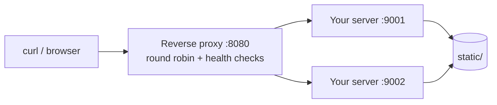

## Project overview

Frameworks hide HTTP. In this project you implement a working subset of HTTP/1.1 directly on TCP sockets, then put a reverse proxy in front of it. You'll leave understanding framing, headers, keep-alive, timeouts and why production servers and proxies are hard to write correctly.

## Requirements

### Functional

- `GET /` returns an HTML page; `GET /static/<file>` serves files from a directory; `POST /echo` returns the request body.
- Correct status codes: `200`, `400` (malformed request), `404`, `405`, `413` (body too large), `431` (headers too large), `500`.
- Keep-alive: multiple requests on one connection; `Connection: close` honoured.
- Reverse proxy on another port distributes requests across two server instances and stops sending to a dead one.

### Non-functional

- Never crash on malformed input (fuzz it).
- Idle connections time out after 10 s; a slow client sending headers byte by byte is cut off after 5 s (slowloris defence).
- Header limit 8 KB, body limit 1 MB.

## Architecture



Inside the server: a connection handler owns a byte buffer; a parser consumes complete requests from it (there may be several, or half of one); a router produces a response; the writer serialises it.

## API contracts

| Request | Response |
| --- | --- |
| `GET /` | `200 text/html` |
| `GET /static/app.css` | `200 text/css` with the file |
| `GET /static/../server.js` | `400` or `404`, never the file |
| `POST /echo` with body | `200` echoing the body, same `Content-Type` |
| `DELETE /` | `405` with `Allow: GET, POST` |
| Headers over 8 KB | `431` then close |

## Technology selection

Use only your language's socket library (`net` in Node, `socket`/`asyncio` streams in Python, `net` in Go). No HTTP libraries in the server. For the proxy you may use your language's HTTP client *after* you've built one version with raw sockets.

## Step-by-step implementation

1. **Echo server:** accept connections, print received bytes, write them back. Observe that one `data` event can contain half a request or two requests.
2. **Parser:** buffer until `\r\n\r\n`; split the request line (`METHOD SP target SP version`); parse headers case-insensitively; reject invalid lines with `400`.
3. **Responses:** always send `Content-Length` (or chunked encoding as an extension), `Date`, `Content-Type`.
4. **Bodies:** read exactly `Content-Length` bytes; enforce the limit before buffering.
5. **Keep-alive:** after writing a response, continue parsing the buffer; set idle and header-read timeouts.
6. **Static files:** resolve the path against the root and verify it stays inside it; map extensions to MIME types; stream files rather than reading them fully.
7. **Proxy:** accept a request, choose the next healthy backend, forward the request (rewrite `Host` if needed, append `X-Forwarded-For`, strip hop-by-hop headers like `Connection`), stream the response back.
8. **Health checks:** poll `GET /health` on each backend every 2 s; mark down after 3 failures and up after 2 successes.

## Starter repository structure

```
http-from-scratch/
├── server/
│   ├── parser.(ts|py|go)     # pure function: bytes → request | need-more | error
│   ├── router.(ts|py|go)
│   ├── static.(ts|py|go)
│   └── main.(ts|py|go)
├── proxy/
│   └── main.(ts|py|go)
├── static/index.html
└── tests/
```

## Testing requirements

- Unit tests for the parser: complete request, split across chunks at every byte boundary, two pipelined requests, malformed request line, oversized headers.
- Integration: `curl -v`, `curl --http1.1 -H 'Connection: keep-alive'` with several URLs on one connection, and raw `printf … | nc`.
- Path traversal tests (`..`, URL-encoded `%2e%2e`).
- A simple fuzzer sending random bytes for 60 seconds without a crash.
- Load: `hey -c 50 -n 10000 http://localhost:8080/` through the proxy with one backend killed midway, reporting your measured error count.

## Deployment instructions

Run both servers and the proxy with Docker Compose. Optionally put real Nginx in front and compare behaviour on the same tests.

## Evaluation criteria

| Criterion | Meets the bar when… |
| --- | --- |
| Correct framing | Partial and pipelined requests handled |
| Robustness | Fuzzing and malformed input never crash the server |
| Limits and timeouts | Slowloris, oversized headers and bodies are rejected |
| Security | No path traversal; hop-by-hop headers not forwarded |
| Proxy | Fails over within one health-check cycle |

## Advanced extensions

- Chunked transfer encoding for request and response bodies.
- TLS termination in the proxy.
- Least-connections balancing; a `/metrics` endpoint with request counts per backend.
- Read the HTTP request smuggling research and test your proxy and server against conflicting `Content-Length`/`Transfer-Encoding` headers.
