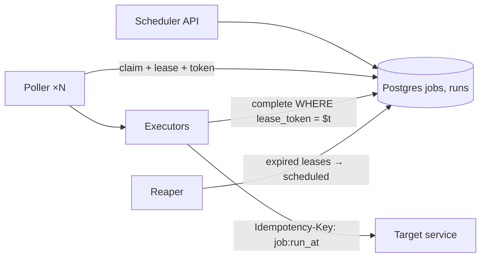

## Project overview

A scheduler is deceptively simple until processes pause, crash and restart. You'll build one whose guarantees you can state precisely: no lost jobs, no concurrent duplicate execution, exactly-once *effect* through idempotency.

## Requirements

**Functional:** schedule a job at a time or on a cron expression with a payload and a target (HTTP webhook to a test service); cancel; list runs with status and errors; retries with backoff and max attempts.

**Non-functional:** jobs run within 2 s of due time at normal load; durable across restarts; at-least-once triggering with fenced completion; one tenant can't starve others.

## Architecture

See the design in [infrastructure design cases](/learn/design-cases-infrastructure/): API → `jobs` table → pollers (SKIP LOCKED) → executors → targets with idempotency keys; a reaper resets expired leases.



## Database design

Use the `jobs` table from the lesson plus `runs(job_id, run_at, attempt, status, started_at, finished_at, error)` and `tenant_limits(tenant_id, max_concurrent)`.

## API contracts

`POST /jobs {run_at | cron, timezone, target_url, payload, max_attempts}` → `201`; `DELETE /jobs/{id}`; `GET /jobs/{id}/runs`. Targets receive `POST` with headers `Idempotency-Key` and `X-Fence-Token`.

## Technology selection

Plain SQL with your Postgres driver; a cron parser library (`cron-parser`, `croniter`, `robfig/cron`). A tiny target service that records received idempotency keys (to detect duplicate effects).

## Step-by-step implementation

1. Schema and API with validation (cron syntax, time zones, URL allowlist to avoid SSRF).
2. Poller: claim up to N due jobs, set `lease_until` and increment `lease_token`, respecting tenant concurrency (count claimed per tenant in the same query or a pre-check).
3. Executor: call target with timeout; complete with `WHERE lease_token = $token` (0 rows = stale worker → discard result).
4. Failure: increment attempts, `run_at = now() + backoff`, or mark `failed` after max.
5. Reaper every 5 s.
6. Cron: on completion, compute next occurrence and insert/update in the same transaction; implement a "missed runs" policy (run once on recovery).
7. Chaos: schedule 50k jobs over 10 minutes, randomly kill and pause (`docker pause`) pollers and executors; the target service reports duplicates and missing keys.

## Starter repository structure

```
scheduler/
├── api/  poller/  executor/  reaper/
├── target-recorder/
├── chaos/
└── compose.yaml
```

## Testing requirements

Concurrent claim test (no job claimed twice concurrently); stale-worker test (paused worker's completion rejected by fencing); cron next-run correctness across DST changes; chaos report: zero missing jobs, duplicate deliveries only where leases expired, zero duplicate *effects* at the target.

## Deployment instructions

Compose with Postgres, 3 pollers, executors and the target recorder; document scaling knobs (batch size, lease length, poll interval).

## Evaluation criteria

| Criterion | Meets the bar when… |
| --- | --- |
| Durability | No lost jobs across crashes |
| Mutual exclusion | Fencing rejects stale workers |
| Effect-once | Idempotency keys prevent duplicate effects |
| Fairness | Tenant limits enforced under load |
| Evidence | Chaos test report attached |

## Advanced extensions

Timing wheel in memory for sub-second precision; leader-elected cron expander via a Postgres advisory lock; a web UI; compare with Temporal schedules.
