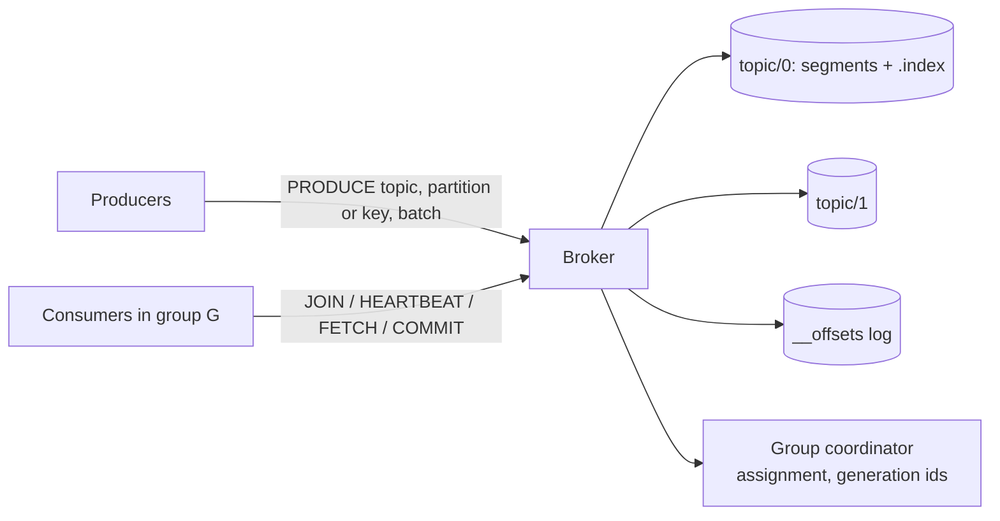

## Project overview

Implement the storage and consumer-group heart of a log-based broker, so Kafka's guarantees and limits become concrete.

## Requirements

**Functional:** create topics with N partitions; produce records (key, value, headers) with acks; fetch from an offset (long poll); consumer groups with automatic partition assignment and committed offsets; retention; compaction.

**Non-functional:** acknowledged records survive process crashes (with the fsync policy you document); recovery handles a partially written final record; throughput measured and reported.

## Architecture



## Database design (on-disk format)

Record batch: `[length u32][crc32 u32][base_offset u64][count u32][records…]`, each record `[offset_delta][timestamp][key_len][key][value_len][value]`. Segment files named by base offset; sparse index every 4 KB mapping offset → file position.

## API contracts

`POST /topics {name, partitions}`; `POST /topics/{t}/records {key?, value, partition?}` → `{partition, offset}` (or a binary protocol); `GET /topics/{t}/partitions/{p}?offset=&max_bytes=&wait_ms=`; group endpoints: `join`, `heartbeat`, `commit`, `offsets`. Generation ids reject stale members' commits (fencing).

## Technology selection

Go or Rust for control over I/O; standard library file APIs; `crc32` for integrity.

## Step-by-step implementation

1. Log: append batches to the active segment; roll on size; fsync per batch or interval (document it).
2. Index: write sparse entries; fetch uses binary search then a sequential scan.
3. Partitioning: `hash(key) % partitions`, round-robin for null keys.
4. Producer acks: `acks=0` (don't wait) and `acks=1` (after append, or after fsync if configured).
5. Fetch with long polling: block until new data or `wait_ms`.
6. Groups: members join with a session timeout; coordinator assigns partitions (range or round-robin) and bumps a generation id; heartbeats; rebalance on join/leave/timeout; commits store `(group, topic, partition) → offset` in an internal log.
7. Retention deletes whole old segments; compaction rewrites segments keeping the latest record per key, preserving offsets.
8. Recovery: on startup, validate the last segment's batches by CRC, truncate at the first invalid batch, rebuild missing indexes.

## Starter repository structure

```
minikafka/
├── log/ (segment, index, batch, recovery)
├── broker/ (topics, produce, fetch)
├── groups/ (coordinator, assignment, offsets)
├── api/
└── bench/
```

## Testing requirements

Unit tests for batch encoding and CRC; property test that fetched records equal produced records in order per partition; crash tests (kill during writes, verify no corrupt reads and acknowledged data present per the fsync policy); consumer group tests (members join and leave, no partition assigned twice, stale generation commits rejected); compaction correctness.

## Deployment instructions

Single binary with a data directory flag; container image; document disk layout.

## Evaluation criteria

| Criterion | Meets the bar when… |
| --- | --- |
| Log correctness | Ordered, durable per policy, recovers from torn writes |
| Fetch efficiency | Sparse index + sequential reads; long polling |
| Groups | Correct assignment, rebalancing and fenced commits |
| Retention | Time/size retention and key compaction work |
| Evidence | Benchmark and crash-test results reported |

## Advanced extensions

Replication to a follower with a high watermark; idempotent producers with sequence numbers; zero-copy `sendfile` for fetches; a Kafka-protocol subset so real clients can connect.
