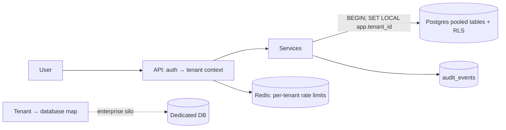

## Project overview

Most B2B software is multi-tenant. The defining risk is one customer seeing another's data, and the defining scaling problem is noisy neighbours. You'll build defence in depth for isolation and operational controls for fairness.

## Requirements

**Functional:** organisations (tenants) with members and roles; projects and tasks; invitations; plan tiers (free/pro/enterprise) controlling limits and features; tenant data export; admin audit log.

**Non-functional:** no code path can read or write another tenant's data, even with a bug in a query (RLS backstop); per-tenant fairness (rate limits, quotas); tenant-level metrics; an enterprise tenant can be moved to a dedicated database later.

## Architecture



## Database design

```sql
create table tenants (id uuid primary key, name text not null, plan text not null default 'free', db_shard text not null default 'pool-1');
create table memberships (tenant_id uuid references tenants(id), user_id uuid, role text not null, primary key (tenant_id, user_id));
create table projects (id uuid primary key, tenant_id uuid not null references tenants(id), name text not null);
create index on projects (tenant_id, name);
alter table projects enable row level security;
alter table projects force row level security;          -- applies to the table owner too
create policy tenant_isolation on projects
  using (tenant_id = current_setting('app.tenant_id')::uuid)
  with check (tenant_id = current_setting('app.tenant_id')::uuid);
-- the application connects as a role WITHOUT bypassrls
```

## API contracts

Tenant comes from the authenticated session or token (membership checked), never from a client-supplied header alone. `GET /projects`, `POST /projects`, `POST /invitations`, `GET /audit-events` (admins), `POST /exports` → `202` + download link. Plan limits return `402`/`403` with a problem type such as `plan-limit-reached`.

## Technology selection

Postgres RLS; a transaction wrapper that sets `SET LOCAL app.tenant_id` (and resets with the transaction, safe with poolers in transaction mode); Redis token buckets keyed by tenant.

## Step-by-step implementation

1. ADR comparing pool, bridge and silo models; choose pool with a silo escape hatch.
2. Schema with `tenant_id` on every table; composite indexes lead with `tenant_id`; unique constraints include it.
3. Middleware resolves `tenant_id` from the token and membership; every DB access goes through `withTenant(tx => …)`.
4. RLS policies on every tenant table; a CI check fails if any table with `tenant_id` lacks RLS.
5. RBAC with a `can()` helper.
6. Plans: feature flags and limits per plan; per-tenant rate limits and storage quotas.
7. Audit events in the same transaction as changes; export job producing a zip in object storage.
8. Metrics labelled by plan (not tenant id, which has unbounded cardinality); per-tenant usage in logs and a usage table; alert on tenants exceeding fair share.
9. Tenant router: map tenant → database DSN, so an enterprise tenant can live in a dedicated database.

## Starter repository structure

```
saas/
├── src/ (tenancy/, auth/, rbac/, plans/, projects/, audit/, exports/)
├── migrations/
├── test/isolation/
└── compose.yaml
```

## Testing requirements

An isolation suite that, for every endpoint, creates data in tenant A and attempts every operation as tenant B (expect 404/403 and zero rows); a test that a deliberately buggy query without a tenant filter still returns no foreign rows (RLS); quota and rate-limit tests; export contains only the tenant's data.

## Deployment instructions

Compose; document how to migrate one tenant from the pool to a dedicated database (export, import, flip the router entry, verify, delete from pool).

## Evaluation criteria

| Criterion | Meets the bar when… |
| --- | --- |
| Isolation | Application checks + RLS + tests on every endpoint |
| Fairness | Per-tenant limits and quotas enforced |
| Auditability | Audit log for sensitive actions |
| Operability | Tenant-aware usage tracking, safe metric cardinality |
| Evolvability | Documented silo migration path |

## Advanced extensions

Schema-per-tenant variant and migration tooling; data residency (EU tenants in an EU database); SSO via SAML/OIDC per tenant; usage-based billing events.
