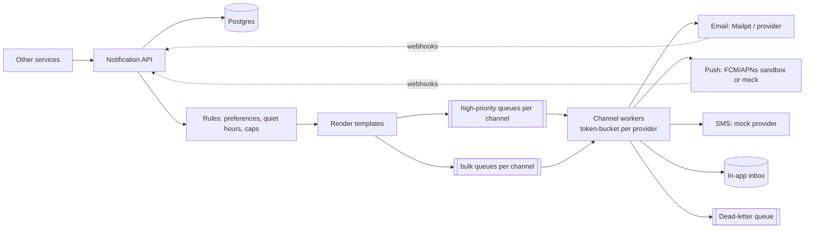

## Project overview

Implement the notification system from [design cases](/learn/design-cases-product/): a platform service other services call, which must never spam users with duplicates, never delay a security code behind a marketing blast, and degrade gracefully when providers fail.

## Requirements

**Functional:** `POST /notifications` with type, user and data; channels selected by type and user preferences; in-app inbox with read state; campaigns to user segments; delivery status per channel.

**Non-functional:** high-priority notifications delivered to providers within 5 s at normal load; no duplicate sends per (notification, channel); provider outages queue and retry without data loss; campaigns throttled to provider limits.

## Architecture



## Database design

```sql
create table notifications (id uuid primary key, idempotency_key text unique not null, user_id uuid not null,
  type text not null, data jsonb not null, priority text not null, created_at timestamptz default now());
create table preferences (user_id uuid, type text, channel text, enabled boolean not null, primary key (user_id, type, channel));
create table devices (id uuid primary key, user_id uuid not null, platform text not null, token text unique not null, last_seen_at timestamptz);
create table deliveries (notification_id uuid, channel text, status text not null, attempts int default 0,
  provider_message_id text, last_error text, updated_at timestamptz default now(), primary key (notification_id, channel));
create table templates (type text, channel text, locale text, subject text, body text not null, primary key (type, channel, locale));
create table inbox (id uuid primary key, user_id uuid not null, notification_id uuid not null, title text, body text, read_at timestamptz, created_at timestamptz default now());
```

## API contracts

| Method | Path | Notes |
| --- | --- | --- |
| `POST` | `/v1/notifications` | `{idempotency_key, user_id, type, data, priority}` → `202 {id}`; same key → same id |
| `GET` | `/v1/users/{id}/inbox?cursor=` | In-app notifications |
| `POST` | `/v1/users/{id}/inbox/read` | `{up_to_id}` |
| `PUT` | `/v1/users/{id}/preferences` | Per type and channel |
| `POST` | `/v1/campaigns` | Segment query + template; returns progress URL |
| `POST` | `/webhooks/{provider}` | Signature-verified delivery, bounce and complaint events |

## Technology selection

RabbitMQ (priority isolation via separate queues, DLX for dead letters) or BullMQ on Redis. Mailpit for email. Mock SMS and push providers you control, so you can inject failures and rate limits.

## Step-by-step implementation

1. Schema; ingestion with `INSERT … ON CONFLICT (idempotency_key) DO NOTHING RETURNING`.
2. Rules: resolve channels from type defaults and preferences; quiet hours by the user's time zone (defer non-urgent); frequency caps.
3. Rendering with per-locale templates and fallbacks; escape variables.
4. Enqueue one job per (notification, channel) on the queue for its priority.
5. Workers: claim delivery row; skip if already `sent`; call provider through a token bucket; on 429/5xx retry with backoff + jitter; after max attempts → DLQ and `failed`.
6. Webhooks: verify signatures; update delivery status; disable bouncing emails and invalid push tokens.
7. Campaigns: page through the segment in batches of 1,000, enqueue to bulk queues, throttle, track progress.
8. Failure tests: make the mock SMS provider fail 50% and return 429s.

## Starter repository structure

```
notifications/
├── api/  rules/  render/  workers/(email, push, sms, inapp)
├── providers/mock-sms, mock-push
├── migrations/
└── compose.yaml
```

## Testing requirements

Duplicate ingestion yields one notification; a worker crash after a provider call but before marking `sent` does not double-send (use provider idempotency or a pre-send state); high-priority latency stays low during a 100k-message campaign (measure); preferences and quiet hours honoured; DLQ receives poison messages; webhook signature failures are rejected.

## Deployment instructions

Compose with API, workers per channel (scale independently), RabbitMQ or Redis, Postgres, Mailpit and the mock providers.

## Evaluation criteria

| Criterion | Meets the bar when… |
| --- | --- |
| Idempotency | No visible duplicates under retries and redelivery |
| Isolation | Campaigns never delay transactional messages |
| Resilience | Provider outages queue, retry and alert; DLQ works |
| User respect | Preferences, quiet hours, caps, unsubscribe |
| Observability | Per-channel latency, success and failure metrics |

## Advanced extensions

Digest batching ("5 new comments"); failover to a secondary SMS provider via a circuit breaker; WebSocket push for in-app notifications using the [chat project's](/projects/realtime-chat/) gateway.
