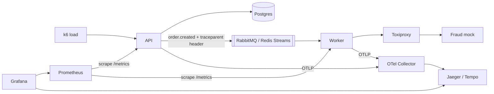

## Project overview

Take a small but realistic system and make it fully observable, then prove it by diagnosing injected faults using only telemetry.

## Requirements

**Functional:** `POST /orders` (API) validates, stores, publishes `order.created`; a worker consumes, calls a mock "fraud check" service, and updates status. `GET /orders/{id}` returns status.

**Non-functional:** every request and job produces correlated logs, metrics and a trace; one trace covers API → queue → worker → fraud service; an SLO of 99% of `POST /orders` under 300 ms with a burn-rate alert.

## Architecture



## API contracts

`POST /orders {items[], customer_id}` → `201 {id, status:"pending"}`; `GET /orders/{id}` → `200`; `GET /healthz`, `GET /readyz`, `GET /metrics` (internal only).

## Technology selection

OpenTelemetry SDK + auto-instrumentation for your language; `pino`/`structlog`; `prom-client`/`prometheus-client`; Docker Compose for the whole stack.

## Step-by-step implementation

1. Build the services with graceful shutdown and health endpoints.
2. Logging: JSON, one line per request and per job, `trace_id` included, sensitive fields redacted.
3. Tracing: auto-instrument HTTP, DB and queue clients; add a custom `fraud-check` span with attributes; inject `traceparent` into message headers and extract it in the worker.
4. Metrics: request duration histogram by route template and status class; job duration and failures; queue depth gauge; DB pool in-use and waiting.
5. Dashboard: RED per route, job metrics, pool saturation, SLO error budget remaining; deploy annotations.
6. Alerts: 1h/5m and 6h/30m burn-rate rules.
7. Faults via Toxiproxy: latency on the fraud service, connection resets, and a DB pool exhaustion scenario. For each, write how you found it from telemetry.

## Starter repository structure

```
observable/
├── api/  worker/  fraud-mock/
├── otel/collector.yaml
├── prometheus/prometheus.yml, alerts.yml
├── grafana/dashboards/*.json
├── loadtest/orders.js
└── compose.yaml
```

## Testing requirements

A test asserts the worker's span has the API span as an ancestor (export spans in memory in tests); metric label cardinality check (no ids in labels); alert rules unit-tested with `promtool test rules`.

## Deployment instructions

`docker compose up` starts the whole system and observability stack; document URLs for Grafana, Jaeger and Prometheus.

## Evaluation criteria

| Criterion | Meets the bar when… |
| --- | --- |
| Correlation | One click from log line to trace and back |
| Trace continuity | Single trace across HTTP and the queue |
| Metrics hygiene | Histograms, route templates, bounded labels |
| Alerting | Burn-rate alerts fire on injected faults and resolve after |
| Diagnosis | Written walkthroughs identify each fault's cause from telemetry alone |

## Advanced extensions

Tail-based sampling in the Collector (keep errors and slow traces); exemplars linking metrics to traces; Loki for logs with Grafana correlations; continuous profiling (Pyroscope).
