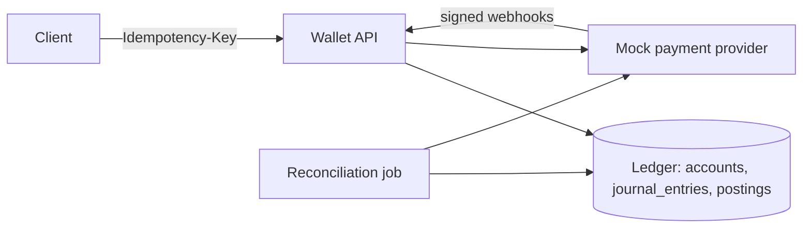

## Project overview

Money systems have unforgiving invariants: money is never created or destroyed by bugs, every movement is auditable forever, and retries never double-charge. You'll build a small wallet platform on a double-entry ledger and prove its invariants under concurrency.

## Requirements

**Functional:** user wallets in INR; top-up via a (mock) card provider; peer-to-peer transfers; refunds; transaction history; admin reconciliation report.

**Non-functional:** sum of all postings is always zero; no negative user balances; every request retry-safe; entries immutable; reconciliation detects any mismatch with the provider.

## Architecture



## Database design

```sql
create table accounts (id uuid primary key, owner_id uuid, kind text not null,   -- 'user_wallet' | 'provider_clearing' | 'fees' | 'refunds'
  currency char(3) not null, allow_negative boolean not null default false);
create table journal_entries (id uuid primary key, idempotency_key text unique not null, kind text not null,
  created_at timestamptz not null default now(), metadata jsonb not null default '{}');
create table postings (
  id bigint generated always as identity primary key,
  entry_id uuid not null references journal_entries(id),
  account_id uuid not null references accounts(id),
  amount_minor bigint not null check (amount_minor <> 0)          -- debit negative, credit positive
);
create table balances (account_id uuid primary key references accounts(id), balance_minor bigint not null default 0, version bigint not null default 0);
-- Immutability: revoke UPDATE/DELETE on journal_entries and postings from the app role.
```

Every entry's postings sum to zero (enforce in the transaction, and verify with a constraint trigger or a periodic check).

## API contracts

| Method | Path | Notes |
| --- | --- | --- |
| `POST` | `/topups` | Creates a provider payment intent; ledger posting happens on `payment.succeeded` webhook |
| `POST` | `/transfers` `{from, to, amount_minor}` | `Idempotency-Key` required; `409 insufficient-funds` problem type |
| `POST` | `/refunds` | Reversal entry referencing the original |
| `GET` | `/wallets/{id}` | Balance plus last entries |
| `GET` | `/wallets/{id}/entries?cursor=` | History |
| `POST` | `/webhooks/provider` | Signature verified; idempotent by provider event id |

## Technology selection

Postgres with `SERIALIZABLE` transactions or explicit row locks on `balances` in a deterministic order. Integers for money (minor units). A mock provider you control (delays, duplicate webhooks, out-of-order delivery).

## Step-by-step implementation

1. Chart of accounts; design doc listing invariants.
2. Transfer: one transaction → insert entry (idempotency key unique) → lock both balance rows ordered by id → check sufficient funds → insert postings → update balances. Retry on 40001/40P01.
3. Idempotency: same key and same body returns the original entry; same key with a different body returns 422.
4. Top-ups: create intent; on verified, deduplicated webhook, post `provider_clearing → user_wallet`.
5. Refunds as reversing entries; never edit history.
6. Balance verification job: recompute balances from postings and compare with the `balances` table.
7. Reconciliation: compare provider settlement report (mock CSV) with ledger entries; flag mismatches.
8. Tests (below).

## Starter repository structure

```
ledger/
├── api/  ledger/ (postings, transfers, invariants)  provider-mock/  jobs/ (verify, reconcile)
├── migrations/
├── test/ (property, concurrency, webhooks)
└── compose.yaml
```

## Testing requirements

Property-based tests generating random transfer sequences (sum of postings stays zero, no negative balances); 1,000 concurrent transfers between 10 accounts with final balances matching the expected totals; duplicate and out-of-order webhooks post once; balance verification finds a deliberately corrupted balance.

## Deployment instructions

Compose; production notes: synchronous replication, PITR backups, restricted DB roles, audit log shipping to immutable storage.

## Evaluation criteria

| Criterion | Meets the bar when… |
| --- | --- |
| Double entry | Every entry balances; invariant checks automated |
| Concurrency | No lost updates or overdrafts under concurrent load |
| Idempotency | Retries and duplicate webhooks never double-post |
| Auditability | Immutable entries; reversals instead of edits |
| Reconciliation | Mismatches detected and reported |

## Advanced extensions

Multi-currency with FX entries; holds and captures (two-phase payments); event-sourced ledger with projections; sharding accounts by owner while keeping cross-shard transfers correct (sagas).
