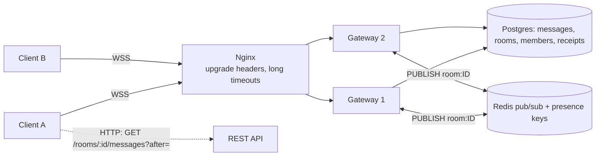

## Project overview

Build a chat backend that keeps working when you run several copies behind a load balancer, when clients drop off networks, and when servers restart.

## Requirements

**Functional:** join rooms, send and receive messages in real time, see history, direct messages, online presence, typing indicators, delivered/read receipts.

**Non-functional:** message delivery p95 < 200 ms between two users on different servers (measure); no message loss for persisted messages; clients recover missed messages after reconnecting; 10k concurrent connections across instances in your load test (report what you achieve).

## Architecture



## Database design

```sql
create table rooms (id uuid primary key, name text, is_direct boolean not null default false);
create table room_members (room_id uuid references rooms(id), user_id uuid, joined_at timestamptz default now(), primary key (room_id, user_id));
create table messages (
  id bigint generated always as identity primary key,     -- global order; also the sync cursor
  room_id uuid not null references rooms(id),
  sender_id uuid not null,
  client_msg_id uuid not null,                            -- idempotency for client retries
  body text not null check (length(body) between 1 and 4000),
  created_at timestamptz not null default now(),
  unique (sender_id, client_msg_id)
);
create index on messages (room_id, id);
create table receipts (message_id bigint, user_id uuid, delivered_at timestamptz, read_at timestamptz, primary key (message_id, user_id));
```

## API contracts

WebSocket messages (JSON):

```
→ {"type":"send","room_id":"…","client_msg_id":"…","body":"hi"}
← {"type":"ack","client_msg_id":"…","id":1842}
← {"type":"message","id":1842,"room_id":"…","sender_id":"…","body":"hi","created_at":"…"}
→ {"type":"typing","room_id":"…"}
← {"type":"presence","user_id":"…","status":"online"}
→ {"type":"read","room_id":"…","up_to_id":1842}
```

HTTP: `POST /ws-ticket` (short-lived one-time ticket for the WebSocket handshake), `GET /rooms/{id}/messages?after={id}&limit=100`, `GET /rooms`.

## Technology selection

`ws` (minimal) or Socket.IO (rooms, fallbacks, Redis adapter) in Node; `gorilla/websocket` or `nhooyr/websocket` in Go. Redis for pub/sub and presence (keys with TTL refreshed by heartbeats).

## Step-by-step implementation

1. Schema; REST endpoints for rooms and history.
2. Auth: client gets a 30-second single-use ticket over HTTPS, connects with `wss://…/ws?ticket=…`; gateway validates and binds the user; check `Origin`.
3. Send: validate membership, insert with `client_msg_id` (duplicate → return existing id), ack, then broadcast.
4. Heartbeats: server pings every 25 s and drops clients after 2 missed pongs; client reconnects with exponential backoff + jitter.
5. Sync: on reconnect, client calls `GET …/messages?after=lastSeenId` for each open room.
6. Multi-server: on send, `PUBLISH room:{id}`; each gateway subscribes to rooms its connected users belong to and pushes locally. Messages are persisted *before* publishing, so pub/sub loss is recoverable through sync.
7. Presence: `SET presence:{user} online EX 60` refreshed on heartbeat; publish changes; typing as ephemeral pub/sub events, never persisted.
8. Receipts: batch read receipts (`up_to_id`) and broadcast.
9. Load test with k6's WebSocket support or Artillery: connections, message rate, end-to-end latency.

## Starter repository structure

```
chat/
├── gateway/ (connection manager, protocol, pubsub)
├── api/ (rooms, history, tickets)
├── shared/ (db, auth, schemas)
├── nginx.conf
├── loadtest/
└── compose.yaml   # postgres, redis, gateway ×2, api, nginx
```

## Testing requirements

Integration tests with two clients on different gateway instances; duplicate `client_msg_id` produces one message; killing a gateway mid-conversation and reconnecting loses no persisted messages; unauthorised users can't join or read rooms; oversized messages and floods are rate-limited.

## Deployment instructions

Compose with two gateways behind Nginx (`proxy_http_version 1.1`, `Upgrade` headers, `proxy_read_timeout 1h`). Graceful shutdown: on `SIGTERM`, stop accepting, send a "reconnect" frame, close connections gradually.

## Evaluation criteria

| Criterion | Meets the bar when… |
| --- | --- |
| Scale-out | Users on different instances chat seamlessly |
| Reliability | Reconnect + sync recovers everything persisted |
| Idempotency | Client retries never duplicate messages |
| Security | Ticket auth, membership checks, Origin checks, rate limits |
| Evidence | Load-test report with connections and latency you measured |

## Advanced extensions

End-to-end encryption design discussion; message search with Postgres full-text; push notifications for offline users via the [notification service](/projects/notification-service/); replace Redis pub/sub with NATS or Kafka and compare.
