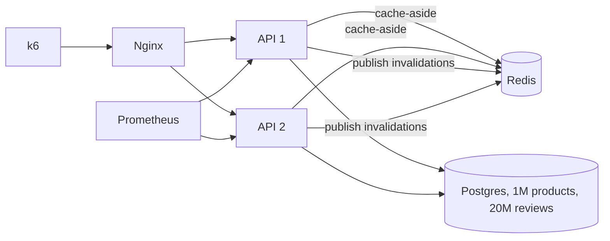

## Project overview

Caching is easy to add and easy to get wrong. You'll add a cache to a realistic API, break it on purpose (stampedes, stale data, penetration), fix it, and produce a measurement report.

## Requirements

**Functional:** `GET /products/{id}`, `GET /categories/{slug}/products?cursor=` (top products by rating, the expensive one), `PATCH /products/{id}` (admin).

**Non-functional:** reads may be stale for at most 60 s (except immediately after a write by an admin, who must see their change); the database must survive a cold cache at the target load; measure everything.

## Architecture



## Database design

`products(id, category_id, name, price_minor, …)`, `reviews(product_id, rating, created_at, …)`. The category listing aggregates reviews (`avg(rating)`, `count(*)`), deliberately expensive before you add a summary table as an extension.

## API contracts

| Method | Path | Cache key | TTL |
| --- | --- | --- | --- |
| `GET` | `/products/{id}` | `product:v1:{id}` | 300 s ± jitter; misses cached 30 s |
| `GET` | `/categories/{slug}/products?cursor=` | `cat:v1:{slug}:{cursor}` | 60 s ± jitter |
| `PATCH` | `/products/{id}` | deletes `product:v1:{id}`, bumps `cat:v1:{slug}` version | — |

Responses include `X-Cache: HIT|MISS|STALE` for debugging.

## Technology selection

Node (`ioredis`, `prom-client`) or Python (`redis-py` asyncio, `prometheus-client`). Grafana for the dashboard.

## Step-by-step implementation

1. Seed data with `generate_series`. Build endpoints without a cache.
2. Baseline: k6 arrival-rate test at a fixed rate with a Zipf-like id distribution. Record p50/p95/p99, error rate, DB CPU and queries/s.
3. Cache-aside with jitter; delete on write; versioned keys for category listings.
4. Negative caching plus id validation; prove random ids no longer reach Postgres.
5. Stampede: set TTL to 5 s and graph DB queries/s around expiries; then add single-flight with a Redis `SET NX PX` lock or stale-while-revalidate and re-graph.
6. Invalidation across instances: publish `invalidate` messages (Redis pub/sub) so an in-process L1 cache on each instance is cleared too.
7. Read-your-writes for admins: after `PATCH`, bypass the cache for that admin for a few seconds (a short-lived cookie flag).
8. Report.

## Starter repository structure

```
cache-layer/
├── src/ (routes, cache.ts, singleflight.ts, metrics.ts)
├── seed/seed.sql
├── loadtest/catalog.js
├── grafana/dashboard.json
└── compose.yaml
```

## Testing requirements

Unit tests for key building, jitter range and the single-flight helper (concurrent callers trigger one load); integration tests: stale data disappears after `PATCH`, Redis outage degrades to DB without errors, negative caching works.

## Deployment instructions

Compose with Postgres, Redis (with `maxmemory` and `allkeys-lru`), two API instances, Nginx, Prometheus and Grafana.

## Evaluation criteria

| Criterion | Meets the bar when… |
| --- | --- |
| Correct invalidation | No stale reads beyond the documented bound; admins see their writes |
| Failure safety | Redis down → slower, not broken |
| Stampede control | Graph shows spikes before and none after |
| Evidence | Report with measured before/after numbers and methodology |

## Advanced extensions

Replace the expensive aggregation with a summary table maintained by triggers or a projector and compare against caching; add probabilistic early expiration; try Redis Cluster with hash tags.
