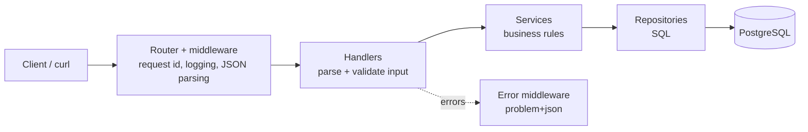

## Project overview

You'll build the backend for a small task tracker: users own projects, projects contain tasks, tasks have a status, priority, assignee and due date. The domain is deliberately simple so all of your attention goes to doing the fundamentals *properly*: structure, validation, error handling, pagination, migrations, tests and documentation. Almost every later project reuses this skeleton.

## Requirements

### Functional

- Create, read, update and delete **projects** and **tasks**.
- List tasks in a project with **filtering** (`status`, `assignee_id`, `due_before`), **sorting** (`created_at`, `due_date`, `priority`) and **cursor pagination**.
- Mark a task done; record `completed_at` automatically.
- Users are identified by an `X-User-Id` header for now (authentication comes in the next project). A user may only see and change their own projects.

### Non-functional

- Every input is validated at the boundary; invalid input never reaches the database.
- Errors use one consistent JSON shape.
- p95 latency under 100 ms for list endpoints with 100,000 tasks (you'll measure this).
- One command (`docker compose up`) starts everything.
- Integration tests run against a real Postgres.

## Architecture



Each layer has one job. Handlers know HTTP; services know the rules ("a task's project must belong to the caller"); repositories know SQL. Services never see `req`/`res`, and handlers never write SQL. See [backend architecture layers](/learn/backend-architecture-layers/).

## Database design

```sql
create table users (
  id          uuid primary key default gen_random_uuid(),
  email       text not null unique,
  created_at  timestamptz not null default now()
);

create table projects (
  id          uuid primary key default gen_random_uuid(),
  owner_id    uuid not null references users(id) on delete cascade,
  name        text not null check (length(name) between 1 and 120),
  created_at  timestamptz not null default now()
);

create type task_status as enum ('todo', 'in_progress', 'done');

create table tasks (
  id            uuid primary key default gen_random_uuid(),
  project_id    uuid not null references projects(id) on delete cascade,
  title         text not null check (length(title) between 1 and 200),
  description   text not null default '',
  status        task_status not null default 'todo',
  priority      smallint not null default 2 check (priority between 1 and 4),
  assignee_id   uuid references users(id) on delete set null,
  due_date      date,
  completed_at  timestamptz,
  created_at    timestamptz not null default now(),
  check ((status = 'done') = (completed_at is not null))
);

-- The main list query filters by project (+ optional status) and pages by created_at.
create index tasks_project_created on tasks (project_id, created_at desc, id desc);
create index tasks_project_status on tasks (project_id, status);
```

Note the last `check`: the database itself guarantees "done tasks have a completion time and only done tasks do". Validation in the app gives friendly errors; constraints in the database guarantee the truth even if a bug slips through.

## API contracts

| Method | Path | Success | Errors |
| --- | --- | --- | --- |
| `GET` | `/health` | `200 {"status":"ok"}` | — |
| `POST` | `/projects` | `201` + project, `Location` header | `400`, `422` |
| `GET` | `/projects` | `200` list | — |
| `GET` | `/projects/{id}` | `200` | `404` |
| `PATCH` | `/projects/{id}` | `200` | `404`, `422` |
| `DELETE` | `/projects/{id}` | `204` | `404` |
| `POST` | `/projects/{id}/tasks` | `201` | `404`, `422` |
| `GET` | `/projects/{id}/tasks?status=todo&sort=-created_at&limit=20&cursor=…` | `200 {"data":[…],"next_cursor":"…"}` | `400` (bad cursor) |
| `PATCH` | `/tasks/{id}` | `200` | `404`, `409`, `422` |
| `DELETE` | `/tasks/{id}` | `204` | `404` |

Returning `404` (not `403`) for another user's project avoids revealing that it exists.

Error body (RFC 9457 `application/problem+json`):

```json
{
  "type": "https://example.com/problems/validation",
  "title": "Request validation failed",
  "status": 422,
  "detail": "2 fields are invalid",
  "errors": [
    { "field": "title", "message": "must be 1–200 characters" },
    { "field": "priority", "message": "must be between 1 and 4" }
  ],
  "request_id": "6c1f…"
}
```

## Technology selection

Pick **one** path:

| | Node path | Python path |
| --- | --- | --- |
| Framework | Fastify or Express | FastAPI |
| Validation | Zod (or Fastify's JSON Schema) | Pydantic (built in) |
| DB access | `pg` + plain SQL, or Kysely | `psycopg` 3 + plain SQL, or SQLAlchemy Core |
| Migrations | `node-pg-migrate` or `dbmate` | Alembic or `dbmate` |
| Tests | Vitest + Supertest | pytest + httpx |
| Docs | `@fastify/swagger` / `zod-to-openapi` | Built in at `/docs` |

Write SQL by hand in this project. ORMs are fine later, but you should first see exactly what you're asking the database to do.

## Step-by-step implementation

1. **Skeleton.** `docker-compose.yml` with `postgres:17` (named volume, healthcheck) and your API. Config comes from environment variables, validated at startup, so the app refuses to boot with a missing `DATABASE_URL`.
2. **Migrations.** Apply the schema above as migration `001`. Never edit an applied migration; add new ones.
3. **Layers.** Create `routes/`, `handlers/`, `services/`, `repositories/`, `errors.ts|py`. Add request-id middleware that also sets an `X-Request-Id` response header.
4. **CRUD.** Validate bodies with a schema; map service-level "not found" and "forbidden" errors to 404. Use `RETURNING *` to avoid a second query after inserts and updates.
5. **Cursor pagination.** Encode `(created_at, id)` of the last row as base64url JSON. Query:
   ```sql
   select * from tasks
   where project_id = $1
     and ($2::timestamptz is null or (created_at, id) < ($2, $3))
   order by created_at desc, id desc
   limit $4 + 1;   -- fetch one extra row to know whether there's a next page
   ```
6. **Errors.** One error middleware that converts validation errors to 422, domain errors to their codes, unique violations (`23505`) to 409, and everything else to 500 *without leaking stack traces*.
7. **Tests.** Spin up Postgres in Compose (or Testcontainers), run migrations, truncate between tests. Test the happy path, validation failures, pagination boundaries and cross-user access.
8. **Docs.** Generate OpenAPI and serve Swagger UI or Redoc.
9. **Measure.** Seed 100,000 tasks, run `EXPLAIN ANALYZE` on the list query, and load-test with `k6` or `hey`. Record p50 and p95.

## Starter repository structure

```
task-api/
├── docker-compose.yml
├── Dockerfile
├── migrations/
│   └── 001_init.sql
├── src/
│   ├── config.ts          # env parsing + validation
│   ├── app.ts             # build the app (used by server and tests)
│   ├── server.ts          # listen + graceful shutdown
│   ├── middleware/        # request id, logging, errors
│   ├── routes/            # URL → handler
│   ├── handlers/          # HTTP in/out, validation
│   ├── services/          # business rules
│   ├── repositories/      # SQL
│   └── schemas/           # request/response schemas
└── test/
    ├── setup.ts
    └── tasks.test.ts
```

## Testing requirements

- At least 20 integration tests covering every endpoint, including one test per error code you return.
- A pagination test that walks every page of 55 tasks with `limit=10` and asserts exactly 55 unique ids.
- A test proving user A gets `404` for user B's project and task.
- Tests run in CI (GitHub Actions) on every push.

## Deployment instructions

Build a multi-stage Docker image that runs as a non-root user. Run migrations as a separate step before starting the new version (`docker compose run --rm api migrate`). Optionally deploy to a free tier (Render, Railway or Fly.io) with a managed Postgres.

## Evaluation criteria

| Criterion | Meets the bar when… |
| --- | --- |
| Structure | No SQL in handlers, no `req` in services |
| Validation | Every field has limits; invalid input returns 422 with field errors |
| Errors | One error shape everywhere; no stack traces leaked; 500s logged with request id |
| Data integrity | Constraints in the database mirror app validation |
| Pagination | Stable under concurrent inserts; no `OFFSET` |
| Tests | Real database; cover errors and authorisation |
| Docs | OpenAPI matches actual behaviour |
| Operability | One-command start; graceful shutdown; config validated at boot |

## Advanced extensions

- Add `ETag` and `If-Match` on `PATCH /tasks/{id}` to prevent lost updates (return `412 Precondition Failed`).
- Add idempotency keys on `POST` endpoints.
- Add full-text search over titles with a Postgres `tsvector` column and GIN index.
- Replace `X-User-Id` with real authentication from the [authentication project](/projects/auth-service/).
