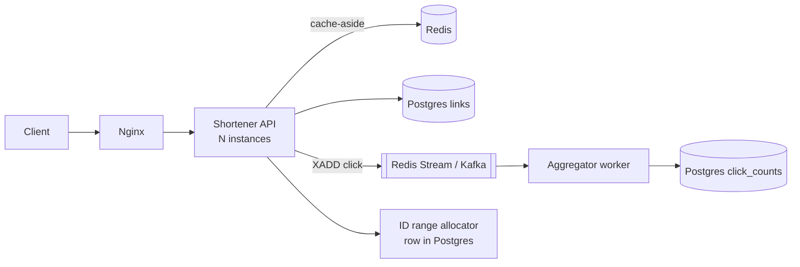

## Project overview

Implement the URL shortener from the [design walkthroughs](/learn/design-walkthroughs/) for real, then prove its performance and failure behaviour with measurements. The interesting parts are the read path (fast redirects), code generation (no collisions, not enumerable), and keeping analytics off the hot path.

## Requirements

**Functional:** create a short link (optional custom alias, optional expiry); redirect; per-link click count and daily clicks; delete own links.

**Non-functional:** redirect p99 < 20 ms at the service on your test hardware at your target rate (measure and report); creation p99 < 100 ms; redirects keep working if analytics is down; codes are not sequentially guessable.

## Architecture



## Database design

```sql
create table links (
  code        text primary key,
  long_url    text not null check (length(long_url) <= 2048),
  owner_id    uuid,
  created_at  timestamptz not null default now(),
  expires_at  timestamptz
);
create table id_ranges (name text primary key, next_start bigint not null);   -- each instance claims 10,000 ids at a time
create table click_counts (code text not null, day date not null, clicks bigint not null default 0, primary key (code, day));
```

Code generation: claim a block (`update id_ranges set next_start = next_start + 10000 returning next_start - 10000`), then encode each id after a reversible bit shuffle (or a Feistel permutation) in base62, so consecutive ids don't produce consecutive codes.

## API contracts

| Method | Path | Success | Errors |
| --- | --- | --- | --- |
| `POST` | `/v1/links` `{url, alias?, expires_at?}` | `201 {code, short_url}` | `400` invalid URL, `409` alias taken, `422` blocked domain, `429` |
| `GET` | `/{code}` | `302 Location` | `404`, `410` expired |
| `GET` | `/v1/links/{code}/stats` | `200 {total, by_day[]}` | `404` |
| `DELETE` | `/v1/links/{code}` | `204` | `404` |

## Technology selection

Go (`net/http`, `pgx`, `go-redis`) gives very low overhead; Node (Fastify) is fine too. Redis Streams keeps the stack small; swap in Kafka/Redpanda as an extension.

## Step-by-step implementation

1. Design doc: requirements, estimates (from the method lesson), API, data, diagram.
2. Range allocator and base62 with shuffle; property test that 1M generated codes are unique.
3. Create endpoint: validate scheme (http/https only), length, blocklist; custom aliases checked against reserved words.
4. Redirect: Redis `GET` → hit: 302; miss: DB → cache with TTL + jitter; unknown codes cached as negative for 60 s.
5. Clicks: `XADD clicks * code X ts Y` (fire-and-forget with a short timeout so a Redis problem never blocks the redirect); aggregator with a consumer group batches increments every second with `INSERT … ON CONFLICT DO UPDATE`.
6. Token bucket rate limit on creation per IP and per API key.
7. Load test with k6 (arrival-rate executor), a realistic Zipf-like distribution of codes.
8. Drills: stop Redis (redirects degrade to DB but still work), stop the aggregator (stream grows, then drains), restart Postgres.

## Starter repository structure

```
shortener/
├── cmd/api, cmd/aggregator
├── internal/ (codes, links, cache, clicks, ratelimit)
├── migrations/
├── loadtest/redirect.js
└── compose.yaml
```

## Testing requirements

Unit tests for base62, shuffle reversibility and URL validation; integration tests for every endpoint and error; a test that redirects still return 302 when Redis is unavailable; a load-test report with your measured numbers, hardware and data size.

## Deployment instructions

Compose with 2 API instances behind Nginx; optional deploy to a free tier with managed Postgres and Redis.

## Evaluation criteria

| Criterion | Meets the bar when… |
| --- | --- |
| Correctness | No duplicate codes under concurrent creation |
| Performance | Measured redirect p99 reported with methodology |
| Isolation | Analytics failure never affects redirects |
| Abuse | Rate limits, blocklist, no open redirect to `javascript:` URLs |
| Ops | Failure drills documented with observations |

## Advanced extensions

Edge caching with a CDN and `Cache-Control` on redirects (and what that does to click counting); custom domains; QR codes; Kafka plus a real-time top-links dashboard over SSE.
